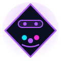
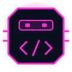

# João Saccucci Labs

**Sou estudante de TI, e este repositório é o meu laboratório de projetos.**

Ele simula uma empresa em que trabalho com uma equipe de agentes de IA para transformar ideias em projetos, do primeiro requisito ao código explicado. Cada agente cuida de uma parte do trabalho: levantar os requisitos, desenhar o visual, programar, testar e me explicar o código. Eu decido o que construir, aprovo cada etapa e estudo o que foi feito.

### 🌐 Veja o site: **https://joaosaccucci.github.io/empresa-ia/**

O site da **João Saccucci Labs** é a vitrine da empresa: mostra os projetos, o que cada agente fez em cada um, a linha do tempo do trabalho e as aulas do professor. Ele foi o primeiro projeto e continua neste repositório. Os projetos novos, como a [Agenda](https://github.com/JoaoSaccucci/agenda), têm **repositório, site e README próprios** e aparecem na aba Projetos da Labs com o trabalho de cada agente.

---

## A equipe

| | Agente | Papel |
|---|---|---|
|  | **Product Owner** | Me entrevista com perguntas curtas e escreve as user stories com critérios de aceite. |
|  | **Artista** | Define cores, tipografia e layout, e escreve o CSS e os ícones em SVG. |
|  | **Dev** | Implementa o que foi definido e testa no computador e no celular. |
|  | **Testador** | Garante a qualidade (QA): testa celular, teclado, acessibilidade e contraste e escreve um relatório de teste. |
|  | **Professor** | Explica o código de cada entrega em aulas curtas, com exercícios e frases para entrevista. As aulas ficam na aba **Aulas** do site. |
|  | **Mentor de carreira** | Agente de apoio, fora do fluxo dos projetos: me ajuda a planejar os estudos e a carreira. |

Os agentes rodam no [Claude Code](https://claude.com/claude-code). As regras da empresa estão em [`CLAUDE.md`](CLAUDE.md) e a descrição de cada agente em [`.claude/agents/`](.claude/agents/).

## Como o trabalho acontece

```text
Ideia do chefe → Product Owner → Artista → Dev → Testador → Professor
                 (requisitos)    (visual)   (código)  (relatório)  (aula + exercício)
```

1. O **product-owner** levanta os requisitos comigo, uma pergunta por vez, e escreve as user stories.
2. O **artista** define o visual a partir dos requisitos.
3. O **dev** implementa e testa.
4. O **testador** confere a entrega contra os critérios de aceite e escreve um relatório. Se algo falhar, volta para o dev.
5. O **professor** escreve uma aula sobre o código entregue, e eu faço o exercício.

O **mentor de carreira** trabalha fora desse fluxo. O trabalho dele (LinkedIn, currículo, entrevistas simuladas) fica fora deste repositório.

Cada entrega vira um commit, e o site no GitHub Pages se atualiza sozinho. Num projeto novo, a entrega tem dois commits: primeiro o código no repositório do projeto, depois os documentos, as aulas e a vitrine neste repositório.

## Projetos

| Projeto | O que tem | Código | Site |
|---|---|---|---|
| **Site João Saccucci Labs** | A vitrine: Início, Projetos (com linha do tempo e os botões Ver site e Ver código), Equipe, Aulas (27 aulas curtas em módulos, separadas por projeto, com exemplos que rodam na própria página, quiz, sumário, glossário e código colorido) e Sobre | Este repositório, em [`trabalhos/joao-saccucci-labs`](trabalhos/joao-saccucci-labs/) | [joaosaccucci.github.io/empresa-ia](https://joaosaccucci.github.io/empresa-ia/) |
| **Agenda** | Agenda online para anotar compromissos: lista por dia, criar, editar e excluir, hora de fim, "Sair às...", aviso de conflito e de aperto, checklist "O que levar", marcar como feito, seções "Ficou pendente", "Sem data" e "Anteriores", dados salvos no navegador e cópia em arquivo .json para levar a outro aparelho | [github.com/JoaoSaccucci/agenda](https://github.com/JoaoSaccucci/agenda) | [joaosaccucci.github.io/agenda](https://joaosaccucci.github.io/agenda/) |

Os requisitos, o design e os relatórios de teste de cada projeto novo ficam aqui, em [`trabalhos/joao-saccucci-labs/docs/projetos/`](trabalhos/joao-saccucci-labs/docs/projetos/). O repositório do projeto guarda só o produto (código e README).

## Tecnologias

- **HTML, CSS e JavaScript puros**, sem framework e sem etapa de build
- Dados em **JSON**, lidos com `fetch`
- Na tela de aulas: **marked** (Markdown → HTML) e **highlight.js** (cores do código), por CDN com versão fixa e `integrity`
- **Git e GitHub**, com publicação no **GitHub Pages** (um repositório por projeto)

## Estrutura

```text
empresa-ia/
├── CLAUDE.md              Regras da empresa
├── .claude/agents/        Os 6 agentes (product-owner, artista, dev, testador, professor, mentor-carreira)
├── index.html             Atalho que leva ao site
└── trabalhos/
    ├── joao-saccucci-labs/    O site da Labs (a vitrine)
    │   ├── README.md          Detalhes do site e como rodar
    │   ├── docs/              Requisitos (PO), design (artista) e testes (testador) da Labs
    │   │   ├── guias/         Guias comuns da equipe (relatório de teste, aulas, criar repositório)
    │   │   └── projetos/      Requisitos, design e testes de cada projeto novo (ex.: agenda/)
    │   ├── aulas/             Aulas do professor, em Markdown
    │   ├── data/              Projetos, agentes, aulas e glossário (JSON)
    │   ├── css/ · js/ · img/
    │   └── *.html             As páginas do site
    └── agenda/                Código da Agenda: fica FORA deste repositório
```

Cada projeto novo fica em `trabalhos/<projeto>/` no computador, com o próprio Git e o próprio repositório no GitHub. O `.gitignore` deste repositório ignora essas pastas (só a Labs entra aqui), e não há submódulos. Os docs desses projetos ficam na Labs, em `docs/projetos/<projeto>/`.

## Como rodar no seu computador

1. Clone o repositório: `git clone https://github.com/JoaoSaccucci/empresa-ia.git`
2. Abra a pasta `trabalhos/joao-saccucci-labs` no VS Code.
3. Clique com o botão direito no `index.html` e escolha **Open with Live Server**.

O site precisa de um servidor local porque lê os arquivos JSON com `fetch`, e o navegador bloqueia isso quando a página é aberta direto do disco (`file://`).

**Os projetos novos não vêm junto.** Clonar o `empresa-ia` traz só a Labs. Para ter o código de um projeto novo, clone o repositório dele dentro de `trabalhos/`, com o nome do projeto. Exemplo com a Agenda, a partir da pasta `empresa-ia`:

```bash
git clone https://github.com/JoaoSaccucci/agenda.git trabalhos/agenda
```

Cada projeto explica como rodar no próprio README (a Agenda abre com dois cliques no `index.html`).

## Sobre mim

Sou o **João Saccucci**, estudante de Análise e Desenvolvimento de Sistemas na USCS (4º semestre), em São Caetano do Sul, SP. Estou buscando estágio em desenvolvimento de software.

[LinkedIn](https://www.linkedin.com/in/jo%C3%A3o-lucas-lemes-saccucci/) · [E-mail](mailto:jllsaccucci@gmail.com) · [Página Sobre no site](https://joaosaccucci.github.io/empresa-ia/trabalhos/joao-saccucci-labs/sobre.html)

---

## In English

I'm an IT student, and **João Saccucci Labs** is my project lab. It simulates a company where I work with a team of AI agents to turn ideas into projects, from the first requirement to the explained code. A Product Owner agent gathers requirements by interviewing me, an Artist agent designs the UI, a Dev agent implements it, a Tester agent checks it (QA), and a Teacher agent writes lessons explaining the code so I learn from every delivery. The lessons are in the site's **Aulas** (Lessons) tab.

Its first project is its own website (the showcase, kept in this repository), built with **plain HTML, CSS and JavaScript** (no framework, no build step) and data in JSON. It shows each project, what each agent did, a project timeline, and an interactive lesson reader with table of contents, glossary tooltips, syntax highlighting and saved exercise checklists.

New projects have their own repository, site and README. The first one is a calendar app called **Agenda**: [code](https://github.com/JoaoSaccucci/agenda) · [live site](https://joaosaccucci.github.io/agenda/).

**Live site:** https://joaosaccucci.github.io/empresa-ia/

I'm a Systems Analysis and Development (ADS) student at USCS, Brazil, looking for a software development internship. [LinkedIn](https://www.linkedin.com/in/jo%C3%A3o-lucas-lemes-saccucci/) · [E-mail](mailto:jllsaccucci@gmail.com)
