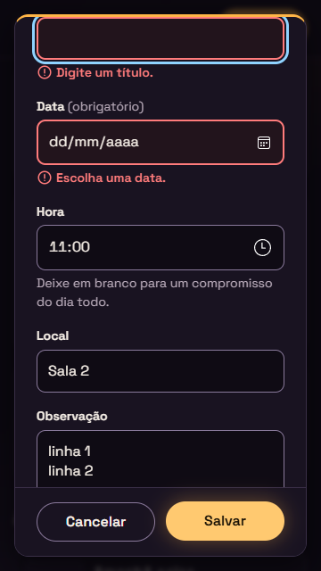
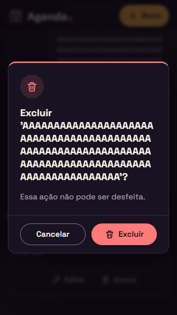
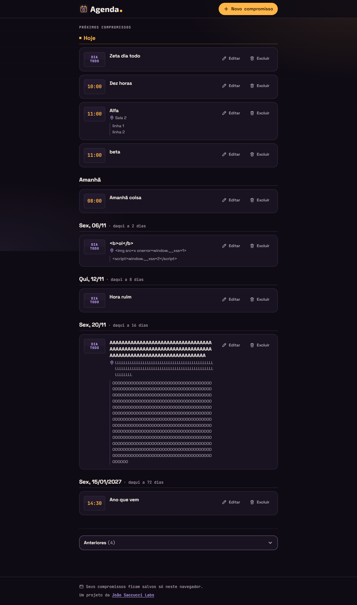

# Relatório de teste — Agenda, Etapa 1

- **Data:** 2026-11-04
- **O que foi testado:** a página `index.html` da Agenda (com `css/style.css`, `js/datas.js`, `js/armazenamento.js`, `js/app.js` e `favicon.svg`) contra a Agenda US01 a US07 e os requisitos gerais da Etapa 1 ([requisitos](../requisitos.md)), o visual do [design](../design.md) e o `README.md` da Agenda contra a US36 da Labs.
- **Onde:** Microsoft Edge (Chromium), num servidor local que imita o endereço do GitHub Pages (`/agenda/`), e também abrindo o `index.html` direto do disco (`file://`). Fuso `America/Sao_Paulo`, com o relógio do navegador fixado em quarta-feira, 04/11/2026, 10:00:30, para conferir as regras de data e a virada do minuto e da meia-noite. Larguras: 1280px, 360px e 320px. Ainda **não** testado no GitHub Pages, porque o repositório `agenda` ainda não foi publicado.

## Resultado

**Aprovado com pendências.** Todos os critérios de aceite da US01 à US07 e os requisitos gerais passaram (177 conferências no navegador, nenhuma falha). Ficou só uma pendência pequena (gravidade baixa), que não quebra nenhum critério. **Atualização:** a pendência já foi corrigida (ver Problemas encontrados, item 1).

## Verificações

| Área | Resultado | Observação |
|---|---|---|
| Celular a 360px | Passou | Sem rolagem horizontal a 360px nem a 320px, inclusive com textos de 100/500 caracteres sem espaço, com "Anteriores" aberta e com as janelas abertas. Botões e campos com pelo menos 44px, campos com 16px. O formulário rola por dentro e Salvar/Cancelar ficam sempre visíveis. |
| Teclado | Passou | Ordem do Tab lógica (Novo → Editar/Excluir de cada item → Anteriores → link do rodapé). Foco azul de 3px em tudo. Esc fecha as duas janelas. O foco vai para o Título ao abrir o formulário, para "Cancelar" na confirmação, e volta ao botão que abriu. A página atrás das janelas fica inerte. |
| Acessibilidade | Passou | `h1` → `h2` → `h3` em ordem. Dias em `section` + `h3` + `ul/li`. Botões "Editar Dentista"/"Excluir Dentista". `aria-expanded`, `aria-invalid` e `aria-describedby` corretos. Avisos em `role="status"`/`aria-live="polite"`. Ícones com `aria-hidden`. `prefers-reduced-motion` anula animações e transições. |
| Contraste | Passou | Medido nas cores reais da página: texto 16.9:1, texto suave 8.2 a 8.8:1, link 9.6:1, botão principal 10.5/12.2:1, hora em "Anteriores" 7.5:1, borda do botão "Anteriores" 5.0:1, foco 11:1. Confere com a tabela do design (seção 2.1). |
| Erros | Passou | Console sem erros nem avisos em todos os cenários. Nenhum 404. Mensagens amigáveis com `localStorage` bloqueado, cheio ou corrompido. |

## Critérios de aceite

**Agenda US01: Lista dos próximos compromissos por dia**
- [x] Mostra só o que ainda não passou (10:00 continua às 10:00:30; dia todo de hoje continua).
- [x] Agrupado por dia, sem dias vazios.
- [x] "Hoje", "Amanhã", "Sex, 06/11" e, de outro ano, "Sex, 15/01/2027".
- [x] "daqui a X dias" do terceiro dia em diante, contando dias de calendário ("Sex, 06/11 · daqui a 2 dias").
- [x] Ordem: dias do mais próximo ao mais distante; no dia, primeiro dia todo, depois por hora e, empatando, por ordem alfabética ("Alfa" antes de "beta").
- [x] Hora 24h ou "Dia todo", título, local e observação só quando preenchidos.
- [x] Textos longos quebram linha, sem rolagem horizontal.
- [x] `<b>oi</b>`, `` e `<script>` aparecem como texto e nada é executado.
- [x] Lista vazia: "Nenhum compromisso por vir" com um botão que abre o formulário.
- [x] O botão "Novo compromisso" está sempre visível (no topo, que gruda na tela).
- [x] Atualiza sozinha: às 10:01 o compromisso das 10:00 foi para "Anteriores"; depois da meia-noite, "Amanhã" virou "Hoje" e "Hoje" virou "Ontem" em "Anteriores".
- [x] `ul`/`li` e o título de cada dia em `h3`.

**Agenda US02: Criar um compromisso**
- [x] "Novo compromisso" abre o formulário com esse título.
- [x] Campos com rótulo visível: Título (`maxlength` 100), Data (`date`), Hora (`time`), Local (100) e Observação (`textarea`, 500).
- [x] "(obrigatório)" escrito no rótulo de Título e Data.
- [x] A data vem com hoje e a hora vem vazia.
- [x] Dica "Deixe em branco para um compromisso do dia todo." ligada à Hora por `aria-describedby`.
- [x] Sem hora, o compromisso é salvo como dia todo (`hora: null`).
- [x] Salvar, Cancelar e Enter num campo de uma linha (testado no Título e na Data) salvam.
- [x] Espaços nas pontas são removidos, e um campo opcional vazio vira `null`.
- [x] Fecha, aparece no lugar certo e mostra "Compromisso salvo." (`aria-live="polite"`), que some em cerca de 5s.
- [x] Data ou hora que já passou vai para "Anteriores", com "Compromisso salvo em Anteriores."
- [x] Cancelar não salva nada.
- [x] Continua lá depois de recarregar a página.

**Agenda US03: Avisos do formulário**
- [x] Título vazio ou só com espaços → "Digite um título.", e nada é salvo.
- [x] Data vazia → "Escolha uma data."
- [x] As duas mensagens aparecem juntas.
- [x] O foco vai para o primeiro campo com problema (Título; depois, Data).
- [x] `aria-invalid="true"` e `aria-describedby` no campo com erro (ligado só enquanto o erro aparece, como foi aprovado).
- [x] O erro está em texto, com ícone, borda de 2px e contraste de 7.2:1.
- [x] A mensagem some ao digitar ou ao tentar salvar de novo.
- [x] Os outros campos não são apagados.
- [x] Os limites de tamanho usam `maxlength`, sem mensagem.
- [x] O `novalidate` está no form e a checagem é feita em JS.

**Agenda US04: Editar**
- [x] "Editar" em todos os itens, inclusive em "Anteriores", com o título no rótulo ("Editar Alfa").
- [x] O mesmo formulário, com o título "Editar compromisso" e os campos preenchidos (inclusive a observação com várias linhas).
- [x] As regras da US03 valem na edição.
- [x] Atualiza sem criar outro (mesmo `id` e mesmo `criadoEm`, com `atualizadoEm` novo). Uma data passada vai para "Anteriores" e uma data de "Anteriores" trocada por uma futura volta para a lista principal.
- [x] Apagar a hora transforma o compromisso em dia todo.
- [x] Cancelar e Esc não mudam nada.
- [x] "Compromisso atualizado." é anunciado, e o foco volta ao "Editar" do compromisso.

**Agenda US05: Excluir com confirmação**
- [x] "Excluir" em todos os itens, com o título no rótulo.
- [x] Confirmação "Excluir 'Dez horas'? Essa ação não pode ser desfeita." com os botões "Cancelar" e "Excluir".
- [x] Apaga do `localStorage` e anuncia "Compromisso excluído."
- [x] Cancelar e Esc não apagam nada.
- [x] O foco começa em "Cancelar".
- [x] O botão vermelho também diz "Excluir" em texto e tem ícone de lixeira.
- [x] O foco vai para o próximo compromisso (inclusive de outro dia e dentro de "Anteriores"). Sem próximo, vai para "Novo compromisso". Nunca cai no topo da página.
- [x] Ao excluir o último por vir, aparece a mensagem de lista vazia.

**Agenda US06: Anteriores**
- [x] Fica abaixo da lista principal.
- [x] Começa recolhida, com "Anteriores (4)".
- [x] `aria-expanded` muda e o botão funciona com clique, Enter e Espaço.
- [x] Sem nenhum anterior, a seção some.
- [x] Agrupados por dia ("Hoje", "Ontem", "Qui, 01/10"), sem "daqui a".
- [x] Do mais recente para o mais antigo, com a mesma ordem da US01 dentro do dia.
- [x] Nada é apagado sozinho.
- [x] Os compromissos podem ser editados e excluídos.
- [x] Quando um compromisso passa, ele vai para "Anteriores" sem recarregar e a contagem é atualizada. A seção continua aberta se estava aberta.

**Agenda US07: Salvo no navegador**
- [x] Os dados são salvos na hora em `agenda:compromissos`, no formato `{ versao: 1, compromissos: [...] }`, com `id` no formato `c-<número>-<4 letras>`.
- [x] Os mesmos compromissos aparecem depois de recarregar.
- [x] O aviso do rodapé está sempre presente, com contraste de 8.8:1. O rodapé não é fixo, e o aviso flutuante não aceita clique e reserva espaço embaixo.
- [x] Com `localStorage` bloqueado (ao ler ou ao gravar), a página funciona e mostra "Não foi possível salvar neste navegador. Seus compromissos vão sumir ao fechar a página."
- [x] Com o `localStorage` cheio: ao criar ou editar, o formulário continua aberto com o que foi digitado e mostra o aviso dentro da janela (`role="alert"`), como foi aprovado. Ao excluir, aparece uma faixa de erro e o item continua lá. O que já estava salvo não é alterado.
- [x] Dado corrompido (texto inválido ou um JSON no formato errado) é copiado para `agenda:compromissos-corrompido`, o original fica intacto ao abrir, a agenda começa vazia e mostra um aviso. Itens sem título ou com data inexistente (31/02) são ignorados e os outros aparecem.
- [x] Não há `localStorage.clear()`. Só chaves `agenda:` são usadas, e a chave `jsl:` da Labs ficou intacta depois de criar, editar e excluir.

**Requisitos gerais da Etapa 1**
- [x] Celular: funciona de 320px a 1280px, sem rolagem horizontal. Toque de 44px, campos de 16px, e as janelas cabem e rolam por dentro.
- [x] Teclado: tudo pode ser feito pelo teclado, com foco visível e ordem lógica. Foco no Título ao abrir e de volta ao botão que abriu. Esc e Tab funcionam dentro do `dialog`.
- [x] Acessibilidade: títulos em ordem, botões com rótulo, ícones decorativos, avisos em `aria-live` sem mover o foco, nada depende só da cor e `prefers-reduced-motion` é respeitado.
- [x] Contraste AA em texto, botões, bordas de campo, foco e erros.
- [x] Erros: console limpo, nenhum 404 e mensagens amigáveis nos casos da US07.
- [x] Nenhuma biblioteca: só HTML, CSS e JS puros (as fontes do Google Fonts têm opção de reserva, como diz o design).
- [x] Caminhos relativos (`favicon.svg`, `css/style.css`, `js/...`). Funciona em `/agenda/` e também em `file://`. *(Conferir de novo no GitHub Pages depois do push.)*
- [x] O README segue a US36: o que é o projeto, o link do site, as tecnologias, como rodar, as limitações dos dados e a seção da equipe com links para o detalhe, os docs e as aulas na Labs. Os endereços estão no formato certo (`detalhe-projeto.html?id=agenda` e `aulas.html` existem na Labs). Eles só vão abrir depois do passo 4 e do commit, como já foi combinado. O README não tem dados pessoais.

## Problemas encontrados

**1. Ao mover o foco para o Título com erro, o rótulo do campo pode ficar fora da tela no celular**
- **Página:** `index.html`, formulário, a 360px.
- **Passos:** abrir "Editar" num compromisso com observação; rolar a janela até o fim; apagar o Título (ou deixar vazio) e tocar em "Salvar".
- **Esperado:** o campo com erro aparece com o rótulo "Título (obrigatório)" visível acima dele.
- **Obtido:** a janela rola só até a borda do campo. O campo e a mensagem "Digite um título." ficam visíveis, mas o rótulo e o título da janela ficam escondidos acima (ver print abaixo). O leitor de tela lê o rótulo normalmente.
- **Gravidade:** baixa (nenhum critério quebra: o foco vai para o campo certo e o erro está visível).
- **Onde corrigir (sugestão):** em `js/app.js`, na `validarFormulario()`, rolar o `.campo` inteiro para a tela (por exemplo, `campo.closest(".campo").scrollIntoView({ block: "nearest" })`) logo depois do `focus()`.
- **Status:** corrigido pelo dev em 2026-11-04 (`js/app.js`, `validarFormulario()`, linha 532: `campoComErro.closest(".campo").scrollIntoView({ block: "nearest" })`). Conferido a 360px com Título vazio e com Data vazia: rótulo, campo e mensagem visíveis.

### Observações (não são problemas)

- No `<dialog>` modal do Edge/Chrome, o Tab depois do último botão passa pela interface do navegador e volta para o primeiro. A página atrás nunca recebe foco. Esse é o comportamento nativo pedido nos requisitos.
- O link "João Saccucci Labs" do rodapé tem 18px de altura. Ele está dentro de uma frase, que é a exceção da regra de área de toque. O critério de 44px fala de botões e campos.
- A data só aceita anos de 4 dígitos entre 1000 e 9999. Um ano como 0050 mostra "Escolha uma data.", o que é razoável.
- Testes ainda a fazer depois da publicação: abrir `https://joaosaccucci.github.io/agenda/` (favicon, CSS e JS sem 404) e conferir os links do README depois do passo 4.

