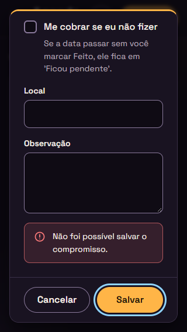

# Relatório de teste — Agenda, Etapa 2 (Entrega 2b)

- **Data:** 2026-11-06
- **O que foi testado:** a página `index.html` da Agenda (com `css/style.css`, `js/datas.js`, `js/armazenamento.js`, `js/copia.js` e `js/app.js`) e o `README.md`, ainda sem commit, comparados com o commit `e413ad8` (Entrega 2a). Testei contra a Agenda **US11** (migração para a versão 2), **US12** ("Sair às..."), **US13** (Feito e Desfazer), **US14** ("Me cobrar" e "Ficou pendente"), **US15** (resolver uma pendência), **US16** ("Sem data"), as mudanças da 2b nas US01 a US07 e os requisitos gerais da Etapa 2 ([requisitos](../requisitos.md)), com o visual da seção 13 do [design](../design.md) e as 5 decisões da 13.14. Também conferi se a pendência baixa da 2a (`#erro-salvar` coberto a 320 × 568) foi resolvida e avaliei as 8 decisões do dev para casos que os requisitos não cobrem.
- **Onde:** Microsoft Edge (Chromium) **headless**, controlado por script, num servidor local que imita o endereço do GitHub Pages (`/agenda/`), e também abrindo o `index.html` direto do disco (`file://`). Usei fuso `America/Sao_Paulo`, com o relógio parado em sexta-feira, 06/11/2026, às 10:00, e, nos testes de tempo, um relógio que anda de 09:40 até 00:01 do dia seguinte. Larguras testadas: 320, 360, 412, 640 e 1280px, com alturas de 568 a 915px. **Não testei:** celular de verdade, leitor de tela de verdade e GitHub Pages (a 2b ainda não foi publicada).
- **Dados reais da versão 1:** para criar compromissos, usei a própria Agenda da 2a (commit `e413ad8`, servida no mesmo endereço, que divide o mesmo `localStorage`). Também baixei por ela uma cópia `versao: 1`. Depois abri a 2b no mesmo navegador.

## Resultado

**Aprovado com pendências.** Fiz cerca de 270 conferências automáticas minhas no navegador e repeti os testes do dev (45 no navegador e 15 casos de lógica). Nenhum critério de aceite falhou. As poucas falhas que apareceram no caminho eram erros do meu script de teste, e conferi uma por uma (veja "Como foi testado"). A pendência da 2a está resolvida. Ficaram só observações de gravidade baixa e a conferência manual (celular e leitor de tela).

## Verificações

| Área | Resultado | Observação |
|---|---|---|
| Celular a 360px | Passou | Não há rolagem horizontal a 320, 360, 412, 640 e 1280px, nem com "Ficou pendente", "Sem data" e "Anteriores" abertas e um título longo. Nada fica cortado na lateral. Os botões do card quebram linha sem se sobrepor (os 4 da pendência ficam em 2 linhas a 360px). Todos os botões, campos, caixas de marcar e plaquinhas medem pelo menos 44px depois da animação de abertura. Os campos têm letra de 16px. O formulário cabe na tela e rola por dentro, inclusive com "Outro" aberto. |
| Teclado | Passou | A ordem do Tab é: Seus dados → Novo → pendências (Feito → Remarcar → Não vou fazer → Excluir) → lista principal → "Sem data" → "Anteriores". No formulário: Título → Data → Ainda sem data → Hora → plaquinhas (com o grupo ativo) → Me cobrar → Local → Observação → Cancelar → Salvar. Nas plaquinhas, as setas trocam a opção e o Tab sai do grupo. Todo elemento novo mostra o contorno de foco (3px azul), inclusive as plaquinhas. Esc fecha o formulário em qualquer modo, e o foco volta para o botão que abriu. |
| Acessibilidade | Passou | "Ficou pendente" é `h2`. "Sem data" é `h2` com botão, `aria-expanded` e `aria-controls`. Os dias continuam `h3`. Nomes acessíveis conferidos: "Feito: marcar Pagar boleto da luz como feito", "Remarcar …", "Não vou fazer …", "Excluir …", "Agendar Marcar oftalmologista", "Desfazer Pagar aluguel". O grupo "Tempo para sair" é um `group` chamado "Tempo para sair", com a descrição "Escolha uma hora para usar o tempo para sair." só enquanto está desativado. A situação é anunciada como "Situação: Feito", e o selo como "Cobrar se eu não fizer". A linha "Sair às" não fica dentro de `aria-live`. Com `prefers-reduced-motion`, nada anima. No alto contraste do Windows, os selos, as plaquinhas e os botões continuam visíveis. |
| Contraste | Passou | Medi nas cores reais da tela. "Sair às": 8.2, com a hora em 10.3. A pílula "Sair em 5 min" tem 10.6 de texto e 10.3 contra o card. "Hora de sair (já passou)": 8.2. Selos: Cobrar 10.3, Feito 13.0, Não vou fazer 9.6, Passou 8.8. Título "Ficou pendente": 11.1, com contagem e subtexto em 8.8. "Era para": 8.2, com o valor em 10.3. Placa "Sem data": 9.0. Botões: Feito 8.2 (ícone 12.1), Agendar (ícone) 10.3, neutros de 8.2 a 8.8. Plaquinha: texto 8.2, borda 4.6 e marcada 10.5. Borda da caixa de marcar: 5.0. Dicas: 8.2. Erro dos minutos: 7.2, com borda de 4.6. Aviso âmbar: texto 14.5 e barrinha 9.5. Tudo bate com a tabela 13.12 do design. |
| Erros | Passou | O console fica sem erros da Agenda em todos os cenários, inclusive com `file://`. Nenhum arquivo dá 404. O único aviso no console foi `ERR_CONNECTION_RESET` das Google Fonts, porque o ambiente de teste não tem internet. Isso não é da Agenda: ela já usa as fontes do sistema quando as fontes não carregam. As mensagens são amigáveis com dado corrompido, migração que não pôde gravar, dados de versão mais nova e arquivo `versao: 3`. |

## Critérios de aceite

**Agenda US11: Atualização automática para a versão 2**
- [x] Com os dados reais da 2a, o texto original foi guardado **byte a byte** em `agenda:compromissos-v1`, e só depois `agenda:compromissos` passou para a `versao: 2`.
- [x] Quando `agenda:compromissos-v1` já existe, ela não é sobrescrita (testei com o valor "ANTIGO").
- [x] Os 6 compromissos mantêm todos os campos (id, título, data, hora, local, observação, `criadoEm`) e ganham `antecedenciaMin: null`, `cobrar: false`, `status: "aberto"`, `concluidoEm: null`, `duracaoMin: null` e `itens: []`. O `atualizadoEm` não mudou, nem no item editado na 2a. A migração também não grava `agenda:ultima-mudanca`.
- [x] A tela da 2b mostra exatamente o que a tela da 2a mostrava (mesmos dias, títulos, placas e seções), inclusive o título `Reunião <b>oi</b>` como texto. Os 2 que já tinham passado aparecem em "Anteriores" com "Passou", e nenhum vira pendência.
- [x] Abrir a página de novo não converte outra vez: `agenda:compromissos` e a `-v1` ficam iguais.
- [x] **Falha ao gravar a `-v1`:** simulei de dois jeitos, com o `setItem` dando erro de cota e com o `localStorage` **cheio de verdade** (deixei uns 600 caracteres livres; o texto da versão 1 tinha 1286). Nos dois casos, `agenda:compromissos` continua na versão 1, intacto, a `-v1` não fica gravada pela metade, os 6 compromissos aparecem na tela e aparece a faixa vermelha "Não foi possível atualizar seus dados neste navegador. As mudanças não serão salvas.". Criar, marcar "Feito" e importar não gravam nada por cima. Também passou o caso em que a `-v1` grava e a versão 2 falha. *(Ver a observação 1, sobre o `localStorage` 100% cheio.)*
- [x] Com `versao: 3`, aparece a faixa âmbar "Seus dados são de uma versão mais nova da Agenda. As mudanças não serão salvas.", e o dado não muda ao criar nem ao marcar "Feito". Depois de recarregar, o que foi criado some (não foi salvo).
- [x] Com dado corrompido, a regra da US07 continua valendo: o conteúdo é copiado para `agenda:compromissos-corrompido` e aparece a faixa.
- [x] A importação aceita o arquivo `versao: 1` baixado na 2a ("Esta cópia tem 6 compromissos."), que é convertido antes de "Substituir tudo". Juntar o mesmo arquivo de novo dá "nada mudou". A cópia baixada sai com `versao: 2` e não leva a chave `-v1`. Um arquivo `versao: 3` é recusado com "Esta cópia é de uma versão mais nova da Agenda.".

**Agenda US12: "Sair às..."**
- [x] O grupo "Tempo para sair" é um `fieldset` com `legend` e botões de opção de verdade. As opções são Nenhum (padrão), 15 min, 30 min, 45 min, 60 min e Outro, e o grupo funciona pelo teclado.
- [x] "Outro" mostra o campo "Minutos antes". Os valores "", 0, 721, 12.5, -3 e "abc" são recusados com "Digite um número de minutos entre 1 e 720.", com `aria-invalid`, `aria-describedby="dica-minutos erro-minutos"`, o foco no campo e a janela aberta. Com o título vazio ao mesmo tempo, os dois erros aparecem e o foco vai para o Título. O erro some quando o valor é corrigido.
- [x] Sem hora, o grupo fica desativado e aparece a dica. Quando a pessoa apaga a hora, o grupo é desativado e, ao salvar, `antecedenciaMin` vira `null`. Um valor inválido em "Outro" não impede salvar quando não há hora.
- [x] Aparecem "Sair às 08:50" (09:30 com 40 min) e "Sair às 23:30 do dia anterior" (00:10 com 40 min).
- [x] Com o relógio andando (compromisso às 10:30 com 25 min): às 09:40 aparece "Sair às 10:05"; às 09:50, "Sair em 15 min", numa pílula com a borda do card âmbar; às 10:04, "Sair em 1 min"; às 10:05, "Sair agora"; às 10:06, "Hora de sair: 10:05 (já passou)", em cinza.
- [x] O texto muda sozinho a cada minuto, sem redesenhar a lista: o foco ficou no mesmo botão "Editar" durante todas as trocas. A linha não fica dentro de `aria-live`.
- [x] Em "Anteriores", "Ficou pendente" e "Sem data", o "Sair às" não aparece (conferi também quando o item muda de seção com o relógio andando).
- [x] Ao editar, um valor de 40 aparece em "Outro" com o número, e um valor de 30 aparece na plaquinha "30 min".

**Agenda US13: Feito e Desfazer**
- [x] O botão "Feito" aparece na lista principal, em "Ficou pendente" e em "Anteriores" com "Passou", e não aparece em "Sem data" nem nos itens já resolvidos. O nome acessível tem o título.
- [x] Ao marcar: `status: "feito"`, `concluidoEm` e `atualizadoEm` com a hora atual (com 1 ms de diferença entre os dois), gravação na hora, o aviso "Marcado como feito." e `agenda:ultima-mudanca` atualizada.
- [x] Marcar antes da hora leva o item para "Anteriores", no grupo do dia dele ("Hoje", "Ter, 10/11"), sem "daqui a X dias".
- [x] Cada item de "Anteriores" mostra a situação em texto e ícone: "Feito" (verde), "Não vou fazer" (lilás) e "Passou" (cinza, com contorno tracejado).
- [x] "Desfazer" (nome "Desfazer Pagar aluguel") volta o item para `aberto` com `concluidoEm: null`, mostra o aviso "Desfeito." e põe o item no lugar certo: lista principal, "Ficou pendente" (item com cobrança que já passou) ou "Anteriores" com "Passou".
- [x] Foco: depois de "Feito" na lista principal, vai para o próximo item da lista. Depois de "Desfazer" em "Anteriores", vai para o próximo de "Anteriores". Sem próximo, vai para "Novo compromisso", e a lista vazia mostra "Nenhum compromisso por vir". Quando o item fica na mesma lista, vale a decisão 4 do dev.
- [x] Os botões do card quebram linha, sem rolagem horizontal a 360px e a 320px, com 44px.

**Agenda US14: "Me cobrar" e "Ficou pendente"**
- [x] A caixa "Me cobrar se eu não fizer" vem desmarcada, com a dica certa, e fica desativada com "Ainda sem data".
- [x] O selo "Cobrar" aparece na lista principal (o leitor de tela ouve "Cobrar se eu não fizer").
- [x] Um item vira pendência só com data, `cobrar: true`, `aberto` e já passado, e as pendências não aparecem em "Anteriores".
- [x] A seção "Ficou pendente (3)" tem `h2`, fica acima da lista principal, está sempre aberta e some quando não há pendências.
- [x] A ordem vai da mais antiga para a mais recente. Aparecem "Era para: Ter, 03/11 · 08:00", "Era para: Ontem · Dia todo" e "Era para: Hoje · 09:30". Depois da meia-noite, "Hoje" vira "Ontem" sozinho.
- [x] Um compromisso com cobrança que passa com a página aberta vai para "Ficou pendente" às 10:31, sem recarregar, e a contagem é atualizada.
- [x] Uma pendência só sai pelas ações da US15, por edição ou por exclusão.
- [x] Sem cobrança, o item vai para "Anteriores" com "Passou" (o "Café" das 10:20 saiu da lista às 10:21).

**Agenda US15: Resolver uma pendência**
- [x] Os botões são Feito, Remarcar, Não vou fazer e Excluir, todos com o título no nome acessível.
- [x] **Feito:** o item vai para "Anteriores" com "Feito".
- [x] **Remarcar:** abre "Remarcar compromisso" com os campos preenchidos, o foco em Data e o subtítulo "Era para: Ontem · Dia todo". Com a data ainda no passado, o item continua pendente e aparece o aviso âmbar "Compromisso continua pendente.". Com a data no futuro, o item vai para a lista principal e aparece "Compromisso remarcado.". Com "Ainda sem data", vai para "Sem data".
- [x] **Não vou fazer:** não pede confirmação, grava `status: "nao-vou-fazer"` e `concluidoEm`, leva o item para "Anteriores" com essa situação e mostra "Marcado como 'Não vou fazer'.".
- [x] **Excluir:** igual à US05. O foco vai para a próxima pendência.
- [x] O foco vai para a próxima pendência depois de cada ação. Quando a última é resolvida, a seção some e o foco vai para "Novo compromisso".

**Agenda US16: "Sem data"**
- [x] A caixa "Ainda sem data" fica perto da Data e vem desmarcada, com a Data preenchida com hoje.
- [x] Marcada, ela limpa e desativa Data e Hora, esconde o "(obrigatório)" e desativa "Tempo para sair" e "Me cobrar". Desmarcada, a Data volta com hoje.
- [x] Só o título é obrigatório. O item é salvo com `data`, `hora` e `antecedenciaMin` iguais a `null`, `cobrar: false` e `status: "aberto"`, e aparece o aviso "Anotado em Sem data.".
- [x] A seção "Sem data (2)" fica entre a lista principal e "Anteriores". Ela começa recolhida, tem `aria-expanded` e abre com clique, Enter e Espaço. Sem itens, não aparece.
- [x] A ordem segue o `criadoEm`, do mais antigo para o mais novo, e a placa diz "Sem data".
- [x] Os botões são Agendar, Editar e Excluir, com o título no nome acessível.
- [x] **Agendar:** abre "Agendar compromisso", com a caixa desmarcada, a Data com hoje, o foco em Data e sem subtítulo. Mostra "Compromisso agendado." e põe o item na lista principal ou em "Anteriores" (data passada).
- [x] **Editar:** abre com a caixa marcada e muda o texto sem agendar.
- [x] Um item sem data nunca passa e não tem "Feito".
- [x] Com só itens sem data, a lista principal continua mostrando "Nenhum compromisso por vir".

**Mudanças da 2b nas US01 a US07**
- [x] US01: a lista principal só mostra itens com data, abertos e que ainda não passaram. A ordem da página é faixas → "Ficou pendente" → "Próximos" → "Sem data" → "Anteriores". O relógio de 1 minuto move os itens para "Ficou pendente" e atualiza o "Sair às".
- [x] US02: o "(obrigatório)" da Data some com "Ainda sem data". Os campos novos funcionam, um item novo nasce `aberto`, Enter salva e Esc não salva.
- [x] US03: "Escolha uma data." só aparece com "Ainda sem data" desmarcada. O erro dos minutos segue as mesmas regras, e o foco vai para o primeiro campo com problema, na ordem do formulário.
- [x] US04: editar não muda o `status` (um item "Feito" continua "Feito"). Os campos novos aparecem e são salvos.
- [x] US05: excluir funciona em "Ficou pendente" e em "Sem data", e o foco vai para o próximo item da mesma seção.
- [x] US06: "Anteriores" mostra a situação de cada item, inclui os itens feitos com data futura e não mostra as pendências.
- [x] US07: o `localStorage` só tem chaves `agenda:`. O código não usa `localStorage.clear()` nem faz envio para a internet (procurei por `fetch`, `XMLHttpRequest` e `sendBeacon`). `innerHTML` só aparece com os SVGs fixos do código. Um título `<i>x</i>` aparece como texto. "Feito", "Desfazer" e "Não vou fazer" gravam `ultima-mudanca`.

**Requisitos gerais da Etapa 2 (parte da 2b)**
- [x] Todos os avisos novos aparecem no aviso flutuante e não tiram o foco do lugar ("Compromisso continua pendente." usa a barrinha âmbar).
- [x] As seções novas usam `h2`, e os dias continuam com `h3`.
- [x] Situação, "Cobrar", "Sem data" e "Sair em X min" estão sempre escritos em texto.
- [x] A ida e volta funciona: a cópia baixada com itens sem data, feitos, "Não vou fazer", pendentes e com "Sair às", importada num navegador vazio, reproduz **exatamente** os mesmos compromissos, cada um na seção certa.
- [x] Na importação de um arquivo `versao: 2`, um campo novo inválido recebe o valor padrão sem descartar o item. Testei `antecedenciaMin: 9999`, `cobrar: "sim"`, `status: "xyz"`, item sem data com hora e cobrança, e dia todo com antecedência. Só o item sem título foi ignorado.
- [x] O README descreve as funções novas e não tem dados pessoais.

**Pendência baixa da 2a: `#erro-salvar` a 320 × 568**
- [x] **Resolvida.** Com o `localStorage` cheio, "Salvar" mostra "Não foi possível salvar o compromisso." inteiro, **acima** da barra Cancelar/Salvar, a 320 × 568, a 360 × 640 e a 1280 × 720. Nas três telas, testei com o formulário normal e com "Outro" aberto (o formulário mais comprido). A 320px, "Cancelar" e "Salvar" agora ficam lado a lado (print abaixo).

## Avaliação das decisões do dev

| # | Decisão | Avaliação |
|---|---|---|
| 1 | Um compromisso **novo** com "Me cobrar" e data passada já nasce em "Ficou pendente", com o aviso "Compromisso salvo em Ficou pendente.". | **Aceitável.** Segue a tabela "Onde cada item aparece" (aberto, passou e com cobrança vai para pendentes) e o mesmo padrão de texto do "Compromisso salvo em Anteriores." aprovado na US02. Mandar o item para "Anteriores" contrariaria a regra da seção 3. O texto é novo: o PO ou o João precisa confirmar. |
| 2 | Em Remarcar, desmarcar "Me cobrar" com a data ainda no passado leva o item para "Anteriores" com "Compromisso atualizado.". | **Aceitável.** Também segue a tabela da seção 3. O item deixou de ser pendência, então "continua pendente" estaria errado e "remarcado" daria a entender que ele foi para o futuro. "Compromisso atualizado." é o texto neutro de edição da US04. |
| 3 | "Desfazer" e "Não vou fazer" atualizam o `atualizadoEm`. | **Aceitável, e é a melhor escolha.** A US13 só pede isso para o "Feito", mas o "Juntar" da US09 usa o `atualizadoEm` para decidir qual versão fica. Sem essa decisão, um "Desfeito" feito em outro aparelho perderia para uma cópia antiga. A US11 só proíbe mudar o `atualizadoEm` na migração, e isso foi respeitado. |
| 4 | Quando o item continua na mesma lista depois da ação, o foco vai para o botão novo do próprio card ("Desfazer" depois de "Feito", "Feito" depois de "Desfazer"; "Remarcar" quando continua pendente). | **Aceitável.** A US13 só fala do item que **sai** da lista. Mandar o foco para o próximo item faria a pessoa perder o lugar, e o botão novo deixa desfazer na hora com Enter. Conferido em "Anteriores" e em "Remarcar" no passado. |
| 5 | Marcar "Ainda sem data" ao editar um item "Feito" faz ele voltar para "aberto". | **Aceitável.** A seção 3 diz que um "item sem data é sempre aberto", e "Feito" em item sem data está fora do escopo. Isso vence o "editar não muda o status" da US04, que é a regra geral. O `concluidoEm` também volta para `null`, o que é coerente. |
| 6 | Com dados de versão mais nova, a Agenda mostra o que consegue ler, não grava nada e recusa a importação. | **Aceitável.** Cumpre a US11 ("não altera esse dado"). Recusar a importação evita escrever por cima, e a mensagem é a mesma do `localStorage` indisponível. Ver as observações 2 e 3. |
| 7 | O botão "Feito" usa `aria-label` em vez de texto escondido. | **Aceitável.** O nome calculado é "Feito: marcar Dentista como feito". Ele começa pelo texto visível (bom para comando de voz) e evita o espaço antes dos dois-pontos que o `sr-only` criava, o mesmo problema do "Depois" na 2a. Isso só não segue a sugestão de HTML do design 13.4.3, mas segue a regra dela (nome com o texto visível no começo). |
| 8 | A dica do "Tempo para sair" só fica ligada por `aria-describedby` enquanto aparece. | **Aceitável, e é melhor que a sugestão do design.** Um `aria-describedby` apontando para um elemento `hidden` **continua** sendo lido pelo navegador. Com o grupo ativo, o leitor de tela ouviria uma dica que não vale. Conferido: com o grupo desativado, a descrição é "Escolha uma hora para usar o tempo para sair."; com ele ativo, não há descrição. |

## Problemas encontrados

Nenhum problema de gravidade alta. Seguem as observações de gravidade **baixa** (status: pendente). Nenhuma impede a aprovação.

**1. Com o `localStorage` 100% cheio, a agenda aparece vazia e com um aviso errado**
- **Página:** `index.html`, ao abrir.
- **Passos:** encher o `localStorage` do endereço até não caber nem uma chave pequena (por exemplo, com chaves de outro site do mesmo endereço). Depois, abrir a Agenda com compromissos salvos (versão 1 ou 2).
- **Esperado:** os compromissos aparecem na tela, com uma faixa que explica que não dá para gravar (no caso da migração, a faixa da US11).
- **Obtido:** o teste de armazenamento (`testarArmazenamento`, que grava `agenda:teste`) falha, e a Agenda trata o caso como "indisponível". A lista aparece **vazia**, com a faixa "Não foi possível salvar neste navegador. Seus compromissos vão sumir ao fechar a página.". **Nenhum dado se perde:** nada é gravado e os compromissos voltam quando sobra espaço. Isso já acontecia na Etapa 1 e só aparece quando não sobram nem uns 30 bytes. Com algumas centenas de bytes livres, o caso da US11 funciona certo (critério marcado acima).
- **Gravidade:** baixa. Sugestão para uma etapa futura: se o teste falhar por cota (`QuotaExceededError`), ler mesmo assim os dados e tratar como "não dá para gravar".

**2. Com a gravação bloqueada, os avisos de sucesso continuam aparecendo**
- **Passos:** abrir a Agenda com dados `versao: 3` (ou com a migração que falhou) e criar um compromisso ou marcar "Feito".
- **Esperado/obtido:** aparecem "Compromisso salvo." e "Marcado como feito.", mas nada foi gravado. A faixa do topo já avisa que "As mudanças não serão salvas.", e isso é o que a US11 pede. Mesmo assim, o aviso de sucesso pode confundir. O mesmo já acontecia na Etapa 1 com o `localStorage` indisponível.
- **Gravidade:** baixa. Fica para o PO decidir se quer outro texto nesses casos.

**3. Com dados de versão mais nova, "Baixar cópia" sai como `versao: 2`**
- **Passos:** abrir com `versao: 3` e, em "Seus dados", clicar em "Baixar cópia".
- **Obtido:** o arquivo sai com `versao: 2`, só com os campos que a 2b conhece (os campos da versão mais nova somem do arquivo). O dado salvo no navegador não muda.
- **Gravidade:** baixa (é um caso hipotético hoje, porque a versão 3 ainda não existe). Fica anotado para quando ela existir.

### Observações (não são problemas)

- **A. "Sair agora" e "Sair em 1 min" seguem o minuto do relógio**, sem contar os segundos, como a regra do "passou": com saída às 10:05, das 10:04:00 às 10:04:59 aparece "Sair em 1 min", e das 10:05:00 às 10:05:59 aparece "Sair agora". É coerente e está explicado no código.
- **B. Quando um item com foco muda de seção pelo relógio** (por exemplo, vira pendência às 10:31 com o foco no "Editar" dele), o foco vai para o próprio card na seção nova, porque lá não existe "Editar". O foco não se perde.
- **C.** Se "Sem data" for esvaziada (agendando o último item) e depois ganhar um item de novo, ela volta aberta se estava aberta. É o mesmo comportamento de "Anteriores" e vale só enquanto a página está aberta.
- **D. Textos que não estão nos requisitos** (para o PO ou o João confirmar): "Compromisso salvo em Ficou pendente." (decisão 1), "Anotado em Sem data." ao remarcar ou editar para "Ainda sem data" e "Compromisso atualizado." no caso da decisão 2.
- **E.** O ambiente de teste não tinha internet, então as Google Fonts não carregaram (aviso `ERR_CONNECTION_RESET` no console). Nos prints aparecem as fontes do sistema. No GitHub Pages, elas devem carregar.

## Prints

## Como foi testado (o que foi de verdade e o que foi por leitura)

- **No navegador (Edge headless, por script):** tudo o que está marcado acima. Usei dados reais criados pela Agenda da 2a e um arquivo de cópia baixado por ela. O relógio do navegador foi controlado: parado nas telas e andando minuto a minuto nos testes de "Sair às", de "Ficou pendente" e da meia-noite. O `localStorage` cheio foi testado de dois jeitos: com o `setItem` dando erro de cota e com o armazenamento enchido de verdade. O contraste foi medido nas cores calculadas da página, compondo os fundos transparentes. Os nomes acessíveis vieram da árvore de acessibilidade do navegador.
- **Falhas que eram do meu script, não da Agenda:** o `innerText` incluía o texto `sr-only` ("Era para", selo "Cobrar"); a semente já deixava o Dentista no estado "Sair em 5 min", que está certo; a plaquinha marcada foi medida no meio da transição de 0,18s (depois dela, 10.5:1); e o primeiro Tab começou no lugar do último clique. Corrigi cada caso e rodei de novo.
- **Testes do dev:** rodei os testes de navegador do dev (45 conferências) e os de lógica (15 casos), e todos passaram.
- **Só por leitura de código:** a leitura dos avisos pelo leitor de tela (conferi as regiões `aria-live`/`role="status"` e os nomes, mas não ouvi) e o comportamento no Android e no iPhone.
- Os scripts e os arquivos de teste ficaram fora do projeto. Nenhum navegador nem servidor ficou aberto no fim, e não mexi no código da Agenda.

## Conferência manual (para o João)

1. **Migração no seu navegador:** antes de publicar, abra a Agenda da 2a com os seus compromissos e baixe uma cópia (por segurança). Depois abra a 2b e confira se tudo aparece igual, com os antigos em "Anteriores" com "Passou".
2. **Celular de verdade (Chrome do Android):** crie um compromisso para daqui a uns 20 minutos com "Tempo para sair: 15 min" e veja a pílula "Sair em X min" aparecer e mudar sozinha. Marque "Feito" e "Desfazer" com o dedo.
3. **"Me cobrar":** crie um compromisso para daqui a 2 minutos com "Me cobrar" e deixe a página aberta: ele deve ir para "Ficou pendente" sozinho.
4. **Leitor de tela** (NVDA ou TalkBack): ouvir "Feito: marcar … como feito", "Situação: Feito", "Cobrar se eu não fizer", o grupo "Tempo para sair" com a dica quando estiver sem hora, e os avisos "Marcado como feito." e "Compromisso continua pendente.".
5. **Depois do push:** abrir `https://joaosaccucci.github.io/agenda/` e conferir que não há erro no console e que as fontes carregam.
