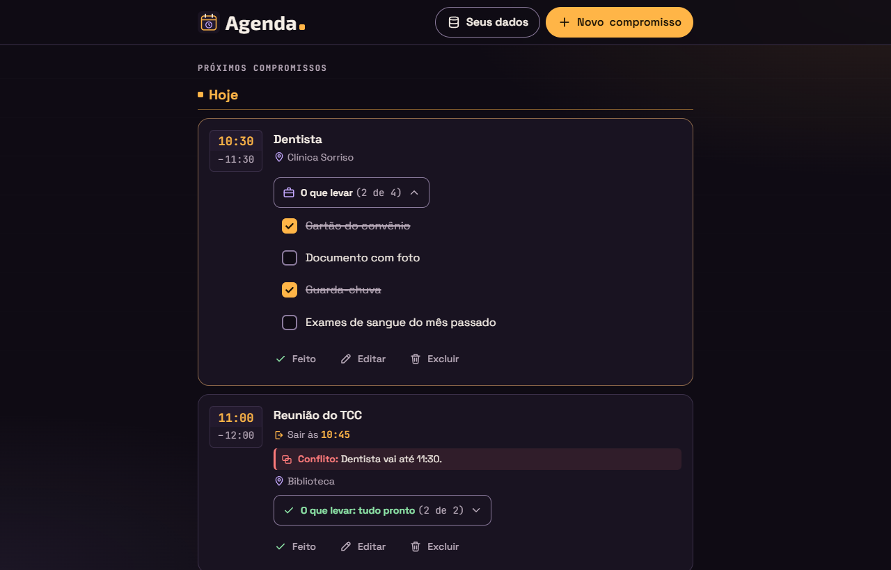

# Relatório de teste — Agenda, Etapa 3 (Entrega 3a)

- **Data:** 2026-11-06
- **O que foi testado:** a página `index.html` da Agenda (com `css/style.css`, `js/datas.js`, `js/armazenamento.js`, `js/copia.js` e `js/app.js`) e o `README.md`, ainda sem commit, comparados com o último commit da Entrega 2b. Testei contra a Agenda **US17** (checklist "O que levar" no formulário), **US18** (marcar o checklist no card), **US19** (hora de fim: "Termina às" e "Duração"), **US20** (aviso de conflito e de aperto), as mudanças da 3a nas stories anteriores, os requisitos gerais da Etapa 3 e as regras da seção 3 ("Hora de fim", "Conflito e aperto" e as regras de leitura de `duracaoMin` e `itens`) dos [requisitos](../requisitos.md). O visual foi comparado com a seção 14 do [design](../design.md), com a conferência da 14.11 e as decisões aprovadas da 14.12. Também avaliei as 4 decisões do dev e conferi se as Entregas 2a e 2b continuam funcionando.
- **Onde:** Microsoft Edge (Chromium) **headless**, controlado por script, num servidor local que imita o endereço do GitHub Pages (`/agenda/`), e também abrindo o `index.html` direto do disco (`file://`). Usei o fuso `America/Sao_Paulo`, com o relógio parado em sexta-feira, 06/11/2026, às 10:00, e um relógio que anda nos testes de atualização de cada minuto. Larguras testadas: 320, 360, 400 e 1280px. Também testei com movimento reduzido, alto contraste (cores forçadas) e `localStorage` bloqueado e cheio. **Não testei:** celular de verdade, leitor de tela de verdade e GitHub Pages (a 3a ainda não foi publicada).

## Resultado

**Aprovado com pendências.** Fiz 270 conferências automáticas no navegador, e todas passaram depois de eu corrigir 4 falhas que eram do meu script (veja "Como foi testado"). Nenhum critério de aceite falhou. As 4 decisões do dev são aceitáveis. Ficaram só observações de gravidade baixa e a conferência manual (celular e leitor de tela).

## Verificações

| Área | Resultado | Observação |
|---|---|---|
| Celular a 360px | Passou | Não há rolagem horizontal a 320, 360 e 1280px, nem com o checklist aberto em todas as seções, com avisos de conflito e de aperto e com itens e títulos longos. Nada passa da borda do card. A placa com o intervalo ("10:30" em cima e "–11:30" embaixo) não corta a 320px. Os textos longos dos itens e dos avisos quebram linha. O formulário cabe na tela e rola por dentro. "Termina às" e "Duração" ficam um embaixo do outro no celular e lado a lado a partir de 480px. O botão "O que levar", as caixas, "Adicionar", "Remover" e os campos novos têm pelo menos 44px depois da animação de abertura. |
| Teclado | Passou | No card, a ordem do Tab é: botão "O que levar" → caixas (se aberto) → Feito → Editar → Excluir. O botão abre e fecha com Enter e Espaço, e o foco fica nele. A caixa marca com Espaço, e o foco fica nela. No formulário, a ordem é: Hora → Termina às → Duração → Minutos → Tempo para sair → … → Observação → Novo item → Adicionar → Cancelar → Salvar. Enter em "Novo item" adiciona e não salva. As setas no `select` trocam a opção e já preenchem "Termina às". Todos os elementos novos mostram o contorno de foco (3px). |
| Acessibilidade | Passou | Os nomes acessíveis vieram da árvore de acessibilidade do navegador: "O que levar (2 de 5), Dentista", lista "O que levar: Dentista", caixa "Documento com foto", "Remover Cartão do convênio", "Novo item", "Termina às", "Duração" e "Minutos". O grupo "Hora de fim" tem a descrição "Preencha um dos dois: …" com hora e "Escolha uma hora para usar a hora de fim." sem hora. A placa é lida como "Das 10:30 às 11:30" (o "–" fica escondido do leitor). Os avisos de conflito e de aperto não ficam dentro de `aria-live`. Os anúncios "… adicionado." e "… removido." vão para a região `aria-live="polite"` do formulário. Com 20 itens, o campo diz "Limite de 20 itens." na descrição. Com movimento reduzido, o "acender" âmbar e a seta não animam. No alto contraste, o botão do checklist, as tarjas, os itens e a seta do `select` continuam visíveis. |
| Contraste | Passou | Medi nas cores reais da tela. Hora de início 10.3, hora de fim 8.2 (7.5 em "Anteriores"). "Conflito:" 7.2, com o texto da tarja em 15.8 e o ícone em 7.2. "Aperto:" 10.3, com o texto em 15.8. Botão "O que levar": texto 15.8, "(2 de 5)" 8.2, mala 9.0, seta 8.2 e borda 4.6. "tudo pronto": 12.1 (13.0 em "Anteriores"). Item 15.8, item marcado 8.2, borda da caixa 4.6. No formulário: dica 8.2, seta do `select` 8.8, item 16.9, "Remover" 8.8, "Adicionar" 15.8 e dica do limite acima de 4.5. Todos os valores estão iguais ou melhores que a tabela 14.10 do design. |
| Erros | Passou | O console fica sem erros da Agenda em todos os cenários, inclusive com `file://`, com o `localStorage` bloqueado e com arquivos de importação com valores errados. Nenhum arquivo dá 404. O único aviso no console foi o do meu script, que pôs "abc" num campo de número. |

## Critérios de aceite

**Agenda US17: Checklist "O que levar" no formulário**
- [x] O grupo "O que levar" é um `fieldset` com `legend`, depois da Observação, e aparece em criar, editar, remarcar e agendar.
- [x] O campo "Novo item" tem rótulo visível e `maxlength="60"`, e o botão se chama "Adicionar".
- [x] "Adicionar" (clique ou Enter no campo) põe o item no fim, sem os espaços das pontas ("  Cartão do convênio  " → "Cartão do convênio"), limpa o campo e deixa o foco nele. Enter nesse campo não salva. Enter no Título continua salvando (US02).
- [x] Campo vazio ou só com espaços não faz nada e não mostra erro.
- [x] Itens repetidos são aceitos.
- [x] Cada item tem "Remover", com o nome "Remover Cartão do convênio". Ao remover um item do meio, o foco vai para o "Remover" do próximo. Ao remover o último, vai para "Novo item".
- [x] Com 20 itens, o campo fica com `aria-disabled="true"` e `readonly` (ajuste da 14.6), "Adicionar" fica `disabled` e aparece "Limite de 20 itens.". O foco fica no campo depois do 20º Enter. Digitar e Enter não fazem nada. Removendo um item, tudo volta.
- [x] Os anúncios "Cartão do convênio adicionado." e "Cartão do convênio removido." vão para o `#itens-aviso`, que é limpo ao abrir o formulário.
- [x] Ao Salvar, o texto que ficou em "Novo item" vira item ("Guarda-chuva" entrou como 20º item).
- [x] Cancelar e Esc descartam as adições e as remoções.
- [x] Item novo é salvo com `feito: false`. Ao editar, os itens já marcados continuam marcados, e no formulário aparecem riscados com "(já marcado)" para o leitor de tela.
- [x] O checklist funciona com "Ainda sem data" marcada, e o grupo não é desativado.
- [x] Um item `` aparece como texto.
- [x] A 360px o grupo cabe sem rolagem horizontal, os textos longos quebram linha, e "Adicionar" e "Remover" têm 44px.

**Agenda US18: Marcar os itens do checklist no card**
- [x] O botão mostra "O que levar (2 de 5)". Com todos marcados, mostra "O que levar: tudo pronto (5 de 5)", com o ícone de check e a cor verde. Sem itens, nada aparece.
- [x] O botão abre e fecha com clique, Enter e Espaço e tem `aria-expanded` e `aria-controls`. A lista começa fechada ao abrir a página. Ela continua aberta quando a tela é redesenhada, depois de "Feito" em outro card e na atualização do minuto (com o relógio andando até um item mudar de seção).
- [x] Cada item é um `input type="checkbox"` com o texto como rótulo (`label`), e a linha tem 44px.
- [x] O item marcado aparece riscado e com a caixa marcada.
- [x] Marcar grava na hora: `feito`, `atualizadoEm` e `agenda:ultima-mudanca` mudam, e o contador e o nome acessível do botão se atualizam.
- [x] Depois de marcar, o foco continua na mesma caixa, e não aparece aviso flutuante. Na atualização do minuto que redesenha a lista, o foco volta para a mesma caixa.
- [x] Com a gravação falhando (erro de cota), a caixa volta ao estado anterior, o contador não muda, o foco fica na caixa e aparece "Não foi possível salvar o compromisso." com a barrinha de erro.
- [x] O checklist aparece igual e pode ser marcado em "Próximos", "Ficou pendente", "Sem data" e "Anteriores".
- [x] Marcar todos não muda o `status`, e "Feito" não muda os itens.
- [x] A 360px e a 320px a lista não causa rolagem horizontal, e os textos longos quebram linha.

**Agenda US19: Hora de fim ("Termina às" e "Duração")**
- [x] O grupo "Hora de fim" fica logo depois da Hora, com "Termina às" (`type="time"`, vazio) e "Duração" (`select`: "Sem hora de fim", "30 min", "1 h", "2 h" e "Outro").
- [x] "Outro" mostra "Minutos". Os valores "", 0, 1440, "abc", -3 e 12.5 são recusados ao salvar.
- [x] A 360px os campos ficam um embaixo do outro, sem rolagem. A partir de 480px, ficam lado a lado.
- [x] **Um preenche o outro:**
  - "Termina às" depois da Hora: 09:00–10:30 → "Outro" com 90; 10:00 → "1 h"; 09:30 → "30 min"; 11:00 → "2 h";
  - "Termina às" igual, antes ou apagado → "Sem hora de fim";
  - "1 h" com 09:00 → "Termina às" 10:00. "30 min", "2 h" e "Outro" com 45 também funcionam. Passando de 23:59 ("Outro" com 1439), "Termina às" fica vazio;
  - "Sem hora de fim" ou "Outro" vazio ou inválido → "Termina às" vazio;
  - o campo que mudou sozinho "acende" em âmbar (decisão 3 da 14.12).
- [x] Mudar a Hora mantém a duração: com "1 h", 14:00 → 15:00; com "Outro" 90, 13:00 → 14:30; com 23:30 + "1 h", "Termina às" fica vazio e a Duração continua "1 h".
- [x] Sem Hora (apagada ou "Ainda sem data"), os campos ficam vazios e desativados, com a dica certa, e ao salvar `duracaoMin` é `null`. Com a Hora de volta, os campos voltam vazios.
- [x] **Ao salvar:** 10:00–11:30 grava `duracaoMin: 90`. "Termina às" igual ou antes da Hora mostra "A hora de fim precisa ser depois da hora de início.". 23:30 + "1 h" mostra "Com essa duração, o compromisso passaria da meia-noite. Escolha uma duração menor.". "Outro" inválido mostra "Digite um número de minutos entre 1 e 1439.". Com "Sem hora de fim", grava `null`.
- [x] Os três erros têm `aria-invalid` e `aria-describedby` (no "Minutos": "De 1 a 1439 minutos. Digite um número…"). O foco vai para o primeiro campo com problema, na ordem do formulário: com o Título vazio, vai para o Título; com "Termina às" errado e "Minutos antes" errado, vai para "Termina às". O que foi digitado não se perde, e o erro some quando o valor é corrigido.
- [x] Ao editar, `duracaoMin: 90` abre com "Termina às" calculado e "Outro" 90, e `duracaoMin: 60` abre em "1 h".
- [x] No card, em todas as seções, aparece o intervalo empilhado na placa (decisão 1A), lido como "Das 10:30 às 11:30", com os dois `time` com `datetime`. Sem hora de fim, aparece só "10:05".
- [x] A hora de fim não muda o "passou" (a "Aula" 09:00–10:10 já está em "Anteriores" às 10:00), nem o "Sair às" ("Sair às 10:45" para 11:00 com 15 min), nem o "Era para" ("Era para: Hoje · 09:30").

**Agenda US20: Aviso de conflito e de aperto** (24 situações numa mesma semente)
- [x] Só entram compromissos com data, hora e "aberto". Um A "Feito" ou "Não vou fazer" não gera aviso, e o de dia todo e o sem data ficam de fora.
- [x] **Conflito:** "Conflito: Dentista vai até 11:30." e "Conflito: mesmo horário de Dentista." (Ônibus e Dentista às 10:30).
- [x] **Aperto:** "Aperto: sair às 11:25, mas Dentista vai até 11:30.". Quando a hora de sair é igual ao fim (o Café às 11:45 com 15 min e o Dentista até 11:30), não há aviso. Começar exatamente no fim de A é aperto, não conflito ("Aperto: sair às 08:59, mas E1 vai até 09:00." e a Reunião remarcada para 11:30).
- [x] Um A sem hora de fim e com horário diferente não gera nada.
- [x] O aviso só aparece no card do segundo e só em "Próximos". O A pode estar em "Anteriores" ("Conflito: Aula vai até 10:10.", da Aula que já passou) ou em "Ficou pendente" (aperto com a "Pend").
- [x] Aparece um aviso só: o conflito vence o aperto, mesmo quando o aperto vem antes na ordem (o Multi mostra o conflito com Y2, e não o aperto com Y1; o Ônibus mostra "mesmo horário de Dentista", e não o aperto com a Pend).
- [x] "Conflito:" e "Aperto:" ficam em `strong`, cada um com seu ícone e sua cor, e o título `<b>Chefe</b>` aparece como texto.
- [x] O aviso não impede de salvar e não abre janela.
- [x] Os avisos se atualizam depois de editar, excluir, importar, "Feito" e "Desfazer". Com "Feito" no Dentista, os avisos da Reunião e do Almoço somem, e o Ônibus passa a mostrar o aperto com a Pend. Com "Desfazer", eles voltam. Não há `aria-live` no aviso.
- [x] Mudar o horário de B (11:00 → 11:30 → 11:45) ou a duração de A faz o aviso mudar ou sumir na hora.
- [x] A 360px o aviso quebra linha, sem rolagem horizontal.

**Mudanças da 3a nas stories anteriores**
- [x] US01: o card mostra o intervalo, o checklist e o aviso, nesta ordem: título → meta → aviso → local → checklist → botões (design 14.4.4).
- [x] US02: um compromisso novo nasce com `duracaoMin` e `itens` do formulário (`null` e `[]` quando vazios). Enter em "Novo item" não salva.
- [x] US03 e US04: os três erros novos funcionam, e editar mostra e salva a hora de fim e o checklist.
- [x] US06: "Anteriores" mostra o intervalo e o checklist, sem aviso.
- [x] US08 e US09: a cópia sai com `versao: 2`, com `duracaoMin` e `itens` preenchidos e sem preferências. A ida e volta num navegador vazio reproduz os compromissos **exatamente**. Na importação com valores errados, nenhum compromisso foi descartado:
  - `duracaoMin` "60", 0, 12.5, passando de 23:59 ou sem hora viram `null`. 23:00 + 59 é aceito;
  - `itens` que não é lista vira `[]`;
  - itens `null`, número, só espaços e sem texto são ignorados;
  - o texto de 70 caracteres é cortado em 60 (e perde o espaço da ponta);
  - `feito` só fica `true` quando é exatamente `true`;
  - de 25 itens, ficam os 20 primeiros válidos.
- [x] US12: o "Tempo para sair" do segundo é usado no aperto (Reunião com 15 min; Madrugada com 40 min).
- [x] US16: "Ainda sem data" limpa e desativa a hora de fim, e o checklist continua ativo.

**Requisitos gerais da Etapa 3 (parte da 3a) e regressões das Entregas 2a e 2b**
- [x] "O que levar", "tudo pronto", "Conflito" e "Aperto" estão em texto, e o estado do botão vem do `aria-expanded`.
- [x] O formulário, mais comprido, cabe a 360px e a 320 × 568 e rola por dentro.
- [x] Tudo o que é novo funciona com o teclado e tem foco visível (tema escuro; o claro é da 3b).
- [x] Dados da Etapa 2 (`versao: 2` com `duracaoMin: null` e `itens: []`) abrem sem mudança ("Sair às 07:30", placa "08:00"). A migração v1 → v2 continua guardando a `-v1` byte a byte e cria `duracaoMin: null` e `itens: []`.
- [x] O `localStorage` só tem chaves `agenda:`. O código não usa `localStorage.clear()`, `fetch`, `XMLHttpRequest` nem `sendBeacon`. `innerHTML` só aparece com os SVGs fixos do código.
- [x] **Regressões:** "Sair às", "Feito"/"Desfazer", "Ficou pendente", "Sem data", a mudança de seção pelo relógio, a cópia e a importação continuaram funcionando nos cenários acima. Com o `localStorage` cheio, o "Não foi possível salvar o compromisso." aparece inteiro acima da barra a 320 × 568 (pendência da 2a, continua resolvida). Com o `localStorage` bloqueado, aparece a faixa da Etapa 1, e dá para criar com hora de fim e marcar o checklist enquanto a página está aberta.
- [x] O README descreve as três funções novas e não tem dados pessoais.

## Avaliação das decisões do dev

| # | Decisão | Avaliação |
|---|---|---|
| 1 | Se a Duração está em "Sem hora de fim" e "Termina às" tem uma hora (que era igual ou antes da Hora antiga), mudar a Hora recalcula a Duração a partir de "Termina às". | **Aceitável.** Conferido: Hora 10:00 e fim 09:00 ("Sem hora de fim"); com a Hora mudada para 08:00, a Duração vira "1 h" e o fim continua 09:00. Os requisitos não cobrem esse caso. Sem a decisão, os dois campos diriam coisas diferentes, e "Termina às", que vale mais na hora de salvar, só daria erro. |
| 2 | Ao importar ou ler os dados, o checklist fica com os 20 primeiros itens **válidos**. | **Aceitável.** A seção 3 primeiro manda ignorar os itens sem texto e depois diz "do 21º item em diante, eles são ignorados". Contar só os válidos garante 20 itens de verdade quando há lixo no começo. Conferido com 1 item vazio + 25: ficam I1 a I20. |
| 3 | O botão "O que levar" usa `aria-label` ("O que levar (2 de 5), Dentista"). | **Aceitável.** É o mesmo motivo da decisão 7 da 2b (evitar o espaço antes da vírgula). O nome começa pelo texto visível (bom para comando de voz) e é atualizado junto com o contador ao marcar e na falha. Conferido na árvore de acessibilidade. |
| 4 | No aperto, a hora de sair aparece só com os minutos ("sair às 23:30"), sem " do dia anterior", no caso raro depois da meia-noite. | **Aceitável.** Conferido: "Aperto: sair às 23:30, mas Zero vai até 00:05.". Ele segue o formato da tabela da seção 3 ("sair às HH:MM"). A linha "Sair às 23:30 do dia anterior" logo acima, no mesmo card, já deixa o dia claro. Só aparece com compromissos logo depois da meia-noite. |

## Problemas encontrados

Nenhum problema de gravidade alta. Seguem as observações de gravidade **baixa** (as 4 foram corrigidas pelo dev em 2026-11-06, depois da aprovação). Nenhuma impedia a aprovação.

**1. O exemplo "Ex.: guarda-chuva" fica cortado no celular**
- **Página:** `index.html`, formulário, campo "Novo item" (`index.html:285`).
- **Passos:** abrir "Novo compromisso" a 360px (ou 320px) e rolar até "O que levar".
- **Esperado:** o exemplo aparece inteiro, ou é curto o bastante para caber.
- **Obtido:** a 360px aparece "Ex.: guarda-chu" (campo com cerca de 144px, como na conta da 14.3.4), e a 320px o campo tem 102px e mostra menos ainda. O rótulo "Novo item" é visível e é ele que dá o nome do campo, então nada se perde.
- **Gravidade:** baixa (só aparência). Sugestão para a artista: um exemplo mais curto ("Ex.: chave") ou o botão só com "+" e o texto "Adicionar" num `sr-only` abaixo de 360px.

**2. O valor escondido de "Minutos" (da Duração) fica guardado ao trocar de "Outro" para outra opção**
- **Passos:** Hora 09:00 → "Termina às" 10:30 (a Duração vai para "Outro" com 90) → escolher "30 min" → escolher "Outro" de novo.
- **Obtido:** "Minutos" volta com 90, e "Termina às" vira 10:30. Nada errado é salvo: enquanto a opção não é "Outro", o número escondido é ignorado (`duracaoEscolhida`, em `js/app.js`).
- **Gravidade:** baixa. Pode até ajudar quem voltou atrás. Se o PO preferir o campo limpo, basta limpar `campoDuracaoMin` no `aoMudarDuracao` (`js/app.js:1444`) quando a opção não for "Outro".

**3. O checklist pode reabrir sozinho depois de ser esvaziado**
- **Passos:** abrir "O que levar" num card, editar o compromisso e remover todos os itens, salvar. Depois editar de novo e adicionar um item.
- **Obtido:** o botão volta com a lista **aberta**, porque o `id` continua no `Set` `checklistsAbertos` (`js/app.js:69` e `:1599`). Isso só vale enquanto a página está aberta. É o mesmo comportamento de "Sem data" e "Anteriores" (observação C da 2b).
- **Gravidade:** baixa.

**4. README: o checklist aparece junto dos `<fieldset>`**
- **Onde:** `README.md:28`, Tecnologias: "`<fieldset>` com botões de opção e caixas de marcar para … e o checklist 'O que levar'".
- **Obtido:** no formulário o checklist é um `fieldset`, mas no card ele é um botão com uma lista de caixas, fora de qualquer `fieldset`. A frase não está errada, só incompleta.
- **Gravidade:** baixa (texto). Sugestão: "… e o checklist 'O que levar' (no card, um botão que abre uma lista de caixas de marcar)".

### Observações (não são problemas)

- **A.** A dica do grupo "Hora de fim" fica ligada por `aria-describedby` só enquanto aparece (o JS troca entre `dica-fim` e `dica-fim-sem-hora`). O HTML de referência do design ligava as duas. É a mesma escolha, melhor, da decisão 8 da 2b. Conferido: o leitor de tela ouve só a dica que está visível.
- **B.** As setas do teclado no `select` fechado trocam a opção e já preenchem "Termina às", como pede a 14.6 (conferido: ArrowDown de "Sem hora de fim" para "30 min" → 13:30).
- **C.** Os avisos de conflito e de aperto não dependem do relógio (só da seção de B e do `status` de A). Por isso, a atualização de cada minuto só os recalcula quando algo muda de seção ou o dia vira, e isso basta para o critério "na atualização de cada minuto".
- **D.** Os textos sugeridos pela artista e aprovados na 14.12 estão todos lá: "Preencha um dos dois: o outro se ajusta sozinho.", "De 1 a 1439 minutos.", "Ex.: guarda-chuva", "(já marcado)" e o "acender" âmbar.

## Prints

## Como foi testado (o que foi de verdade e o que foi por leitura)

- **No navegador (Edge headless, por script):** tudo o que está marcado acima, em três roteiros: formulário (100 conferências), card e avisos (96) e geral (74: contraste, teclado, tamanhos, movimento reduzido, alto contraste, cópia e importação, migração, `localStorage` bloqueado e cheio, e `file://`). A semente dos avisos tem 24 situações de conflito e de aperto, cada uma com o texto esperado escrito à mão a partir da tabela da seção 3. O relógio foi controlado: parado nas telas e andando nos testes de redesenho. O contraste foi medido nas cores calculadas, compondo os fundos transparentes. Os nomes e as descrições vieram da árvore de acessibilidade do navegador.
- **Falhas que eram do meu script, não da Agenda:**
  - eu esperava que o erro de duração sumisse com 23:30 + "30 min", mas isso também passa da meia-noite, e o erro deve continuar mesmo;
  - o `innerText` da placa incluía o texto `sr-only` ("Das", "às");
  - medi os botões do formulário durante a animação de abertura (43px; depois dela, 44px);
  - cliquei em Salvar com o `localStorage` cheio antes de a janela terminar de se ajustar à nova largura.

  Corrigi cada caso, rodei de novo e, num roteiro separado, conferi o aviso de erro de salvar a 320 × 568 (print guardado fora do projeto).
- **Só por leitura de código:** a ordem estável do `sort` no empate completo (mesmo título no mesmo minuto), a leitura real dos anúncios por um leitor de tela e o comportamento no Android e no iPhone.
- Os scripts e os arquivos de teste ficaram fora do projeto. Nenhum navegador nem servidor ficou aberto no fim, e não mexi no código da Agenda.

## Conferência manual (para o João)

1. **Celular de verdade (Chrome do Android):** crie um compromisso com "1 h" e veja "Termina às" se preencher. Toque em "O que levar" no card e marque os itens com o dedo até aparecer "tudo pronto".
2. **Lista de escolha da Duração:** no celular, a lista que abre é a do sistema. Confira se dá para ler as opções e se a seta do campo fechado aparece.
3. **Conflito:** crie dois compromissos hoje, um das 14:00 às 15:00 e outro às 14:30, e veja o aviso vermelho no segundo. Mude o segundo para 15:10 e veja virar o aviso âmbar de aperto.
4. **Leitor de tela** (NVDA ou TalkBack): ouvir "O que levar (2 de 5), Dentista, botão, recolhido", "Das 10:30 às 11:30", "Cartão do convênio adicionado." e o "marcado"/"desmarcado" das caixas.
5. **Depois do push:** abrir `https://joaosaccucci.github.io/agenda/` e conferir que não há erro no console.

## Aulas do Módulo 3 — 2026-11-09

- **O que foi testado:** as 4 aulas novas da Agenda na Labs (`aulas/agenda/modulo-3/aula-01.md` a `aula-04.md`) e as mudanças em `data/aulas.json` (módulo `agenda-m3` e 4 aulas), `data/glossario.json` (12 termos novos: trim, splice, referência, preventDefault, Object.assign, imutabilidade, filter, delegação de eventos, fonte única da verdade, includes, for...of e continue) e `data/projetos.json` (trabalho do professor da 3a e linha do tempo da Agenda). O teste foi feito antes do commit da Labs, do mesmo jeito que as aulas da 2b, e seguiu o guia `docs/guias/aulas.md` e a regra do João de que nenhum exercício manda mexer no código de um projeto.
- **Onde:** Edge headless, com o site da Labs servido por um servidor local (marked e highlight.js carregados pelo CDN), a 1280px, 360px e 320px, nos temas escuro e claro ("papel"). Os links fixos foram comparados com o commit `297ffa3cf92dc2ca0e41dfe17ac72858441826b2` no repositório local da Agenda (`git show 297ffa3:js/app.js` e `js/datas.js`). Esse commit está em `origin/main`, e a página dele no GitHub respondeu 200.

### Resultado

**Aprovado com pendências.** Foram 201 conferências automáticas, mais dois roteiros curtos (progresso e rolagem). As 6 falhas do roteiro eram do script ou de um comportamento antigo da Labs, e conferi uma por uma (veja "Como foi testado"). Todos os exemplos rodam e mostram exatamente o que o texto diz. Os exercícios de "Para praticar" e as respostas dos quizzes batem com o código, e os links fixos apontam para as linhas certas. Corrigi dois detalhes de texto (problemas 2 e 3). Fica **uma pendência média já conhecida**: o balão de `[[map]]` mostra a explicação do `Map` (problema 1). Ela não é deste módulo e não impede o commit.

### Verificações

| Área | Resultado | Observação |
|---|---|---|
| Celular a 360px e 320px | Passou | Sem rolagem horizontal nas 4 aulas (antes e depois de Rodar), em `aulas.html#agenda-m3` e em `detalhe-projeto.html?id=agenda`. A tabela da aula 3 fica dentro do `.tabela-rolagem` (288px a 320px, com `tabindex="0"` e nome "Tabela"). As linhas longas de código (a mais longa é a L7 da aula 2) rolam dentro do próprio bloco (`overflow-x: auto`), que termina em 303px a 320px. |
| Teclado | Passou | O Tab passa por: Rodar, Editar, Console, tabela rolável (aula 3), termos do glossário, links fixos, alternativas do quiz e checklist. O foco aparece em todos. Cada balão abre com Enter e fecha com Esc, e o foco fica no termo. O quiz responde com Enter, e o "Tentar de novo" funciona com Espaço. Os botões "Agenda" e "João Saccucci Labs" de `aulas.html` trocam com Enter e Espaço. |
| Acessibilidade | Passou | Os componentes são os mesmos da Labs. O aviso do Rodar conta certo ("2", "2", "3" e "3 linhas no console"). Depois de responder, as 3 alternativas ficam com `aria-disabled="true"` e as 3 explicações aparecem. |
| Contraste | Passou | Medido nas cores calculadas, nos dois temas (escuro / claro): termo do glossário 16,7 / 15,3; código no texto 15,6 / 13,9; texto 7,9 / 6,7; rótulo do Linha por linha 14,8 / 5,3; célula da tabela 16,7 / 15,3. Tudo acima de 4,5. |
| Erros | Passou | Sem erro no console nas 4 aulas, em `aulas.html`, no detalhe da Agenda, em 2 aulas da Labs da amostra e com um id que não existe (`agenda-m3-aula-09` mostra "Aula não encontrada." e "Ver todas as aulas"). O Console dos exemplos também ficou sem erro. O único 404 foi o `/favicon.ico` que o navegador pede na raiz do servidor de teste. |

### Conferências

**1. `aulas.html`, progresso e vitrine**
- [x] No botão "Agenda" aparece o "Módulo 3 — Entrega 3a: O que levar, hora de fim, conflito e aperto", logo depois do Módulo 2, com as 4 aulas (3.1 a 3.4; `tempoLeitura` 6, 6, 6 e 7) e os links `aula.html?id=agenda-m3-aula-01` a `-04`. São 12 cards da Agenda e 19 da Labs.
- [x] Progresso: no começo, "Agenda, 0 de 12 concluídas" e "0 de 4 concluídas" em cada módulo. Depois de marcar a 3.1 e a 3.4 como concluídas, aparece "Agenda, 2 de 12 concluídas" e, no Módulo 3, "2 de 4 concluídas". Os Módulos 1 e 2 continuam em 0 de 4, e a Labs em 0 de 19.
- [x] `detalhe-projeto.html?id=agenda` mostra o trabalho do professor da 3a ("Aulas — Agenda, Módulo 3" → `aulas.html#agenda-m3` e o Glossário) e a nova linha da linha do tempo (2026-11-09). Os links dos Módulos 1 e 2 continuam lá. Clicando no link do Módulo 3 e depois no card 3.4, a aula 3.4 abre.

**2. Cada aula em `aula.html`** (as 4 passaram em tudo)
- [x] Têm Em resumo (2 linhas), Erro comum, Dica "Para ir além (opcional)" e Em entrevista.
- [x] O glossário funciona com todos os termos: trim, push, splice, referência, map, early return, preventDefault (aula 1); localStorage, map, Object.assign, referência, imutabilidade, filter, length, delegação de eventos (aula 2); fonte única da verdade, Date, includes, split (aula 3); for...of, continue, Map, aria-live (aula 4). Nenhum `[[` ou `]]` sobra na página.
  - `[[for...of]]` e `[[Object.assign]]` (com ponto) viram balão normalmente.
  - O `[[preventDefault]]` entre dois trechos de código da aula 1 fica certo: `<code>evento.</code>`, o botão do termo e `<code>()</code>`, nessa ordem e sem espaço sobrando.
  - Os 12 termos novos não repetem nenhum termo que já existia, nem ignorando maiúsculas. O único par repetido continua sendo `map`/`Map` (problema 1).
- [x] O código aparece colorido. Há 1 exemplo com Rodar por aula, com 14, 15, 15 e 14 linhas.
- [x] O Linha por linha está ligado ao exemplo e cita as linhas certas. Conferi cada item com o código: aula 1 (L1, 2–4, 6, 7, 8, 10–11, 12, 13–14); aula 2 (L1, 2, 4, 5–9, 7, 8, 10, 11–12, 14–15); aula 3 (L1–4, 5–8, 9–11, 12–13, 14–15); aula 4 (L1, 3, 4, 5, 6, 7, 8, 9, 11, 13–14).
- [x] O Rodar mostra exatamente o que o texto diz, e conferi cada número calculado pelo professor:
  - Aula 1: `Rascunho: [{"texto":"Cartão do convênio","feito":false}]` e `Compromisso, sem Salvar: [{"texto":"RG","feito":true}]`.
  - Aula 2: `Não foi possível salvar o compromisso.` e `RG marcado? false`.
  - Aula 3: `Duração: 90 min` (630 − 540), `Com 1 h, termina às 10:00` (600) e `23:30 + 1 h: passa da meia-noite, fica vazio` (1410 + 60 = 1470, que passa de 1439).
  - Aula 4: `11:00 -> Conflito: Dentista vai até 11:30.`, `11:40 -> Aperto: Dentista vai até 11:30.` (sair às 11:25: 685 < 690) e `11:45 -> null` (690 não é menor que 690).
- [x] Editar abre o código num campo de texto, o código editado roda, e Restaurar volta ao original.
- [x] Quizzes: as aulas 1 a 3 têm 2 e a aula 4 tem 3, todos com 3 alternativas e **exatamente uma certa**. Testei cada quiz duas vezes, em páginas limpas. Clicando na certa, aparece "Certa!". Respondendo uma errada com Enter, aparece "Errada. A resposta certa é a B.". Nos dois casos as 3 explicações aparecem e o quiz trava, e o "Tentar de novo" limpa a resposta. Conferi as respostas certas contra o código:
  - `rascunho = compromisso.itens` seguido de `splice` tira o RG do compromisso também;
  - 10:30 − 09:00 = 90, que vai para "Outro";
  - o Café às 11:30 dá aperto (675 < 690, e 690 < 690 é falso);
  - aperto no primeiro A e conflito no segundo dá conflito.

**3. Navegação**
- [x] A 2.4 agora leva à 3.1, a 3.1 volta para a 2.4, e a 3.4 não tem "próxima".
- [x] Amostra da Labs (a primeira e a última aula): abrem sem erro, e nenhum link de navegação leva para a Agenda.

**4. Links fixos** (todos com o hash completo `297ffa3cf92dc2ca0e41dfe17ac72858441826b2`, nenhum com `/blob/main/`)
- [x] Aula 1: `app.js#L1132-L1137` (o comentário da 3a e a cópia dos itens com `map` na `abrirFormulario`), `app.js#L1575-L1595` (a `adicionarItem` e a `removerItem` inteiras), `app.js#L1281-L1288` (o texto pendente de "Novo item" na `salvarFormulario`) e `app.js#L2146-L2155` (o `keydown` com `isComposing` e `preventDefault`).
- [x] Aula 2: `app.js#L1613-L1638` (a `marcarItemDoChecklist` inteira), `app.js#L505-L533` (a `textosDoChecklist` e a `preencherBotaoDoChecklist` inteiras) e `app.js#L2077-L2083` (o comentário e o ouvinte de `change` na área principal).
- [x] Aula 3: `datas.js#L238-L247` (a `minutosDoDia` e a `horaDosMinutos`, com os comentários), `datas.js#L254-L259` (a `horaDeFim`, com o comentário), `app.js#L1437-L1474` (a `aoMudarFim`, a `aoMudarDuracao` e a `aoMudarHora`) e `app.js#L1488-L1506` (a `avaliarHoraDeFim`).
- [x] Aula 4: `datas.js#L262-L302` (o comentário e a `avisoDeHorario` inteira), `app.js#L461-L479` (a `calcularAvisosDeHorario` inteira) e `app.js#L484-L500` (a `criarAvisoDeHorario` inteira).
- Em todos os links, a função citada termina na última linha do intervalo. Alguns começam no comentário logo acima da função, o que ajuda a leitura.

**5. Conteúdo**
- [x] As explicações batem com o código da Agenda:
  - o rascunho é uma cópia feita com `map` ao abrir, e vira `[]` num compromisso novo;
  - `trim`, `push` e `splice` estão na `adicionarItem` e na `removerItem`;
  - a `marcarItemDoChecklist` guarda `listaAntes`, monta o compromisso novo com `Object.assign` e, se falhar, volta a lista e faz `caixa.checked = !caixa.checked`;
  - o contador usa `filter(...).length`;
  - a Duração escolhe a opção com `OPCOES_DE_DURACAO.includes(String(minutos))`;
  - `ULTIMO_MINUTO_DO_DIA` é 1439, e um fim vazio, igual ou antes da Hora deixa a Duração em "Sem hora de fim" (a opção de valor vazio);
  - a `avisoDeHorario` usa `for...of`, `continue` e `<`, e só guarda o primeiro aperto;
  - a hora de sair aparece com `(sairB + 1440) % 1440` (00:05 − 15 → 23:50);
  - a tarja não tem `aria-live`, e o título entra como texto.
- [x] **Nenhum exercício manda mexer no código da Agenda ou da Labs.** Todos os itens de "Para praticar" mexem no exemplo da aba Aulas. Rodei cada item com o editor do próprio exemplo, e as linhas citadas são as certas:
  - Aula 1: com `const rascunho = compromisso.itens;`, "Compromisso, sem Salvar" mostra só o Cartão do convênio (o RG sumiu). Com `adicionar("RG")` depois da linha 11, o rascunho fica com o Cartão e um RG novo (`feito: false`).
  - Aula 2: com `return true`, aparecem "Salvo." e "RG marcado? true". Trocando as linhas 5 a 9 por `compromissos[0].itens[indice].feito = marcado;`, aparece o erro, mas "RG marcado? true".
  - Aula 3: com "09:30" na linha 10, "Duração: 30 min" (opção "30 min"). Com "14:00" na linha 9, "Duração: -210 min" e "termina às 15:00". `horaDosMinutos(1439)` dá "23:59".
  - Aula 4: com o Café antes do Dentista, às 11:00 continua o conflito com o Dentista (o aperto com o Café fica guardado, mas o conflito vence). Com `<=` e "11:30", aparece "Conflito: Dentista vai até 11:30."; com `<`, "Aperto: Dentista vai até 11:30.". Com `sair: 5`, às 11:40 dá `null` (695 não é menor que 690).
- [x] Tamanho: de 698 a 858 palavras fora do código, `tempoLeitura` 6 ou 7, 2 ou 3 itens em "Para praticar" e quiz nas 4 aulas.

### Problemas encontrados

**1. Glossário: `[[map]]` mostra a explicação do `Map`** (status: pendente, já conhecida)
- **Onde:** `js/aula.js`, linha 241 (`termos.set(String(item.termo).toLowerCase(), item)`), com `map` (linha 15) e `Map` (linha 80) no `glossario.json`. Afeta as aulas 3.1 e 3.2 deste módulo.
- **Passos:** abrir `aula.html?id=agenda-m3-aula-01`, ir até "L2–4" do Linha por linha e abrir o termo "map".
- **Esperado:** "mapear — Cria uma lista nova transformando cada item da lista original."
- **Obtido:** "mapa — Estrutura que guarda um valor para cada chave, como um id…". Na aula 3.1 isso aparece logo ao lado de "map cria uma lista nova", o que confunde. Na aula 3.4, o `[[Map]]` mostra o certo.
- **Gravidade:** média, mas não é deste módulo: é a observação B do relatório `docs/testes/etapa-7.md`, que já afetava as aulas do Módulo 2. Sugestão para o dev, numa próxima etapa: buscar primeiro o termo exato e só depois ignorar maiúsculas, ou trocar um dos termos.

**2. Aula 3, Linha por linha (L14–15): mensagem de erro incompleta** (status: corrigido por mim)
- **Obtido:** a aula citava "Com essa duração, o compromisso passaria da meia-noite.". O texto real da Agenda (`index.html`, linha 199, no commit `297ffa3`) continua com "Escolha uma duração menor.".
- **Gravidade:** baixa. **Correção:** acrescentei a segunda frase na citação.

**3. Aula 1, "Em entrevista": `{ ...}` parece o operador de espalhar** (status: corrigido por mim)
- **Obtido:** "por exemplo com `map` devolvendo `{ ...}` novos". Escrito como código, `{ ...}` parece a sintaxe de espalhar (`{ ...item }`), que ainda não foi ensinada, e a frase fica difícil de repetir numa entrevista.
- **Gravidade:** baixa. **Correção:** "por exemplo com `map` devolvendo objetos novos, como `{ texto: item.texto, feito: item.feito }`", que é o que o exemplo da aula faz.

### Observações (gravidade baixa, nenhuma impede a aprovação)

- **A. Rolagem até `aulas.html#agenda-m3` em telas estreitas.** A rolagem suave para antes do ponto certo: o título do módulo fica a 348px do topo a 320px e a 295px a 360px (o esperado era cerca de 88px, a margem do cabeçalho). O módulo aparece na tela e dá para ler o título, então o link funciona. Isso não é deste módulo: o `#agenda-m2` também para a 162px a 320px. Parece que a posição é calculada antes de a página terminar de se ajustar. Fica para o dev olhar numa próxima etapa da Labs.
- **B. Linha longa na aula 2.** A L7 do exemplo (o `map` dos itens com o operador ternário) tem mais de 100 caracteres e, no celular, só aparece rolando o bloco de código. Funciona, mas quebrar em duas linhas deixaria mais fácil de ler (o Linha por linha teria de ser renumerado).
- **Conferir à mão (João):** depois do commit da Labs, abrir uma aula do Módulo 3 no GitHub Pages e clicar num link fixo, para ver se o GitHub abre com as linhas destacadas.

### Como foi testado

- **No navegador (Edge headless, por script):** tudo o que está marcado acima. Os exercícios de "Para praticar" foram rodados com o editor do próprio exemplo. Cada quiz foi respondido em páginas limpas: uma vez com clique na certa e outra com Enter numa errada.
- **As 6 falhas do roteiro, que não eram das aulas:**
  - 4 vezes "foco sem contorno" em `modo-foco`: era o `body`, depois de o Tab passar do último link da página e voltar ao começo (igual à 2b);
  - "404 em aulas.html": era o `/favicon.ico`;
  - "aulas.html#agenda-m3 a 320px não leva ao módulo": o meu limite era 300px, e o módulo parou a 348px (observação A).
- **Só por leitura:** a conferência do conteúdo com o código da Agenda no commit `297ffa3` e a contagem de palavras.
- Os scripts e os prints ficaram fora do projeto. Nenhum navegador nem servidor ficou aberto no fim. Não mexi no código da Agenda nem nos JSON. Nas aulas, fiz só as duas correções acima (`aula-01.md`, linha 61, e `aula-03.md`, linha 50).
