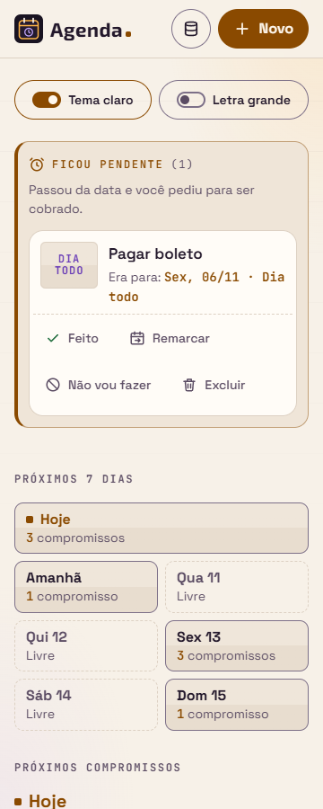
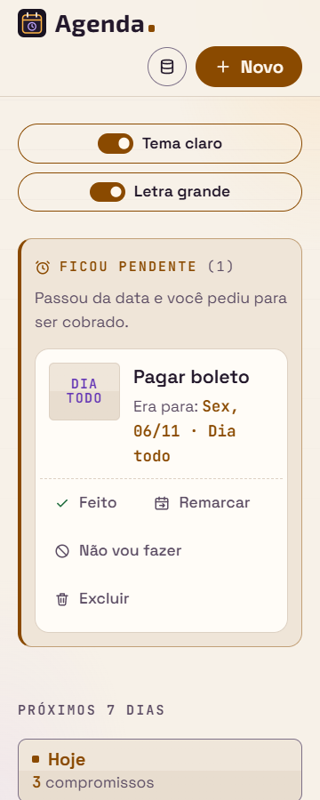
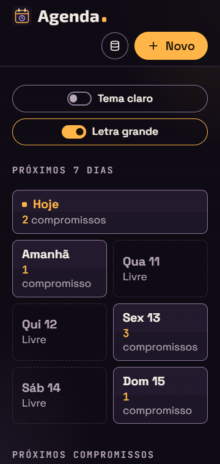
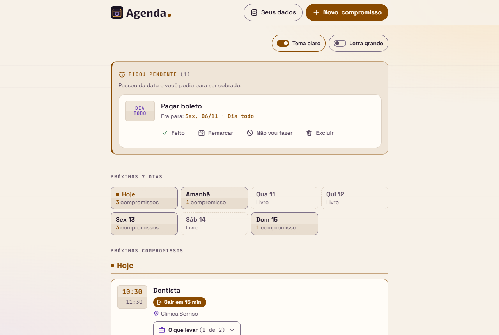
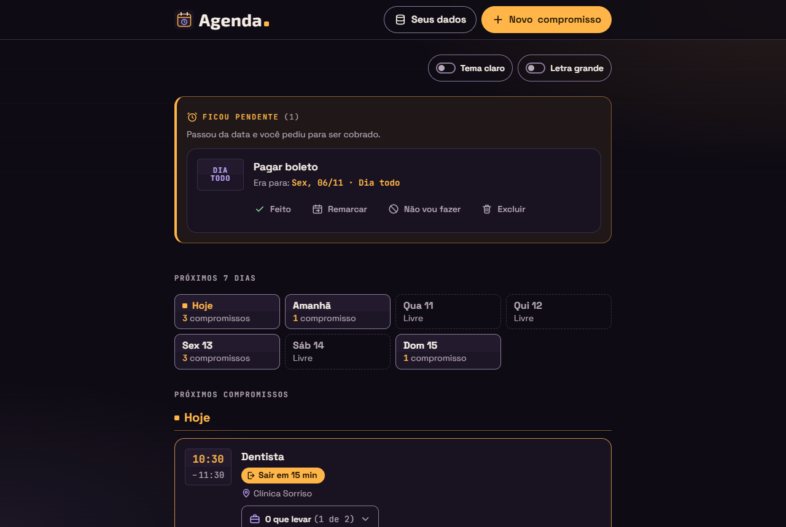

# Relatório de teste — Agenda, Etapa 3 (Entrega 3b)

- **Data:** 2026-11-09
- **O que foi testado:** a página `index.html` da Agenda (com `css/style.css`, `js/app.js`, `js/armazenamento.js`, `js/datas.js` e `js/copia.js`) e o `README.md`, ainda sem commit, comparados com o último commit da Entrega 3a. Testei contra a Agenda **US21** (faixa "Próximos 7 dias"), **US22** (tema claro e escuro), **US23** (letra grande), as mudanças da 3b nas stories anteriores (US01 e US07), os requisitos gerais da Etapa 3 e as regras "Preferências (Etapa 3b)" e "Arquivo de cópia" da seção 3 dos [requisitos](../requisitos.md). O visual foi comparado com a seção 15 do [design](../design.md): a paleta da 15.6, a escala da 15.7, os contrastes da 15.13, a conferência da 15.14 e as decisões aprovadas da 15.15. Também avaliei os 3 desvios anotados pelo dev e conferi se as Entregas 2a, 2b e 3a continuam funcionando, principalmente no tema claro e com a letra grande.
- **Onde:** Microsoft Edge (Chromium) **headless**, controlado por script, num servidor local que imita o endereço do GitHub Pages (`/agenda/`). Fuso `America/Sao_Paulo`, com o relógio parado em segunda-feira, 09/11/2026, às 10:00 (e em 31/10/2026 para a virada do mês), e um relógio que anda nos testes de atualização de cada minuto e da meia-noite. Larguras: 320, 360, 400, 640, 760 e 1280px, nos dois temas e nas duas letras. Também testei com movimento reduzido, alto contraste (cores forçadas), modo celular (tela de toque) e `localStorage` bloqueado e cheio. **Não testei:** celular de verdade, leitor de tela de verdade, as listas nativas de data e hora abertas e o GitHub Pages (a 3b ainda não foi publicada).

## Resultado

**Aprovado com pendências.** Fiz cerca de 380 conferências novas no navegador para a 3b e rodei de novo os 7 roteiros das Entregas 2a, 2b e 3a (cerca de 530 conferências cada vez) no tema escuro com letra normal e no tema claro com letra grande. Encontrei **um problema de gravidade alta**, pequeno, e **corrigi**: com a letra grande, no celular, o aviso "Não foi possível salvar o compromisso." ficava meio escondido atrás da barra Cancelar/Salvar (problema 1). Depois da correção, nenhum critério de aceite falhou. Os contrastes do tema claro foram medidos na tela e estão todos em AA. Os 3 desvios do dev são aceitáveis. Ficam só pendências de gravidade baixa e a conferência manual (celular e leitor de tela).

## Verificações

| Área | Resultado | Observação |
|---|---|---|
| Celular a 360px | Passou | Sem rolagem horizontal e sem nada passando da tela nem cortado a 320, 360 e 1280px, nos 2 temas × 2 letras, em 13 situações: página com tudo aberto, aviso flutuante, formulário com erros (4 posições de rolagem), confirmação de excluir, "Seus dados", importar, "Substituir tudo", erro de importação, `localStorage` bloqueado com a lista vazia e dados corrompidos. A faixa da semana fica com 1 + 2 + 2 + 2 dias abaixo de 640px, 4 + 3 com letra normal e 3 + 3 + 1 com letra grande a partir de 640px, e 1 por linha a 320px com letra grande. Os dias têm 58px de altura (71px com letra grande). Com a letra grande, o cabeçalho vai para 2 linhas (até cerca de 650px, como previsto) e os botões de aparência ficam um embaixo do outro. |
| Teclado | Passou | Ordem do Tab: "Seus dados" → "Novo compromisso" → "Tema claro" → "Letra grande" → faixas → "Ficou pendente" → dias com compromisso da faixa (os livres são pulados) → lista principal. Os dois botões de aparência funcionam com Enter e Espaço, e o foco fica neles. Enter e Espaço num dia levam o foco ao `h3` do dia (contorno de 3px). O próximo Tab vai para o primeiro botão do compromisso daquele dia. O contorno de foco aparece nos dois temas (azul `#0B5FC0` no claro). |
| Acessibilidade | Passou | Pela árvore de acessibilidade do navegador: grupo "Aparência"; botões "Tema claro" e "Letra grande" com estado `pressed` "false"/"true" (o nome não muda); `h2` "Próximos 7 dias" com lista de 7 itens; botão "Hoje, 3 compromissos"; dia livre como item de lista (sem botão, sem `tabindex`, com a vírgula escondida: "Qua 11, Livre"); depois do toque, o foco está no título de nível 3 "Sex, 13/11 daqui a 4 dias". A faixa não tem `aria-live` e não está dentro de nenhum. Movimento reduzido: rolagem até o dia com `behavior: "auto"` (e `"smooth"` sem a preferência), chavinha e botão do dia sem transição e sem encolher. Alto contraste: dia com borda sólida, dia livre tracejado, bolinha da chavinha visível nos dois estados e à direita só quando ligada, foco visível. |
| Contraste | Passou | Medi **todo texto visível** em 13 situações, nos 2 temas, nas 2 letras e em 3 larguras (1.806 medições por combinação, cada uma contra o pior fundo possível, inclusive o brilho âmbar do canto e as duas metades das placas): nenhuma ficou abaixo de AA. Menores valores no claro: horas e "Hoje" em âmbar 5.1, "Conflito:" 5.5, "Aperto:" 5.8. Não-texto no claro (mínimo 3): bordas de botões e campos 3.8 a 4.5, foco 5.1 a 6.0, borda do campo com erro 6.4, check creme no caramelo 6.5, chavinha ligada 6.1 e bolinha 6.5. Tabela completa abaixo. |
| Erros | Passou | Console sem erros da Agenda em todos os cenários, inclusive com `agenda:preferencias` estranha (11 valores), com o `localStorage` bloqueado e com a gravação das preferências falhando. Nenhum arquivo deu 404. |

### Contrastes medidos no tema claro (pior fundo)

| Elemento | Razão | Mínimo | Design (15.13) |
|---|---|---|---|
| Título do card / texto principal | 16.6 | 4.5 | 16.6 |
| Hora, "Hoje", número da semana (âmbar) | 5.1 | 4.5 | 5.1 (placa de baixo) |
| Hora de fim, quantidade da semana | 5.9 | 4.5 | 5.9 |
| Local (lilás) | 7.7 | 4.5 | 7.5 |
| "Conflito:" e ícone · texto da tarja | 5.5 · 14.1 | 4.5 · 3 | 5.5 · 14.1 |
| "Aperto:" e ícone · texto da tarja | 5.8 · 14.3 | 4.5 · 3 | 5.8 |
| "Sair em 15 min" (creme no caramelo) · "Novo compromisso" · opção marcada | 6.5 | 4.5 | 6.5 |
| Botão principal no hover | 8.7 | 4.5 | 8.7 |
| Selo "Cobrar" · título "Ficou pendente" | 6.7 · 5.5 | 4.5 | 6.7 · 5.5 |
| "O que levar" · contagem · "tudo pronto" · item marcado | 16.6 · 7.7 · 6.4 · 7.7 | 4.5 | — |
| Dia livre (nome e "Livre") | 6.5 | 4.5 | 6.5 |
| Erro do campo · rótulo · dica | 6.4 · 16.6 · 7.7 | 4.5 | 6.4 |
| Faixa de lembrete (texto) | 14.2 | 4.5 | 13.9 |
| Borda do botão do dia, dos botões de contorno e do trilho desligado | 3.8 | 3 | 3.8 (pior ponto) |
| Borda do campo, da caixa e do "O que levar" | 4.5 | 3 | 4.5 |
| Borda do campo com erro | 6.4 | 3 | 6.4 |
| Foco (botões, dia, `h3`, campos, faixa) | 5.1 a 6.0 | 3 | 5.0 a 6.0 |
| Caixa marcada · check creme | 6.7 · 6.5 | 3 | 6.1 · 6.5 |
| Chavinha ligada (trilho · bolinha) · bolinha desligada | 6.1 · 6.5 · 7.0 | 3 | 6.1 · 6.5 · 7.0 |
| Botão principal contra o fundo | 6.1 | 3 | 6.1 |

No tema escuro, a mesma varredura deu o menor valor em "Conflito:" (6.3), e o fundo continua `#0F0B14`: nada mudou de cor.

## Critérios de aceite

**Agenda US21: Faixa dos próximos 7 dias**
- [x] A faixa "Próximos 7 dias" é uma `section` com `h2`, depois de "Ficou pendente" e antes de "Próximos compromissos" (ordem do `main`: Aparência, faixas, Ficou pendente, Próximos 7 dias, Próximos compromissos, Sem data, Anteriores).
- [x] São 7 `li` dentro de um `ul`: hoje e os 6 seguintes, em ordem.
- [x] Nomes "Hoje", "Amanhã", "Qua 11" … e quantidades "1 compromisso", "3 compromissos" ou "Livre". Na virada do mês (sábado, 31/10): "Hoje, Amanhã, Seg 2, Ter 3, Qua 4, Qui 5, Sex 6".
- [x] A contagem segue "Próximos compromissos": o de hoje que já passou, "Feito", "Não vou fazer", "Sem data" e o que está fora dos 7 dias não contam; o de dia todo conta (semente com 14 compromissos: "Hoje 3, Amanhã 1, Qua 11 Livre, Qui 12 Livre, Sex 13 3, Sáb 14 Livre, Dom 15 1").
- [x] O dia livre diz "Livre" em texto, além do tracejado.
- [x] Dia com compromisso é `button`. Clique, Enter e Espaço rolam até o grupo do dia (o título fica logo abaixo do cabeçalho) e põem o foco no `h3` (`tabindex="-1"`). Com o mouse não aparece contorno; com o teclado, aparece. Com movimento reduzido, a rolagem é sem animação.
- [x] Nomes acessíveis "Hoje, 3 compromissos", "Amanhã, 1 compromisso", "Sex 13, 3 compromissos", "Dom 15, 1 compromisso" e "Qui 5, 1 compromisso".
- [x] O dia livre é `div`, sem `tabindex`; clicar nele não rola nem muda o foco.
- [x] Com a lista vazia, a faixa aparece com os 7 dias "Livre" (e "Hoje" com as classes `--hoje` e `--livre`).
- [x] Atualiza sem recarregar: criar (Qua 11 vira "1 compromisso"), editar a data (passa para Qui 12), Feito (Sex 13 vai para 2), Desfazer (volta para 3), excluir (Dom 15 vira "Livre"), importar com Juntar (Sáb 14 vira "1 compromisso"), a cada minuto (o Dentista das 10:30 sai da contagem às 10:31) e depois da meia-noite (Hoje passa a ser 10/11 e entra o "Seg 16").
- [x] A 360px (e a 320px) os 7 dias cabem sem rolagem horizontal, e os botões têm 44px ou mais.
- [x] Foco depois do redesenho: continua no mesmo dia; se o dia virou "Livre", vai para o próximo dia com botão; se não houver nenhum, vai para "Próximos compromissos".

**Agenda US22: Tema claro e escuro**
- [x] O botão "Tema claro" tem `aria-pressed` ("false" no começo, "true" ligado). Sem preferência, o tema é o escuro.
- [x] O botão fica na barra "Aparência", logo abaixo do cabeçalho, não fixa (decisão 1A): aparece com a lista vazia, com faixas e sem nada, não cobre nada e funciona com o teclado.
- [x] A troca é na hora, sem recarregar, e o foco fica no botão. A classe `trocando-tema` sai logo depois (sem a troca "em ondas").
- [x] O tema claro cobre todas as partes: as 13 situações da varredura (cabeçalho, faixas de lembrete, de alerta e de erro, "Ficou pendente", faixa da semana, cards com checklist, conflito e aperto, "Sem data", "Anteriores", formulário com erros, as quatro janelas, aviso flutuante e erro de importação) têm fundo creme e texto escuro. A lista vazia mostra o sol (sem a sombra da lua e sem estrelas), e o fundo atrás das janelas é ameixa a 45%.
- [x] Contraste AA nos dois temas em texto, botões, bordas de campo, foco, erros e marcas (tabela acima).
- [x] `color-scheme` fica `light` no `<html>` e nos campos de data e hora; as duas `<meta>` mudam para `light` e `#F7F1E8` (e voltam para `dark` e `#0F0B14`).
- [x] A escolha vai para `agenda:preferencias` (`{"tema":"claro","letra":"normal"}`) e vale ao recarregar.
- [x] **Sem piscar:** com o `app.js` atrasado 1,5 s pelo servidor, a página já aparecia creme, com a chavinha ligada, antes de o `app.js` chegar. Um observador gravou o estado a cada mudança da página durante o carregamento: em nenhum momento o `body` esteve no tema errado (nem no claro, nem no escuro). O script fica no `<head>`, depois das duas `<meta>` de cor e antes das fontes e do CSS.
- [x] Preferência ausente, `abc`, `5`, `null`, `[]`, `"claro"`, `{"tema":"azul","letra":"enorme"}`, `{}` e `{"tema":true}` abrem no escuro e normal; `{"tema":"claro","letra":"x"}` abre claro e normal; `{"tema":"Claro","letra":"grande"}` abre escuro e grande. A chave nunca é apagada, e o console fica limpo. Com o `localStorage` bloqueado, abre no escuro, aparece só a faixa que já existia ("Não foi possível salvar neste navegador…"), e a troca funciona. Com a gravação das preferências falhando, a troca vale, sem aviso e sem erro.
- [x] Trocar o tema não muda `agenda:ultima-mudanca`. O arquivo de cópia continua com `versao: 2` e sem preferências, e importar com "Substituir tudo" não mexe nelas.

**Agenda US23: Letra grande**
- [x] O botão "Letra grande" fica ao lado do "Tema claro", com `aria-pressed`, e o padrão é a letra normal.
- [x] Ligada, a raiz vai de 16px para 20px, e **todos** os textos ficam 1,25 vez maiores. Comparei cada texto em 4 situações (página, formulário com erros, "Seus dados" e aviso flutuante), de 142 a 146 textos em cada uma, e nenhum ficou fora de 1,25.
- [x] A 360px e a 320px, com a letra grande, não há rolagem horizontal nem texto cortado nas 13 situações (depois da correção do problema 1). O cabeçalho vai para 2 linhas, "Tempo para sair" fica com 2 colunas e "Adicionar" desce para baixo do campo, como no design.
- [x] Funciona com os dois temas (as 4 combinações foram testadas).
- [x] Guardada em `agenda:preferencias`, aplicada antes de a página aparecer e com as mesmas regras de falha da US22.
- [x] Zoom do navegador: o tamanho é `125%` na raiz e não há nenhum `font-size` em `px` no CSS (conferido por leitura; o zoom em si não dá para testar no modo headless).
- [x] Trocar a letra não muda `agenda:ultima-mudanca` e não vai para a cópia.

**Mudanças da 3b nas stories anteriores**
- [x] US01: ordem da página certa; os `h3` de "Próximos compromissos" têm `tabindex="-1"`, e os de "Ficou pendente" e "Anteriores" não têm.
- [x] US07: chave nova `agenda:preferencias`; os compromissos continuam na `versao: 2`.

**Requisitos gerais da Etapa 3 (parte da 3b) e regressões das Entregas 2a, 2b e 3a**
- [x] "Livre" e o estado de "Tema claro" e "Letra grande" estão em texto ou em `aria-pressed`, nunca só na cor (a chavinha também muda de lugar).
- [x] O formulário cabe a 360px e a 320px e rola por dentro, inclusive com a letra grande.
- [x] Tudo o que é novo funciona só com o teclado e tem foco visível nos dois temas.
- [x] Dados da Etapa 2 e da 3a abrem sem migração.
- [x] O `localStorage` só tem chaves `agenda:`, sem `localStorage.clear()`; nada é enviado para a internet.
- [x] **Regressões:** os roteiros da 2a/2b (migração v1 → v2, cópia e importação, Juntar e Substituir tudo, lembrete de cópia, "Sair às", Feito/Desfazer, "Ficou pendente", Remarcar, "Sem data", Agendar, teclado, `localStorage` cheio e bloqueado) e da 3a (checklist no formulário e no card, hora de fim com os três erros, conflito e aperto em 24 situações, contraste, alto contraste e `file://`) passaram igual no escuro com letra normal e no claro com letra grande, e o card do roteiro da 3a também no claro com letra normal. A única diferença foi o problema 1, corrigido. As falhas que sobraram nos dois modos são as mesmas e são dos roteiros antigos, não da Agenda (veja "Como foi testado").
- [x] O README descreve a faixa da semana, o tema e a letra, e diz que as preferências não vão na cópia. Não tem dados pessoais.

## Avaliação dos desvios do dev

| # | Desvio | Avaliação |
|---|---|---|
| 1 | O dia do mês aparece sem zero à esquerda ("Qui 5", e não "Qui 05"). | **Aceitável.** Segue o exemplo dos requisitos ("Sex 14") e o do design ("dia da semana abreviado + dia do mês"), e é o jeito que se fala. Conferido na virada do mês: "Seg 2", "Ter 3" … "Sex 6", com o nome acessível "Qui 5, 1 compromisso". |
| 2 | Depois do redesenho (a cada minuto ou depois de uma mudança), o foco volta para o `h3` do dia, se estava nele. | **Aceitável e bom.** O design só falava do foco nos botões da faixa, mas deixar o foco "cair" no topo da página seria pior. Conferido: com o foco no `h3` de "Sex 13", o redesenho das 10:31 devolve o foco a ele; se o dia some da lista (o último compromisso de hoje passou), o foco vai para "Próximos compromissos". |
| 3 | A 360px com letra grande, "1 compromisso" quebra em 2 linhas. | **Aceitável, com pendência baixa** (problema 2). O design previa a quebra só para "3 compromissos". Nada fica cortado e o texto é lido inteiro, só fica um número sozinho na linha de cima. |

## Problemas encontrados

**1. Com a letra grande, no celular, o aviso "Não foi possível salvar o compromisso." ficava meio atrás da barra Cancelar/Salvar** (status: **corrigido por mim**)
- **Página:** `index.html`, formulário (`#erro-salvar`), com `localStorage` cheio.
- **Passos:** abrir com a letra grande a 360 × 640 (com ou sem tema claro), simular o `localStorage` cheio, clicar em "Novo compromisso", escrever um título e Salvar.
- **Esperado:** o aviso aparece inteiro, acima da barra (critério da 2a, que estava resolvido, e "nada fica cortado" da US23).
- **Obtido:** com a letra grande, "Cancelar" e "Salvar" não cabem lado a lado (o design 15.7 contou 120px por botão, mas o espaço interno do botão não entrou na conta) e a barra fica com 148px de altura. O `scroll-padding-bottom` da janela é 6rem (120px), então a rolagem parava antes: o aviso ficava de 386 a 499px na tela e a barra começava em 471px. A última linha ("compromisso.") ficava escondida. Dava para ler rolando a janela, e o leitor de tela anuncia o aviso (`role="alert"`), mas na tela ele aparecia cortado. A 320px e com a letra normal o problema não acontecia.
- **Gravidade:** alta (quebra um critério que já tinha sido aprovado na 2a), mas a correção é pequena.
- **Correção** (`css/style.css`, junto dos ajustes da letra grande, com comentário):
  ```css
  :root[data-letra="grande"] .janela {
    scroll-padding-bottom: 9rem;
  }
  ```
  Com a letra grande, 9rem dá 180px. Depois disso, o aviso fica de 328 a 441px e a barra começa em 471px, a 320 e a 360px, no modo computador e no modo celular. O roteiro da 2b voltou a passar nesse ponto. **Dev:** confira se prefere esse valor ou outro jeito.

**2. A 360px com letra grande, "1 compromisso" e "3 compromissos" quebram em 2 linhas** (status: pendente)
- **Passos:** abrir com a letra grande a 360px e olhar a faixa da semana (print abaixo).
- **Esperado (design 15.8):** só "3 compromissos" quebra.
- **Obtido:** a coluna tem 155px, e o espaço para o texto fica com cerca de 123px (sem os 15px de cada lado e a borda). "compromisso" com letra de 17,5px não cabe junto do número, que fica sozinho na linha de cima ("1" / "compromisso"). Nada fica cortado.
- **Gravidade:** baixa (só aparência). Sugestão para a artista: menos espaço interno na plaquinha com a letra grande no celular, ou aceitar a quebra.

**3. O exemplo "Ex.: chave" do campo "Novo item" tem contraste 4.1 no tema claro** (status: corrigido pelo dev)
- **Onde:** `#campo-novo-item`, texto de exemplo (`placeholder`).
- **Obtido:** o CSS não define a cor do `::placeholder`, e fica o cinza padrão do navegador (`#757575`): 4.1 no creme e 4.2 no escuro (no escuro já era assim na 3a). O rótulo visível "Novo item" é que dá o nome do campo, então nenhuma informação se perde.
- **Gravidade:** baixa. Sugestão: `.campo-controle::placeholder { color: var(--cor-texto-suave); }` (7.0 no creme e 8.7 no escuro).
- **Correção:** o dev acrescentou em `css/style.css` a regra `.campo-controle::placeholder { color: var(--cor-texto-suave); opacity: 1; }` (7.0 no creme e 8.7 no escuro).

### Observações (não são problemas)

- **A. "Cancelar" e "Salvar" um embaixo do outro com a letra grande no celular.** O design 15.7 dizia que cabiam lado a lado, mas a conta não incluiu o espaço interno dos botões. Empilhados, eles continuam com 46px e sem rolagem para o lado. Fica só a nota para a artista corrigir a conta.
- **B. Nome da seção em maiúsculas na árvore de acessibilidade.** A região "Próximos 7 dias" aparece como "PRÓXIMOS 7 DIAS", porque o Chrome aplica o `text-transform: uppercase` do rótulo. É igual em todas as seções da Agenda desde a Etapa 1, e os leitores de tela leem normalmente.
- **C. `aria-pressed` antes do `app.js`.** Enquanto o `app.js` não roda, o HTML diz `aria-pressed="false"` mesmo com o tema claro ligado pelo script do `<head>`. A chavinha já aparece certa (ela segue o atributo do `<html>`, decisão da 15.4), e o `app.js` acerta o `aria-pressed` logo ao começar. Só daria para notar com a página travada no meio do carregamento.
- **D. O dia livre não tem nome na árvore de acessibilidade** (é um item de lista comum). O leitor de tela lê o conteúdo: "Qua 11, Livre", com a vírgula escondida.
- **E.** A barra "Aparência" ocupa 44px no topo do celular (99px com a letra grande, com os botões empilhados), mais o espaço abaixo dela, como foi aprovado na decisão 1A.

## Prints












## Como foi testado (o que foi de verdade e o que foi por leitura)

- **No navegador (Edge headless, por script):** três roteiros novos: faixa da semana (134 conferências, nas duas combinações de tema e letra e em 6 larguras), aparência e preferências (45) e contraste, larguras, alto contraste e movimento reduzido (203). O contraste foi medido nas cores calculadas pelo navegador, compondo os fundos transparentes e as misturas `color-mix`, e contra o pior fundo possível (as duas metades das placas e o brilho âmbar do canto). Os nomes, os papéis e os estados vieram da árvore de acessibilidade do navegador. O "sem piscar" foi testado atrasando o `app.js` no servidor e gravando o estado da página a cada mudança durante o carregamento.
- **Regressão:** rodei de novo os 7 roteiros da 2a/2b e da 3a, primeiro no tema escuro com letra normal e depois no claro com letra grande (a preferência foi gravada antes de a página abrir). Os dois modos deram o mesmo resultado, a não ser pelo problema 1. As poucas falhas que aparecem nos dois modos são dos roteiros antigos, não da Agenda:
  - a ordem do Tab do roteiro da 2b começa onde o último clique deixou o foco (em "Anteriores") e dá a volta; a ordem real está certa;
  - "Plaquinha marcada" e "opção marcada" foram medidas no meio da transição de cor (180ms); medidas depois, dão 6.5;
  - o roteiro da 2b é anterior aos campos `duracaoMin` e `itens` da 3a e à placa com intervalo (as mesmas falhas da rodada da 3a).
- **Falhas do meu próprio roteiro novo:** o nome da seção em maiúsculas (observação B); um observador da página instalado antes de o `<html>` existir; uma função que perdia uma variável ao ser enviada para a página. Corrigi e rodei de novo.
- **Só por leitura de código:** o zoom do navegador junto com a letra grande (não há `font-size` em `px`), o `requestAnimationFrame` duplo da troca de tema e a ilustração da lista vazia no tema escuro (sem mudança).
- **Não deu para ver no modo headless:** as listas nativas de data, hora e `select` abertas (o `color-scheme: light` foi conferido nos campos) e a cor da barra do navegador no celular (`theme-color`).
- Os scripts e os arquivos de teste ficaram fora do projeto. Nenhum navegador nem servidor de teste ficou aberto no fim. No código da Agenda, mudei só a regra do problema 1 em `css/style.css`.

## Conferência manual (para o João)

1. **Celular de verdade (Chrome do Android):** toque em "Tema claro" e em "Letra grande", feche a aba e abra de novo: a Agenda já deve abrir clara e grande, sem piscar no escuro. Veja se a barra do navegador fica creme.
2. **Campos nativos no tema claro:** abra "Novo compromisso" e toque em Data e em Hora: o calendário e o relógio devem aparecer claros. Abra também a lista "Duração".
3. **Faixa da semana:** toque num dia com compromisso e veja a lista rolar até ele. Toque num dia "Livre": nada acontece.
4. **Leitor de tela** (NVDA ou TalkBack): ouvir "Tema claro, botão de alternância, não pressionado" e, depois de tocar, "pressionado"; "Hoje, 3 compromissos, botão"; e, depois de tocar num dia, o título dele ("Sex, 13/11 daqui a 4 dias, título nível 3").
5. **Zoom:** com a letra grande ligada, use Ctrl + e Ctrl − no computador e veja tudo crescer junto, sem rolagem para o lado.
6. **Depois do push:** abrir `https://joaosaccucci.github.io/agenda/` e conferir que não há erro no console.

## Aulas do Módulo 4 — 2026-11-09

- **O que foi testado:** as 4 aulas novas da Agenda na Labs (`aulas/agenda/modulo-4/aula-01.md` a `aula-04.md`) e as mudanças nestes arquivos:
  - `data/aulas.json`: módulo `agenda-m4` e 4 aulas;
  - `data/glossario.json`: 11 termos novos (variável CSS, color-scheme, documentElement, setAttribute, IIFE, rem, tabindex, focus, scrollIntoView, prefers-reduced-motion e aria-label);
  - `data/projetos.json`: trabalho do professor da 3b e linha do tempo da Agenda;
  - `README.md` da raiz: 35 aulas.

  O teste foi feito antes do commit da Labs, do mesmo jeito que o das aulas da 3a. Segui o guia `docs/guias/aulas.md` e a regra do João de que nenhum exercício manda mexer no código de um projeto.
- **Onde:** no Edge headless, com perfil temporário próprio. O site da Labs foi servido por um servidor local, com marked e highlight.js carregados pelo CDN. Testei a 1280px, 360px e 320px, nos temas escuro e claro ("papel"). Comparei os links fixos com o commit `4d7f4243c27f75a806930944c18a7aeb6db1bde4` no repositório local da Agenda (`git show 4d7f424:` em `css/style.css`, `js/app.js`, `js/armazenamento.js` e `index.html`). Esse commit está em `origin/main`, e as páginas dele no GitHub responderam 200.

### Resultado

**Aprovado com pendências.** Foram 216 conferências automáticas e mais dois roteiros curtos: um de progresso e outro dos termos colados no código e dos textos com `<html>`. Nenhuma das 9 falhas do roteiro é das aulas: são do próprio script, de comportamentos antigos da Labs ou de um exercício que gera erro de propósito. Conferi uma por uma (veja "Como foi testado").

- Todos os exemplos rodam e mostram exatamente o que o texto diz.
- Os exercícios de "Para praticar" e as respostas dos quizzes batem com o código.
- Os links fixos apontam para as linhas certas.
- Os títulos e os resumos com `<html>` e `<head>` aparecem como texto em todo lugar.

Corrigi três detalhes de texto (problemas 1 a 3). Nenhum critério falhou. As pendências são baixas e já conhecidas (observações A e B).

### Verificações

| Área | Resultado | Observação |
|---|---|---|
| Celular a 360px e 320px | Passou | Sem rolagem horizontal nas 4 aulas (antes e depois de Rodar), em `aulas.html#agenda-m4` e em `detalhe-projeto.html?id=agenda`. As tabelas das aulas 3 e 4 ficam dentro do `.tabela-rolagem` (288px a 320px, com `tabindex="0"` e nome "Tabela"). A tabela da aula 3 tem 333px e rola dentro da caixa. A da aula 4 cabe (286px). Os blocos de código terminam em 303px a 320px e rolam por dentro. O título "Um atributo no `<html>` troca o tema inteiro" quebra em 3 linhas, sem cortar nada. |
| Teclado | Passou | O Tab passa por: Rodar, Editar, Console, tabela rolável (aulas 3 e 4), termos do glossário, links fixos, alternativas do quiz e checklist. O foco aparece em todos. Cada balão abre com Enter e fecha com Esc, e o foco fica no termo. O quiz responde com Enter, e o "Tentar de novo" funciona com Espaço. Os botões "Agenda" e "João Saccucci Labs" de `aulas.html` trocam com Enter e Espaço. |
| Acessibilidade | Passou | Os componentes são os mesmos da Labs. O aviso do Rodar conta certo ("6", "5", "4" e "7 linhas no console"). Depois de responder, as 3 alternativas ficam com `aria-disabled="true"`, e as 3 explicações aparecem. Os cards, o `h1` e o título da aba (`Aula 4.1 · Um atributo no <html> troca o tema inteiro \| João Saccucci Labs`) mostram o `<html>` como texto. O sumário tem as 5 seções de cada aula. |
| Contraste | Passou | Medido nas cores calculadas, nos dois temas (escuro / claro): termo do glossário 16,7 / 15,3; termo dentro do "Em resumo" (aula 3) 14,8 / 13,7; código no texto 15,6 / 13,9; texto 7,9 / 6,7; rótulo do Linha por linha 14,8 / 5,3; célula da tabela 16,7 / 15,3. Tudo acima de 4,5. |
| Erros | Passou | Sem erro no console nas 4 aulas, em `aulas.html`, no detalhe da Agenda, em 2 aulas da Labs (amostra) e com um id que não existe (`agenda-m4-aula-09` mostra "Aula não encontrada." e "Ver todas as aulas"). O único 404 foi o `/favicon.ico`, que o navegador pede na raiz do servidor de teste. Os 3 JSON alterados são válidos. |

### Conferências

**1. `aulas.html`, progresso e vitrine**
- [x] No botão "Agenda" aparece o "Módulo 4 — Entrega 3b: faixa da semana, tema claro e letra grande", logo depois do Módulo 3. Ele tem as 4 aulas (4.1 a 4.4; `tempoLeitura` 6, 7, 6 e 7) e os links `aula.html?id=agenda-m4-aula-01` a `-04`. São 16 cards da Agenda e 19 da Labs.
- [x] O resumo do módulo e os cards 4.1 e 4.2 mostram `<html>` e `<head>` como texto: nada some e nada vira tag (o `aulas.js` passa tudo pelo `escapar`).
- [x] Progresso: no começo, aparecem "Agenda, 0 de 16 concluídas" e "0 de 4 concluídas" em cada um dos 4 módulos. Depois de marcar a 4.1 e a 4.4 como concluídas, aparecem "Agenda, 2 de 16 concluídas" e, no Módulo 4, "2 de 4 concluídas". Os Módulos 1 a 3 continuam em 0 de 4, e a Labs em 0 de 19.
- [x] O `detalhe-projeto.html?id=agenda` mostra:
  - o trabalho do professor da 3b ("Aulas — Agenda, Módulo 4" → `aulas.html#agenda-m4`, e o Glossário), com "um atributo no `<html>`" e "no `<head>`" como texto no resumo;
  - a linha nova da linha do tempo (2026-11-09, "4 aulas da Entrega 3b, com exemplo Rodar e quiz, no Módulo 4 da Agenda.");
  - os links dos Módulos 1 a 3, que continuam lá.

  Clicando no link do Módulo 4 e depois no card 4.4, a aula 4.4 abre.

**2. Cada aula em `aula.html`** (as 4 passaram em tudo)
- [x] Têm Em resumo (2 linhas), Erro comum, Dica "Para ir além (opcional)" e Em entrevista.
- [x] O glossário funciona com todos os termos, e nenhum `[[` ou `]]` sobra na página:
  - aula 1: variável CSS, color-scheme, operador ternário, Object.assign, aria-pressed, requestAnimationFrame;
  - aula 2: inline, documentElement, setAttribute, localStorage, JSON.parse, try, catch, null, IIFE, fonte única da verdade;
  - aula 3: rem, media query, join;
  - aula 4: undefined, Date, aria-label, scrollIntoView, prefers-reduced-motion, focus, tabindex, aria-live, find.
  - `**[[variável CSS]]**` (com espaço e em negrito) vira balão dentro do `<strong>`.
  - Os termos colados em código aparecem nesta ordem, sem espaço sobrando:
    - aula 2: `<code>document.</code>`, o botão "documentElement" e ". O script só faz…";
    - aula 4: `<code>titulo.</code>`, o botão "focus" e `<code>({ preventScroll: true })</code>`.
  - O `[[prefers-reduced-motion]]` entre parênteses vira balão normalmente.
  - Os 11 termos novos não repetem nenhum termo que já existia, nem ignorando maiúsculas. O único par repetido continua sendo `map`/`Map`.
  - `focus` não conflita com nada, porque não existe o termo `focus-visible`.
  - `rem` também não conflita: o glossário só marca o que está entre `[[ ]]`, então o "rem" dentro de outras palavras ("remover", "premissa") não vira balão.
- [x] O código aparece colorido. Há 1 exemplo com Rodar por aula, com 15 linhas cada.
- [x] O Linha por linha está ligado ao exemplo e cita as linhas certas. Conferi cada item com o código:
  - aula 1: L1–2, 3–6, 7, 9, 10–12, 14, 15;
  - aula 2: L1, 2, 4, 6, 7, 9–10, 13–15;
  - aula 3: L1–5, 6–9, 10–11, 12, 13–14, 15;
  - aula 4: L1, 2, 3–4, 5, 6, 7, 8, 9, 10–12, 13, 14.
- [x] O Rodar mostra exatamente o que o texto diz. Conferi cada valor calculado pelo professor:
  - Aula 1: `data-tema = null`, `Página: fundo #0F0B14, texto #F5EEE6`, `Botão Novo: fundo #FFB547, texto #1A1205`, `data-tema = claro`, `Página: fundo #F7F1E8, texto #23182B` e `Botão Novo: fundo #8A4A00, texto #FFF8EE`. As 8 cores são as mesmas do `style.css`: linhas 15, 26, 31 e 38 no `:root`, e 88, 99, 103 e 110 no bloco claro.
  - Aula 2: `null -> {"tema":"escuro","letra":"normal"}`, `{"tema":"claro","letra":"x"} -> {"tema":"claro","letra":"normal"}`, `abc -> …escuro, normal`, `5 -> …escuro, normal` e `{"tema":"Claro","letra":"grande"} -> {"tema":"escuro","letra":"grande"}`. Como a aula escreve, o Console da Labs mostra o `null` e os textos sem aspas.
  - Aula 3: `14px | 16px | 20px` (raiz 16), `17.5px | 20px | 25px` (raiz 20), `21.875px | 25px | 31.25px` (raiz 25) e de novo `17.5px | 20px | 25px` com 20px fixo. Os números saem com ponto e sem arredondamento (0,875 × 25 = 21,875 é exato em binário).
  - Aula 4: 29/10/2026 é mesmo uma **quinta-feira**. O Console mostra `Hoje: 2 compromissos`, `Amanhã: Livre`, `Sáb 31: Livre`, `Dom 1: 1 compromisso`, `Seg 2: Livre`, `Ter 3: Livre` e `Qua 4: Livre`. O 20/11 fica de fora.
- [x] Editar abre o código num campo de texto, o código editado roda, e Restaurar volta ao original.
- [x] Quizzes: a aula 1 tem 2, e as aulas 2 a 4 têm 3. Todos têm 3 alternativas e **exatamente uma certa**: a B em todos, menos o terceiro da aula 3, em que é a C.
  - Testei cada quiz duas vezes, em páginas limpas. Clicando na certa, aparece "Certa!". Respondendo uma errada com Enter, aparece "Errada. A resposta certa é a B." (ou "a C.").
  - Nos dois casos, as 3 explicações aparecem e o quiz trava. O "Tentar de novo" limpa a resposta.
  - Conferi as respostas certas contra o código e o CSS:
    - o botão "Novo" usa `var(--cor-ambar)` e `var(--cor-sobre-cor)`, e o bloco claro redefine as duas;
    - com `data-tema="azul"`, nenhum bloco combina, então vale o `:root` (escuro);
    - o `app.js` fica no fim do `body`, e por isso o script está no `<head>`;
    - `{"tema":"claro","letra":"enorme"}` dá tema claro e letra normal, porque cada campo é conferido sozinho, como no script do `index.html` (linhas 16 a 23);
    - com o `localStorage` bloqueado, o `catch` vazio deixa o padrão, sem aviso (requisitos, linha 469);
    - `--fs-lg` com a letra grande vale 1,25 × 20 = 25px;
    - 125% respeita a letra do navegador;
    - o que não cresce são os ícones e as bordas em px (`.icone` com 20px, bordas de 2px) e a área de toque de 44px;
    - `tabindex="-1"` dá foco só pelo código;
    - o 05/11 é o oitavo dia e não aparece;
    - o dia livre é um `<div>` (requisitos, linha 454: "não é botão, não recebe foco e não faz nada ao ser tocado").

**3. Navegação**
- [x] A 3.4 agora leva à 4.1, a 4.1 volta para a 3.4, e a 4.4 não tem "próxima".
- [x] Amostra da Labs (a primeira e a última aula): as duas abrem sem erro, e nenhum link de navegação leva para a Agenda.

**4. Links fixos** (todos com o hash completo `4d7f4243c27f75a806930944c18a7aeb6db1bde4`, nenhum com `/blob/main/`)
- [x] Aula 1:
  - `style.css#L11-L74`: o `:root` inteiro, do `{` ao `}`;
  - `#L84-L114`: o `:root[data-tema="claro"]` inteiro;
  - `#L2269-L2302`: as regras do tema claro que não são variável (brilhos do `body`, cabeçalho, `::backdrop`, check da caixa e ilustração);
  - `#L2304-L2310`: o `.trocando-tema`, com `transition: none !important`;
  - `app.js#L2190-L2209`: a `aplicarPreferencias` inteira, com `setAttribute`/`removeAttribute` e os dois `aria-pressed`;
  - `app.js#L2219-L2230`: o comentário, a classe `trocando-tema` e os dois `requestAnimationFrame` da `trocarPreferencia`.
- [x] Aula 2:
  - `index.html#L8-L29`: o comentário e o `<script>` com a IIFE, o `try` e o `catch` vazio. Logo depois dele vêm a `<meta name="description">`, o título e as fontes, e o `style.css` vem só depois;
  - `app.js#L2177-L2183`: a `preferenciasAtuais` inteira, que lê o `<html>`;
  - `armazenamento.js#L388-L398`: a `gravarPreferencias` inteira, com `return false` no `catch`;
  - `app.js#L2480-L2483`: o começo da `iniciar`, com `aplicarPreferencias(preferenciasAtuais())`;
  - `style.css#L2135-L2154`: o comentário e as regras da chavinha ligada, que seguem o atributo do `<html>`.
- [x] Aula 3:
  - `style.css#L44-L49`: `--fs-xs` a `--fs-xl`, todos em rem (o `--fs-xl` usa `clamp` com rem e vw);
  - `#L52-L59`: `--esp-1` a `--esp-8`, em rem;
  - `#L116-L121`: o comentário e o `:root[data-letra="grande"]`, com `font-size: 125%` e `scroll-padding-top: 8rem`;
  - `#L2312-L2358`: os ajustes da letra grande (cabeçalho que quebra, `.btn` que quebra, janela, itens, `.escolhas` em 2 colunas abaixo de 480px e `.semana-lista` em 1 coluna abaixo de 360px);
  - `#L2328-L2334`: o comentário da correção do testador e o `scroll-padding-bottom: 9rem`.
- [x] Aula 4:
  - `app.js#L748-L765`: a `diasDaSemana` inteira, com `(contagem[...] || 0) + 1` e `new Date(ano, mês, dia + i)`;
  - `#L770-L802`: a `criarDiaDaSemana` inteira, com o `<div>` com "Livre" ou o `<button>` com `aria-label`;
  - `#L837-L846`: a `irParaDia` inteira, com `prefers-reduced-motion`, `scrollIntoView` e `focus({ preventScroll: true })`;
  - `#L693-L696`: o comentário e o `if (secao === "proximos") h3.tabIndex = -1;` da `criarDia`;
  - `#L807-L833`: a `desenharSemana` e a `devolverFocoNaSemana` inteiras, com `find` e `botao.dataset.data >= data`.

**5. Conteúdo**
- [x] As afirmações batem com o código da Agenda no commit `4d7f424`.
  - Tamanhos (aula 3):
    - **nenhum `font-size` do `style.css` está em px.** Os únicos que não usam `var(--fs-*)` são `125%` (linha 119), `0.9375rem` (linha 492) e `inherit` (linha 754), e nenhum atalho `font:` tem tamanho;
    - a chavinha tem `width: 2rem` (linha 2115), e a bolinha anda `calc(1.375rem - 8px)`;
    - os espaços `--esp-*` estão em rem. Ficam em px os ícones (`.icone` com 20px, `.marca-icone` com 32px…), as bordas, os 44px de toque e os pontos de quebra das media queries;
    - na tabela, `--fs-sm` (0.875rem), `--fs-base` (1rem) e `--fs-lg` (1.25rem) são os valores do CSS. O `--fs-xs` é 0.75rem (12px) e vira 15px com a letra grande, como na tabela do `design.md`;
    - com a letra grande, abaixo de 480px, o "Tempo para sair" (`.escolhas`) passa de 3 para 2 colunas. Abaixo de 360px, a faixa da semana fica com 1 dia por linha;
    - a barra com os botões empilhados tinha cerca de 148px, e os 6rem do `scroll-padding-bottom` davam só 120px com a letra grande. Por isso a correção usou 9rem (180px), como diz o comentário das linhas 2328 a 2331.
  - Tema (aulas 1 e 2):
    - `--cor-ambar` é cor de texto e de fundo. No tema claro, ele vira `#8A4A00`, e `--cor-sobre-cor` vira `#FFF8EE`;
    - o `color-scheme` é `dark` no `:root` e `light` no bloco claro;
    - o script do `<head>` só usa `setAttribute` no `document.documentElement` e também troca as duas `<meta>` de cor;
    - o `catch` está vazio, com o comentário "Sem console.error: a US22 pede 'sem erro no console'", e a chave nunca é apagada (requisitos, linha 687);
    - `JSON.parse(null)` devolve `null`, e o `preferencias && …` protege o resto.
  - Faixa da semana (aula 4):
    - a contagem usa `contagem[data] || 0`;
    - os nomes são "Hoje", "Amanhã" e o formato "Sex 14" (comentário da linha 759), e o `aria-label` é "Hoje, 2 compromissos";
    - ao receber o foco, o `h3` de hoje se chama só "Hoje", porque a contagem "daqui a X dias" só aparece a partir do terceiro dia. Por isso o leitor de tela diz "Hoje, título nível 3".
  - As aulas citadas existem e tratam do assunto: Labs 1.3 (variável CSS), 2.2 (datas `AAAA-MM-DD` comparadas como texto), 3.3 (`[data-tema="papel"]`) e 4.3 (a armadilha do `{}` como dicionário); Agenda 1.3 (dados de fora) e 3.2 (`Object.assign`).
- [x] **Nenhum exercício manda mexer no código da Agenda ou da Labs.** Todos os itens de "Para praticar" mexem no exemplo da aba Aulas. Rodei cada um no editor do próprio exemplo, e as linhas citadas são as certas:
  - Aula 1:
    - com `"--cor-perigo": "#FF7B7B"` só no tema escuro e a regra "Erro" depois da linha 4, o erro sai `#FF7B7B` **nos dois temas**, porque o claro herda do escuro pelo `Object.assign`. É exatamente o que a pergunta quer mostrar;
    - com `pintar("Claro")`, aparecem `data-tema = Claro` e as cores do tema escuro.
  - Aula 2:
    - `'{"tema":true}'` e `'[]'` dão tema escuro e letra normal;
    - com o `console.error` na linha 10, só o `abc` vai para o `catch` ("Erro: Unexpected token 'a', "abc" is not valid JSON"), e os outros quatro continuam iguais.
  - Aula 3:
    - com `24` na linha 10, `--fs-base` vale 24px na primeira linha e 30px na segunda;
    - com `--fs-xs` depois da linha 1, ele vale 12px, 15px, 18.75px e 15px, o que bate com o design (12 e 15).
  - Aula 4:
    - com `new Date(2026, 9, 31)`, aparecem Hoje (Livre), Amanhã (1 compromisso) e Seg 2 a Sex 6 (Livre), e os dois compromissos de 29/10 somem;
    - com `{ data: "2026-10-30" }`, aparece "Amanhã: 1 compromisso", no singular;
    - sem o `|| 0`, os dias livres mostram "undefined compromissos".
- [x] Tamanho:
  - de 881 a 1.066 palavras fora do código. A aula 4 passa um pouco das "cerca de 1.000 palavras" do guia (observação C);
  - `tempoLeitura` de 6 ou 7;
  - 2 ou 3 itens em "Para praticar";
  - quiz nas 4 aulas.

### Problemas encontrados

**1. Aula 1: "o bloco do tema claro redefine todas elas"** (status: corrigido por mim)
- **Onde:** `aula-01.md`, em "Onde aparece na Agenda" (linha 58) e no primeiro item de "Para praticar" (linha 90).
- **Passos:** ler a frase e abrir o link `style.css#L84-L114`.
- **Esperado:** o texto descreve o que o bloco faz.
- **Obtido:** "elas" são as variáveis do `:root` (linhas 11 a 74), que também tem fontes, tamanhos, espaços, raios e a transição. O bloco claro redefine só as 16 variáveis de cor e as duas de sombra. A pergunta do exercício ("Por que o bloco claro redefine **todas** as variáveis?") exagerava do mesmo jeito.
- **Gravidade:** baixa.
- **Correção:** "redefine todas as de cor" e "redefine **todas** as variáveis de cor?".

**2. Aula 3: "aumenta o espaço do topo"** (status: corrigido por mim)
- **Onde:** `aula-03.md`, em "Onde aparece na Agenda" (linha 64).
- **Passos:** ler a frase e abrir o link `style.css#L116-L121`.
- **Esperado:** o texto descreve o que a regra muda.
- **Obtido:** a regra das linhas 118 a 121 não aumenta nenhum espaço visível. Ela muda o `scroll-padding-top` (a folga que a rolagem deixa embaixo do cabeçalho) de 80px para 8rem.
- **Gravidade:** baixa.
- **Correção:** "que também aumenta a folga do topo na rolagem (`scroll-padding-top: 8rem`), porque o cabeçalho pode ter duas linhas".

**3. Aula 3: `[[map]]` mostraria a explicação do `Map`** (status: corrigido por mim, só nesta aula)
- **Onde:** `aula-03.md`, Linha por linha L6–9.
- **Passos:** abrir `aula.html?id=agenda-m4-aula-03` e abrir o termo "map".
- **Esperado:** "mapear — Cria uma lista nova…".
- **Obtido:** "mapa — Estrutura que guarda um valor para cada chave…". É a pendência conhecida do `js/aula.js`: o problema 1 do relatório das aulas do Módulo 3 e a observação B da `etapa-7.md`. Numa aula sobre tamanho de letra, o balão errado só confundiria.
- **Gravidade:** baixa.
- **Correção:** troquei o balão por "O `map` (aula 3.1 da Agenda) monta os textos", que remete à aula em que o `map` foi ensinado. A causa no `aula.js` continua pendente para o dev.

### Observações (gravidade baixa, nenhuma impede a aprovação)

- **A. Rolagem até `aulas.html#agenda-m4` em telas estreitas.** Já é conhecida: é a observação A das aulas do Módulo 3. O título do módulo para a 401px do topo a 360px e a 405px a 320px. Ele aparece na tela, então o link funciona.
- **B. Glossário `map`/`Map` no `js/aula.js`.** Continua pendente para uma etapa da Labs (veja o problema 3).
- **C. A aula 4 é a mais longa até agora** (1.066 palavras fora do código, `tempoLeitura` 7). Dá para ler sem problema. Se o professor quiser encurtar, o "Para ir além" é o trecho mais fácil de cortar.
- **D. README da raiz.** Na linha da Agenda, a coluna "O que tem" ainda não cita a faixa da semana, o tema claro e a letra grande da Entrega 3b. Não é destas aulas, mas vale atualizar no mesmo commit. A contagem de 35 aulas está certa (19 da Labs e 16 da Agenda).
- **Conferir à mão (João):** depois do commit da Labs, abrir uma aula do Módulo 4 no GitHub Pages e clicar num link fixo (por exemplo, `style.css#L84-L114`), para ver se o GitHub abre com as linhas destacadas.

### Como foi testado

- **No navegador (Edge headless, por script):** tudo o que está marcado acima. Rodei os exercícios de "Para praticar" no editor do próprio exemplo. Respondi cada quiz em páginas limpas: uma vez com clique na alternativa certa e outra com Enter numa errada.
- **As 9 falhas do roteiro, que não eram das aulas:**
  - 4 vezes "foco sem contorno" em `modo-foco`: é o `body`, depois que o Tab passa do último link da página e volta ao começo (igual ao Módulo 3);
  - "404 em `aulas.html`": era o `/favicon.ico`;
  - "`aulas.html#agenda-m4` a 360px e a 320px não leva ao módulo": o meu limite era 300px (observação A);
  - "console da aula 2 com erro": era o `console.error` que o segundo exercício da aula 2 manda colocar, de propósito;
  - "contraste 1,21 no termo da aula 3 no tema claro": o termo "rem" fica dentro do "Em resumo", cujo fundo vem em `color(srgb …)`, e o meu leitor de cores só entendia `rgb()`. Medi de novo e deu 13,7 (claro) e 14,8 (escuro). Conferi também no print.
- **Só por leitura:** a conferência do conteúdo com o código da Agenda no commit `4d7f424` e a contagem de palavras.
- Os scripts e os prints ficaram fora do projeto. Nenhum navegador nem servidor de teste ficou aberto no fim. Não mexi no código da Agenda nem nos JSON. Nas aulas, fiz só as correções acima: `aula-01.md` (linhas 58 e 90) e `aula-03.md` (linhas 53 e 64).
