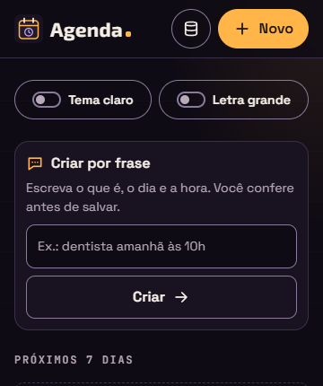
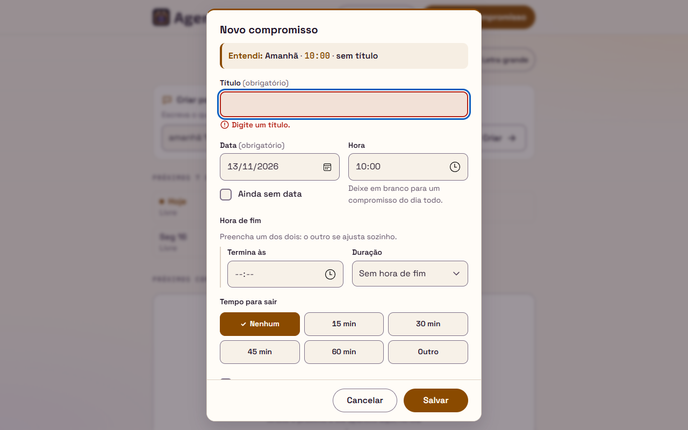

# Relatório de teste — Agenda, Etapa 4 (Entrega 4a)

- **Data:** 2026-11-09
- **O que foi testado:** a página `index.html` da Agenda com o arquivo novo `js/frase.js` (`entenderFrase(frase, agora)`, `partesDoEntendi` e `linhaDoEntendi`) e as mudanças em `js/app.js`, `css/style.css` e `README.md`, ainda sem commit, comparados com o último commit da Entrega 3b. Testei contra a Agenda **US24** (campo "Criar por frase"), **US25** (data), **US26** (hora), **US27** (título) e **US28** (rascunho com a linha "Entendi"), as decisões D1 a D4, a tabela das 52 frases da 4a, as mudanças da Etapa 4 nas stories anteriores (US01, US02, US03, US16, US22 e US23), os requisitos gerais da Etapa 4 e a regra "Captura rápida (Etapa 4)" da seção 3 dos [requisitos](../requisitos.md). O visual foi comparado com a seção 16 do [design](../design.md) (decisões da 16.13, contrastes da 16.11 e conferência da 16.12). A 4b (US29 a US32) não faz parte desta entrega.
- **Onde:** Microsoft Edge 157 (Chromium) **headless**, com perfil próprio numa pasta temporária, controlado por script, numa cópia do site servida por um servidor local no endereço `/agenda/`. Fuso `America/Sao_Paulo` e relógio **parado** em quinta-feira, 12/11/2026, às 14:00 (o "agora" da tabela). Para a virada do ano, o relógio foi parado em 31/12/2026 às 23:30. Larguras: 320, 360, 400, 480, 640 e 1280px, nos dois temas e nas duas letras. Também testei alto contraste (cores forçadas), movimento reduzido e `localStorage` bloqueado e cheio. A lógica da frase foi conferida também em Node, com um script meu, sem usar os testes do dev. **Não testei:** celular de verdade, leitor de tela de verdade (NVDA ou Narrador) e o GitHub Pages (a 4a ainda não foi publicada).

## Resultado

**Aprovado com pendências.** Conferi as 52 frases da tabela e mais **91 frases minhas**, com o resultado esperado escrito a partir das regras da seção 3 (e não a partir do código): as 143 deram o resultado das regras, em Node e no formulário aberto no navegador. No navegador foram **1.355 conferências**, e nenhuma falhou: campo, teclado, foco, leitor de tela (árvore de acessibilidade), larguras, contraste, `localStorage` e uma regressão rápida das Entregas 2a a 3b. Nenhum critério de aceite falhou. Ficam só pendências de gravidade baixa: os 3 casos levantados pelo dev (são o que as regras mandam, e a decisão de mudar é do PO) e um ano de 4 dígitos estranho ("0050") que mostra o ano errado na linha "Entendi". Não corrigi nada no código.

## Verificações

| Área | Resultado | Observação |
|---|---|---|
| Celular a 360px | Passou | Sem rolagem horizontal e sem nada passando da tela a 320, 360, 400, 480, 640 e 1280px, nos 2 temas × 2 letras, com a página e com o formulário aberto pelas frases #1, #25, #41, #42 e uma frase longa com `<b>`. Abaixo de 480px o botão "Criar" fica embaixo do campo, na largura toda; a partir de 480px, ao lado. Campo com 48px de altura (60px com a letra grande) e botão com 48px ou mais; letra do campo 16px (20px com a letra grande). O exemplo "Ex.: dentista amanhã às 10h" cabe inteiro em todas as larguras pedidas; só a 320px com a letra grande o "h" final fica escondido, como o design (16.3) já previa (fora dos requisitos). A tira "Entendi" quebra linha dentro da janela, sem nada cortado. |
| Teclado | Passou | Ordem do Tab: "Seus dados" → "Novo compromisso" → "Tema claro" → "Letra grande" → **campo da frase** → **"Criar"**. Enter no campo, clique, Enter e Espaço no botão abrem o formulário com o foco no Título. Campo vazio ou só com espaços: nada abre e o foco fica (ou volta) no campo. Esc e "Cancelar" fecham sem salvar, a frase continua no campo e o foco volta para ele. "Salvar" (botão ou Enter no Título) limpa o campo e devolve o foco a ele. Contorno de foco de 3px no campo e no botão, nos dois temas e nas duas letras (`:focus-visible`). |
| Acessibilidade | Passou | Pela árvore de acessibilidade do navegador: o campo se chama "Criar por frase", com a descrição "Escreva o que é, o dia e a hora. Você confere antes de salvar."; o botão se chama "Criar". Aberta pela frase, a janela é "Novo compromisso" com a descrição "Entendi: Amanhã, 10:00, título 'Dentista'." (o "·" não entra; entram as vírgulas escondidas), seguida da dica ou do aviso quando aparecem. Aberta por "Novo compromisso", "Editar", "Remarcar" ou "Agendar", a janela não tem descrição e a tira fica escondida. Nenhum `aria-live` na tira. "Sem título": o Título tem `aria-invalid="true"` e a descrição "Digite um título.". Alto contraste: painel e tira com borda sólida, como a 16.10.2. Movimento reduzido: nada novo anima. |
| Contraste | Passou | Medi as cores calculadas pelo navegador, com os fundos compostos (inclusive o âmbar 8% da tira), nos dois temas. Menor valor de texto: 5.97 ("Entendi:" e a hora, no claro). Não-texto: borda do campo 4.14 no claro (mínimo 3). Tabela abaixo. |
| Erros | Passou | Console sem erros e sem avisos em todos os cenários, inclusive com ``, ``, emoji, só pontuação e 200 caracteres (nenhum `alert` rodou). Nenhum arquivo deu 404. Frases "venenosas" de 200 caracteres ("às às às…", "ter as 1 ter as 1…", "1/1 1/1…") são entendidas em menos de 1 ms. `localStorage` bloqueado e cheio: comportamento certo (abaixo). |

### Contrastes medidos

| Elemento | Escuro | Claro | Mínimo | Design (16.11) |
|---|---|---|---|---|
| Rótulo "Criar por frase" | 15.8 | 16.6 | 4.5 | 15.8 · 16.6 |
| Dica do campo | 8.2 | 7.7 | 4.5 | 8.2 · 7.7 |
| Texto digitado | 16.9 | 15.1 | 4.5 | 16.8 · 15.1 |
| Exemplo (`placeholder`) | 8.8 | 7.0 | 4.5 | 8.7 · 7.0 |
| Texto do botão "Criar" · no hover | 15.8 · 14.5 | 16.6 · 13.7 | 4.5 | 15.8 · 14.5 / 16.6 · 13.7 |
| "Entendi:" e a hora | 8.95 | 5.97 | 4.5 | 9.0 · 6.0 |
| Data, "Dia todo", título, "sem título", texto da nota | 13.7 | 14.8 | 4.5 | 13.7 · 14.8 |
| "Ainda sem data" / "data a escolher" | 7.8 | 6.7 | 4.5 | 7.8 · 6.7 |
| Separador "·" (enfeite) | 7.1 | 6.9 | — | 7.1 · 6.9 |
| Erro "Digite um título." já visível | 7.2 | 6.4 | 4.5 | 7.2 · 6.4 |
| Não-texto: borda do campo (contra o painel · contra o fundo do campo) | 4.7 · 5.1 | 4.5 · 4.1 | 3 | 4.6 · 4.9 / 4.5 · 4.1 |
| Não-texto: borda do botão | 4.6 | 4.5 | 3 | 4.6 · 4.5 |
| Não-texto: balão do rótulo · ícone de alerta da nota | 10.3 · 8.95 | 6.7 · 5.97 | 3 | 10.4 · 9.0 / 6.7 · 6.0 |

## Critérios de aceite

**Agenda US24: Campo "Criar por frase"**
- [x] O campo fica logo abaixo da barra "Aparência" e antes de `#faixas` (conferido no HTML e na posição na tela, nas 24 combinações de largura, tema e letra). Aparece com a lista vazia, com dados, com faixas e com o `localStorage` bloqueado (a faixa do problema vem logo abaixo dele). Não é fixo.
- [x] Rótulo visível "Criar por frase"; `type="text"`, `maxlength="200"` (digitar 250 caracteres deixa 200), `autocomplete="off"`; exemplo "Ex.: dentista amanhã às 10h" dentro do campo, e o rótulo continua visível.
- [x] A dica "Escreva o que é, o dia e a hora. Você confere antes de salvar." fica entre o rótulo e o campo, ligada por `aria-describedby="frase-dica"`.
- [x] O botão "Criar" fica ao lado do campo a partir de 480px e embaixo dele abaixo disso.
- [x] Clique, Enter e Espaço em "Criar" e Enter no campo abrem o formulário preenchido. Nada é salvo nesse momento.
- [x] Campo vazio ou só com espaços: Enter, clique, Enter e Espaço no botão não abrem nada, sem mensagem, e o foco fica no campo.
- [x] O formulário abre com o título "Novo compromisso". Salvar dá "Compromisso salvo." (amanhã), "Compromisso salvo em Anteriores." ("festa 10/11/2025") e "Anotado em Sem data." ("comprar pão").
- [x] Depois de Salvar (botão ou Enter no Título), o campo fica vazio e o foco volta para ele.
- [x] Depois de Cancelar ou Esc, nada é salvo, a frase continua no campo e o foco volta para ele.
- [x] `localStorage` cheio: "Não foi possível salvar o compromisso." aparece dentro do formulário, ele continua aberto e a frase continua no campo (também depois de Esc).
- [x] A frase aparece como texto: `<b>oi</b>`, `` e `` ficam com os sinais `<` e `>` no Título e na linha, sem criar elemento nenhum e sem rodar nada.
- [x] Abrir e cancelar não muda nenhuma chave do `localStorage` (comparei todas as chaves antes e depois das 64 frases abertas e fechadas com Esc, e do "Cancelar"), nem `agenda:ultima-mudanca`.
- [x] "Novo compromisso" continua igual: formulário vazio, data de hoje, sem a linha "Entendi", sem descrição na janela, e o foco volta para ele ao fechar.

**Agenda US25: Entender a data da frase**
- [x] "hoje", "amanhã", "depois de amanhã", dias da semana por extenso e abreviados (com e sem ponto, com e sem acento, em maiúsculas), "dia 15", "15/11" e "15/11/2027" (frases 1 a 24, 26 e minhas 91).
- [x] As palavras de ligação saem junto ("na sexta", "para o dia 20", "até sexta", "próxima sexta", "pra amanhã:").
- [x] Sempre a próxima no futuro, com a regra "passou": "aula quinta 15h" → hoje; "aula quinta 10h" → 19/11; "aula quinta 14h" → hoje às 14:00:59 e 19/11 às 14:01; "pagar luz dia 12 às 9h" → 12/12; "consulta 10/11" → 2027; "29/02" → 2028 (e 2032 com o "agora" em 01/03/2028).
- [x] "hoje", "amanhã", "depois de amanhã" e datas com ano usadas como estão ("plantão hoje meia-noite" → hoje às 00:00; "festa 10/11/2025" → 2025).
- [x] Data que não existe ("31/02", "15/13", "0/11", "29/02/2027"): Data vazia, "Ainda sem data" desmarcada, o texto fica no título e aparece "A data 31/02 não existe. Escolha uma data.". Salvar mostra "Escolha uma data." e põe o foco na Data.
- [x] "dia 32" e "dia 0" ficam no título, sem aviso.
- [x] Número sozinho não vira data ("aula 3 sexta" → "Aula 3").
- [x] Duas datas: vale a primeira ("amanhã hoje" → amanhã, título "Hoje"). Data inexistente seguida de uma válida: vale a válida, sem aviso ("festa 31/04 ou 10/12").
- [x] Hora sem data: hoje se não passou, amanhã se passou (D1: "reunião 16h" → hoje; "reunião 14h" → hoje; "plantão meia-noite" → amanhã). Sem data e sem hora: "Ainda sem data" marcada, com Data e Hora desativadas (US16) e a dica.
- [x] A análise fica numa função sem tela, `entenderFrase(frase, agora)` em `js/frase.js`, carregada depois de `js/datas.js`. Usei essa função no meu script de Node.

**Agenda US26: Entender a hora da frase**
- [x] "10h", "10H", "10h30", "10:30", "às 10", "as 10", "às 10h", "às 10 horas", "meio-dia", "meia-noite", "meia noite", "8 da noite", "7h30 da manhã", "8:15 da noite", "3 da tarde", "12 da tarde", "15h da tarde", "0h", "00:00".
- [x] As ligações "às", "as", "à", "a" e "ao" saem junto ("ao meio-dia", "à meia noite", "pagar a 10h").
- [x] Fora dos limites fica no título: "25h", "24:00", "10h75", "10:5".
- [x] Sem adivinhar: "aula às 3 com o João" → 03:00 (amanhã, pela D1).
- [x] "as" comum fica: "buscar as crianças", "buscar as 2 crianças", "jogo as 10 crianças". "às N" com palavra de ligação ou pedaço depois é hora ("às 10 amanhã", "às 10 no centro").
- [x] Número sozinho não vira hora ("comprar 2 pães amanhã", "reunião 10 horas amanhã").
- [x] Duas horas: vale a primeira ("reunião 9h 10h" → 09:00, título "Reunião 10h").
- [x] Sem hora: dia todo (Hora vazia).

**Agenda US27: O título é o que sobra da frase**
- [x] O título guarda acentos e maiúsculas como foram digitados ("DENTISTA", "Médico", "Rua 15").
- [x] "às", "no", "na", "dia" e "para" só saem quando são de um pedaço.
- [x] Pedaços não usados ficam como foram digitados ("Reunião ou sexta 11h", "Festa 31/02", "Reunião 25h").
- [x] Limpeza: espaços repetidos, espaço antes de pontuação, sinais e "e" solto das pontas ("reunião e amanhã e" → "Reunião"; "reunião – amanhã – 10h" → "Reunião"), corte em 100 caracteres sem espaço no fim, primeira letra maiúscula (emoji no começo fica como está).
- [x] "Dentista, amanhã, 10h." → "Dentista"; "DENTISTA amanhã" → "DENTISTA".
- [x] Título vazio ("amanhã 10h", "às 3", ",,, ;;"): erro "Digite um título." já visível, `aria-invalid="true"`, foco no Título; data e hora continuam preenchidas. Escrever um título e salvar funciona.

**Agenda US28: Rascunho no formulário com a linha "Entendi"**
- [x] Título, Data, Hora e "Ainda sem data" preenchidos; o resto como no "Novo compromisso". Desmarcar "Ainda sem data" reativa a Data (US16).
- [x] Linha logo abaixo do título da janela, na ordem data · hora · título, com "Hoje", "Amanhã", "Sáb, 14/11", "Seg, 15/11/2027", "Ainda sem data", "data a escolher", "Dia todo", "título '…'" e "sem título". Conferi a linha das 64 frases no navegador contra um montador meu, escrito pelas regras.
- [x] Exemplos dos requisitos idênticos, inclusive "Entendi: data a escolher · título 'Festa 31/02'".
- [x] Dica "Não encontrei data nem hora. Confira os campos." só quando não há nenhum pedaço de data e de hora ("comprar pão", "ter aula de inglês", "prova dia 32").
- [x] Aviso de data que não existe no mesmo lugar, sem a dica ("festa 31/02 20h" mostra "data a escolher · 20:00").
- [x] Linha, dica e aviso em texto, AA nos dois temas, quebrando linha a 320 e 360px sem rolagem.
- [x] Leitor de tela: a janela fica ligada à tira por `aria-describedby="entendi"` só quando aberta pela frase; o "·" tem `aria-hidden` e há vírgulas escondidas; sem `aria-live`.
- [x] Foco no Título (com ou sem o erro já visível, que é o primeiro campo com erro).
- [x] A linha não muda quando a pessoa corrige o Título e a Hora, nem depois de tentar salvar.
- [x] Em "Novo compromisso", "Editar", "Remarcar" e "Agendar" a linha não aparece e a janela não tem `aria-describedby`.

**Mudanças nas stories anteriores e requisitos gerais da Etapa 4**
- [x] US01: ordem da página Aparência, Criar por frase, faixas, Ficou pendente, Próximos 7 dias, Próximos compromissos, Sem data, Anteriores.
- [x] US02, US03, US16: conferidos acima.
- [x] US22 e US23: tema claro e letra grande cobrem o painel e a tira (prints abaixo).
- [x] 360px: campo e botão sem rolagem, letra de 16px, 44px de toque. Letra grande a 360px: sem rolagem e sem nada cortado.
- [x] Teclado: Tab chega ao campo logo depois de "Letra grande" e ao "Criar" logo depois.
- [x] "Entendi", "Ainda sem data", "Dia todo", "data a escolher", a dica e os avisos são texto.
- [x] Só JavaScript puro: `frase.js` não tem biblioteca nem `fetch`; nada vai para a internet.
- [x] Qualquer frase de até 200 caracteres abre sem demora e sem erro (pontuação, emoji, `<script>`).
- [x] Continua `versao: 2`, sem chave nova; só chaves `agenda:`; nenhum `localStorage.clear()`.

**Regressão rápida (Entregas 2a, 2b, 3a e 3b)**
- [x] "Novo compromisso" à mão com checklist ("RG") e duração de 1 h: salva, o card mostra "09:00 – 10:00" e a faixa da semana conta "Sáb 14: 1 compromisso".
- [x] "Editar" abre com os dados (sem a linha "Entendi"), salva com "Compromisso atualizado." e devolve o foco ao "Editar".
- [x] "Remarcar" de um item pendente (com "Era para:") e "Agendar" de um item sem data abrem sem a linha "Entendi".
- [x] "Tema claro" e "Letra grande" ligam, gravam em `agenda:preferencias` e continuam depois de recarregar.
- [x] "Seus dados": a cópia baixada tem o compromisso; importar a cópia com "Juntar" deixa os 2 compromissos, na `versao: 2`.
- [x] `localStorage` bloqueado: a página abre com a faixa do problema, a frase abre o formulário e salvar fecha e limpa o campo (só na memória).

Esta regressão é um roteiro curto. Não rodei de novo os roteiros completos das entregas anteriores (cerca de 530 conferências), porque a 4a só acrescenta código e não muda nenhuma função antiga, a não ser `abrirFormulario` e `salvarFormulario`, que estão cobertas acima.

## Os 3 casos levantados pelo dev

| Caso | O que acontece | Pelas regras | Gravidade |
|---|---|---|---|
| 1. "para ter aula" | Vira terça, 17/11, com o título "Aula". | **Conforme.** A D2 diz que "ter" conta como dia "logo depois de uma palavra de ligação de data", e "para" está na lista de ligações. O código faz exatamente o que a regra manda. Fica pior em "para ter aula amanhã": vale a primeira data (terça) e "amanhã" fica no título ("Aula amanhã"). A pessoa vê "Ter, 17/11" na linha "Entendi" antes de salvar. | Baixa. **Pendência para o PO**, não para o dev: aceitar só "na", "no", "nesta", "neste", "próxima" e "próximo" antes de "ter" e "dom", ou deixar como risco aceito, como a D4. |
| 2. "comprar vitamina E amanhã" | O título fica "Comprar vitamina", sem o "E". | **Conforme.** A limpeza tira "um 'e' solto" das pontas, e a regra 1 manda comparar sem diferença de maiúsculas. "plano E sexta" também vira "Plano". O título é visível na linha "Entendi" e no campo. | Baixa. Sugestão ao PO: só tirar o "e" que estava colado num pedaço que saiu ("reunião amanhã e" → "Reunião"), ou só o "e" minúsculo. |
| 3. "15/11/27" (ano com 2 dígitos) | Nada é entendido: o título fica "Festa 15/11/27", "Ainda sem data" marcada e a dica aparece. | **Conforme.** A tabela da seção 3 só aceita "/ano de 4 dígitos", e a regra 2 ("palavra inteira") impede ler só o "15/11" e deixar o "/27" sobrando. É o resultado mais seguro: nada some do título e a dica avisa. Um cuidado: "festa 15/11/27 20h" entende só a hora e vai para **hoje** às 20:00 (D1), sem a dica, porque uma hora foi entendida. A linha mostra "Hoje · 20:00 · título 'Festa 15/11/27'", então a pessoa vê. | Baixa. Pode virar evolução (aceitar "/AA" como 20AA). |

## Problemas encontrados

Nenhum problema de gravidade alta. Pendências:

**1. Ano de 4 dígitos começando com "00" mostra outro ano na linha "Entendi"** (status: pendente)
- **Página:** `index.html`, formulário aberto pela frase.
- **Passos:** escrever "festa 15/11/0050" no campo da frase e apertar Enter.
- **Esperado:** pela regra, "D/M/AAAA" é usada como está. A linha deveria mostrar a mesma data que o campo Data (ou a frase poderia ser tratada como data que não existe, a decidir).
- **Obtido:** o campo Data recebe `0050-11-15`, mas a linha mostra "Entendi: Qua, 15/11/1950 · Dia todo · título 'Festa'", porque o `textoParaData` de `datas.js` usa `new Date(ano, …)`, que troca os anos 0 a 99 por 1900 a 1999. Ao salvar, `dataValida` recusa a data e aparece "Escolha uma data.", então nada errado é gravado. Conferido no Node; o comportamento ao salvar foi conferido por leitura do código.
- **Gravidade:** baixa (ninguém escreve o ano 0050, e a data não é salva). Sugestão para o dev: no `dataEm` do `frase.js`, tratar ano menor que 1000 (ou fora de uma faixa, como 1900 a 2100) como data que não existe, com o aviso de sempre. Não corrigi porque é uma decisão de regra (qual faixa de anos aceitar), não um erro óbvio.

**2. Os 3 casos do dev** (status: pendente, decisão do PO): ver a tabela acima. Nenhum quebra critério de aceite.

### Observações (não são problemas)

- **A. Vírgulas com espaço antes na árvore de acessibilidade.** O Chrome monta a descrição da janela como "Entendi: Amanhã , 10:00 , título 'Dentista' ." (com espaço antes da vírgula e do ponto), porque as vírgulas escondidas (`.sr-only`, com `position: absolute`) contam como blocos separados. Na fala não muda nada: a vírgula continua dando a pausa e nenhum "ponto" do "·" é lido. Conferir com o NVDA ou o Narrador (abaixo).
- **B. Outros resultados que seguem as regras mas podem surpreender** (todos aparecem na linha "Entendi" antes de salvar): "pagar até a próxima sexta" → título "Pagar até a" (só uma palavra de ligação sai junto com a data); "show sábado às 9 e meia" → 09:00, título "Show e meia" ("e meia" não está na tabela de horas); "buscar as 2, depois mercado" → 02:00 (a vírgula depois de "as 2" confirma a hora); "comprar 1/2 kg de carne" → 01/02/2027 (risco aceito nos requisitos). Sugestões para o PO na 4b ou depois.
- **C. Exemplo a 320px com a letra grande.** O "h" final de "Ex.: dentista amanhã às 10h" fica escondido até a pessoa digitar, como o design 16.3 já tinha previsto. Os requisitos pedem 360px, e a 360px ele cabe inteiro.
- **D. O dev não mudou nenhuma regra antiga.** As funções de `datas.js` são só usadas pelo `frase.js`; as mudanças no `app.js` são o painel, `preencherRascunho`, `prepararEntendi`, `montarLinhaEntendi`, `criarPelaFrase` e três linhas em `abrirFormulario`, `salvarFormulario` e no `close` da janela.
- **E. README.md** do projeto: a nova funcionalidade, o uso de expressões regulares e o `frase.js` na estrutura de pastas estão descritos certos.

## Prints

## Como foi testado (o que foi de verdade e o que foi por leitura)

- **Lógica da frase (Node, script meu):** carreguei `js/datas.js` e `js/frase.js` num contexto isolado, com o fuso `America/Sao_Paulo`, e comparei `entenderFrase` e `linhaDoEntendi` com uma lista de resultados que escrevi a partir das regras da seção 3: as 52 frases da tabela e 91 frases minhas (acentos e maiúsculas, "as" comum, números no título, "Rua 15", "2 pães", "ter aula", "dom", "próxima/esta/nesta", "dia 31" em mês de 30 dias, "dia 30" depois de janeiro, 29/02 em vários anos, "15/11" já passado, virada de mês e de ano com o "agora" em 31/12 23:30, 15/04 e 31/01, a fronteira 14:00:59 / 14:01, "25h", "10h75", "10:5", "24:00", "meia-noite" com e sem data, "da manhã/tarde/noite" fora da tabela, frases longas, emoji, HTML, só pontuação e os 3 casos do dev). Resultado: 143 de 143 iguais às regras, todas em menos de 50 ms, e 10 frases "venenosas" de 200 caracteres em menos de 1 ms.
- **No navegador (Edge headless, por script):** as 52 frases da tabela e 12 minhas abertas pelo campo, conferindo os campos, a linha (texto visto e texto lido), a nota, o erro, o foco, o `aria-describedby`, Esc e o `localStorage`; a árvore de acessibilidade do campo, do botão e da janela; o campo vazio; Salvar, Cancelar e Esc; `localStorage` cheio e bloqueado; o Tab; o foco visível; 24 combinações de largura, tema e letra; o contraste; alto contraste e movimento reduzido; a regressão rápida; e 4 frases com o "agora" em 31/12/2026 23:30. Total: 1.355 conferências, nenhuma falha.
- **Por leitura do código:** o `diff` de `index.html`, `js/app.js`, `css/style.css` e `README.md`, e o `js/frase.js` inteiro. O caso do ano "0050" ao salvar.
- Os scripts ficaram na pasta temporária, fora do projeto. O Edge foi aberto com perfil próprio e fechado no fim (nenhum processo sobrou).

## Conferência manual (para o João)

1. No celular, escrever "dentista amanhã às 10h" e tocar em "Ir" no teclado: o formulário abre preenchido.
2. Com o NVDA ou o Narrador, abrir pela frase e ouvir "Novo compromisso, caixa de diálogo, Entendi: Amanhã, 10:00, título Dentista" **uma vez só**, sem "ponto". Depois abrir "Novo compromisso" e "Editar" e confirmar que a linha não é lida.
3. Escrever "festa 31/02", tocar em "Criar" e conferir o aviso dentro da tira.

## Aulas do Módulo 5 — 2026-11-11

- **O que foi testado:** as 4 aulas novas da Agenda na Labs (`aulas/agenda/modulo-5/aula-01.md` a `aula-04.md`) e as mudanças nestes arquivos:
  - `data/aulas.json`: módulo `agenda-m5` e 4 aulas (e a vírgula solta que foi tirada entre `agenda-m3` e `agenda-m4`);
  - `data/glossario.json`: 9 termos novos (expressão regular, exec, normalize, replace, toLowerCase, lastIndex, lookahead, função pura e getDay);
  - `data/projetos.json`: trabalho do professor da 4a e linha do tempo da Agenda;
  - `README.md` da raiz: 39 aulas.

  O teste foi feito antes do commit da Labs, do mesmo jeito que o das aulas do Módulo 4 (relatório `etapa-3b.md`). Segui o guia `docs/guias/aulas.md` e a regra do João de que nenhum exercício manda mexer no código de um projeto. Desta vez **não corrigi nada nas aulas**: só descrevo os problemas e a correção sugerida.
- **Onde:** no Edge headless, com perfil temporário, controlado por script. O site da Labs foi servido por um servidor local, com marked e highlight.js carregados pelo CDN. Testei a 1280px, 360px e 320px, nos temas escuro e claro ("papel"). Comparei os links fixos com o repositório local da Agenda, que está no commit `48ba5def7ca4d5d6fad01f42271b787fbd74a611`, sem nenhuma mudança. Esse commit está em `origin/main`, e as páginas de `js/frase.js`, `js/datas.js` e `js/app.js` nesse commit responderam 200 no GitHub.

### Resultado

**Reprovado.** Volta para o professor por **um** problema de gravidade alta, que tem uma correção pequena: na aula 5.2, a faixa dos acentos da regex está escrita com os próprios caracteres invisíveis (U+0300 e U+036F), e não com o texto `̀-ͯ`. Na tela, o `replace` aparece quase como `replace(/[-]/g, "")`. Assim o João não consegue ler nem digitar a parte central da aula, e a Dica "Para ir além" diz o contrário do que a aula mostra (problema 1).

Todo o resto passou:
- os 6 exemplos rodam e o Console mostra exatamente o que o texto diz, linha por linha;
- os 10 quizzes funcionam, e a resposta marcada como certa está certa;
- os 17 links fixos usam o commit `48ba5de` e mostram o que o texto diz;
- os exercícios só mexem no exemplo da aba Aulas.

Também há dois detalhes de texto de gravidade baixa (problemas 2 e 3).

### Verificações

| Área | Resultado | Observação |
|---|---|---|
| Celular a 360px e 320px | Passou | Sem rolagem horizontal nas 4 aulas (antes e depois de Rodar os 6 exemplos), em `aulas.html#agenda-m5` e em `detalhe-projeto.html?id=agenda`. A tabela da aula 5.1 (385px) fica dentro do `.tabela-rolagem` (com `tabindex="0"` e nome "Tabela") e rola por dentro. Os blocos de código terminam dentro da tela e rolam por dentro. |
| Teclado | Passou | O Tab passa por Rodar, Editar, a tabela rolável, os termos do glossário, os links fixos, as alternativas do quiz e o checklist, com foco visível em todos. Cada balão abre com Enter e fecha com Esc, e o foco fica no termo. O quiz responde com Enter, e o "Tentar de novo" funciona com Espaço. Os botões "Agenda" e "João Saccucci Labs" de `aulas.html` trocam com Enter e Espaço. (O roteiro acusou "foco sem contorno" no `body` quando o Tab passa do fim da página e volta ao começo. É o mesmo comportamento antigo das aulas dos Módulos 3 e 4, e não é das aulas.) |
| Acessibilidade | Passou | Os componentes são os mesmos da Labs. O aviso do Rodar conta certo ("3", "5", "5", "5", "2" e "5 linhas no console"). Depois de responder, as alternativas ficam com `aria-disabled="true"`, e todas as explicações aparecem. O título da aba segue o padrão (`Aula 5.4 · Uma função pura que recebe o "agora" \| João Saccucci Labs`). O sumário tem as seções de cada aula. A faixa invisível da aula 5.2 também atrapalha o leitor de tela (problema 1). |
| Contraste | Passou | Medido nas cores calculadas, nos dois temas (escuro / claro): termo do glossário 16,7 / 15,3; código no texto 15,6 / 13,9; texto 7,9 / 6,7; rótulo do Linha por linha 14,8 / 5,3; célula da tabela (aula 5.1) 16,7 / 15,3. Tudo acima de 4,5. |
| Erros | Passou | Sem erro no console nas 4 aulas, em `aulas.html`, no detalhe da Agenda, em 3 aulas de amostra (a primeira e a última da Labs e a 3.1 da Agenda) e com um id que não existe (`agenda-m5-aula-09` mostra "Aula não encontrada." e "Ver todas as aulas"). O único 404 foi o `/favicon.ico`, que o navegador pede na raiz do servidor de teste. Os 3 JSON alterados são válidos. |

### Conferências

**1. `aulas.html`, progresso e vitrine**
- [x] No botão "Agenda" aparece o "Módulo 5 — Entrega 4a: criar compromisso por frase", logo depois do Módulo 4. Ele tem as 4 aulas (5.1 a 5.4, `tempoLeitura` 7, 6, 7 e 7) e os links `aula.html?id=agenda-m5-aula-01` a `-04`. São 20 cards da Agenda e 19 da Labs.
- [x] Progresso: no começo, aparecem "Agenda, 0 de 20 concluídas" e "0 de 4 concluídas" em cada um dos 5 módulos. Depois de marcar a 5.1 e a 5.4 como concluídas, aparecem "Agenda, 2 de 20 concluídas" e, no Módulo 5, "2 de 4 concluídas". Os Módulos 1 a 4 continuam em 0 de 4, e a Labs em 0 de 19.
- [x] O `aulas.html#agenda-m5` mostra o módulo na tela a 1280px, 360px e 320px.
- [x] O `detalhe-projeto.html?id=agenda` (a 1280px e a 360px) mostra:
  - o trabalho do professor da 4a ("Etapa 4, Entrega 4a: 4 aulas curtas…", com "Aulas — Agenda, Módulo 5" → `aulas.html#agenda-m5` e o Glossário);
  - a linha nova da linha do tempo ("4 aulas da Entrega 4a, com exemplo Rodar e quiz, no Módulo 5 da Agenda.");
  - os links dos Módulos 1 a 4, que continuam lá.

  Clicando no link do Módulo 5 e depois no card 5.4, a aula 5.4 abre.
- [x] README da raiz: 39 aulas está certo (19 da Labs e 20 da Agenda).

**2. Cada aula em `aula.html`**
- [x] Têm Em resumo (2 linhas), Erro comum, Dica "Para ir além (opcional)" e Em entrevista. A 5.1 também tem uma caixa Palavra nova.
- [x] O glossário funciona com todos os termos, e nenhum `[[` ou `]]` sobra no texto. Os únicos `[[` da página são os da tabela dentro do código da aula 5.4 (`[[5, false, "13/11"], …]`), que é JavaScript de verdade. Termos de cada aula:
  - aula 1: expressão regular, exec, null, forEach, early return, join;
  - aula 2: normalize, replace, toLowerCase, slice, trim;
  - aula 3: lastIndex, lookahead, Map;
  - aula 4: função pura, localStorage, getDay, Date, continue.
  - Os 9 termos novos mostram a explicação certa. Nenhum repete um termo que já existia, nem ignorando maiúsculas. O único par repetido continua sendo `map`/`Map`.
  - `replace` e `exec` não colidem com nada. O glossário só marca o que está entre `[[ ]]`, então "exec" dentro de "executar" e "replace" no código não viram balão.
  - **`Map` da aula 3 mostra a explicação certa** ("mapa — Estrutura que guarda um valor para cada chave…"). Como o `aula.js` busca em minúsculas e o `Map` vem depois do `map` no `glossario.json`, o `[[Map]]` acerta. A pendência continua para quem escrever `[[map]]` (observação B).
- [x] O código aparece colorido. Há 6 exemplos com Rodar (2 na 5.1, 1 na 5.2, 2 na 5.3 e 1 na 5.4), com 10, 4, 12, 12, 3 e 15 linhas. Todos têm até 15 linhas e não dependem do código da Agenda.
- [x] O Linha por linha está ligado a cada exemplo e cita as linhas certas. Conferi cada item com o código:
  - 5.1: L1, 2, 3–4, 5–8, 9 e L1, 2–3;
  - 5.2: L1–3, 4, 5, 6, 8–9, 10, 11, 12;
  - 5.3: L1, 2–6, 7, 8, 9, 10, 11, 12 e L1, 2, 3;
  - 5.4: L1, 2–3, 4, 5, 6, 9, 10, 11–14, 15.
- [x] O Rodar mostra exatamente o que o texto diz, linha por linha:
  - 5.1 (exemplo 1): `consulta 15/11 -> achou 15/11 | dia 15 | mês 11 | posição 9`, `festa 31/02 às 20h -> achou 31/02 | dia 31 | mês 02 | posição 6` e `comprar 2 pães -> nenhuma data`;
  - 5.1 (exemplo 2): `sexta true`, `Sexta-feira true`, `SEXTA-FEIRA true`, `sextas false` e `sexta- false`;
  - 5.2: `amanha sabado terca-feira`, `true`, `1 2`, `medico amanha | posição 7` e `Título: Médico`;
  - 5.3 (exemplo 1): `não achou`, `não achou`, `achou, termina em 15`, `0` e `12`;
  - 5.3 (exemplo 2): `true 12` e `false 0`;
  - 5.4: `5 false -> 13/11 ok`, `4 false -> 12/11 ok`, `4 true -> 19/11 ok`, `0 false -> 15/11 ok` e `7/1`. 12/11/2026 e 31/12/2026 são mesmo quintas-feiras.
- [x] Editar abre o código num campo de texto, o código editado roda, e Restaurar volta ao original (nos 6 exemplos).
- [x] Quizzes: a 5.1 e a 5.2 têm 2, e a 5.3 e a 5.4 têm 3. Todos têm 3 alternativas, menos o segundo da 5.3, que tem 2 (o guia aceita de 2 a 5). Cada um tem **exatamente uma certa**: a B em todos, menos o primeiro da 5.2 (C) e o segundo da 5.2 (A).
  - Testei cada quiz duas vezes, em páginas limpas. Clicando na certa, aparece "Certa!". Respondendo uma errada com Enter, aparece "Errada. A resposta certa é a …". Nos dois casos, todas as explicações aparecem e o quiz trava. O "Tentar de novo" limpa a resposta.
  - Conferi as respostas certas:
    - `achado[2]` de "festa 31/02" é o texto "02";
    - o "2" sozinho não tem a forma de nenhuma data (a regex da Agenda pede "dia 2" ou "2/…");
    - `simplificar("AÇÃO")` dá "acao";
    - com `y`, `lastIndex = 1` e "terminar na ter", o `exec` devolve `null`;
    - o lookahead não entra no pedaço;
    - "ter aula" não vira terça pela regra D2 (`frase.js`, linhas 134 a 138);
    - "aula quinta 10h" com o "agora" de quinta, 14:00, dá 19/11;
    - a função que grava no `localStorage` é a que não é pura.

**3. Navegação**
- [x] A 4.4 agora leva à 5.1, a 5.1 volta para a 4.4, e a 5.4 não tem "próxima".

**4. Links fixos** (17 links, todos com o hash completo `48ba5def7ca4d5d6fad01f42271b787fbd74a611` e nenhum com `/blob/main/`)
- [x] Aula 1:
  - `frase.js#L81-L94`: a `EXPRESSAO_DATA` inteira, com o comentário do número de cada grupo e a flag `y`;
  - `#L129-L162`: os ramos da `dataEm` (relativa, dia da semana, "dia 15", "15/11") e a conferência com a `diasNoMes`. O aviso "A data 31/02 não existe." está no `app.js`, linha 1814;
  - `#L73-L84`: a lista `LIGACOES_DE_DATA`, com as compridas antes das curtas, e o `new RegExp` com `join("|")` e `"\\s+"`. É verdade que a Agenda não usa a flag `i`.
- [x] Aula 2:
  - `frase.js#L25-L41`: o comentário e a `prepararFrase` inteira, letra por letra, com `if (simples.length !== 1) simples = letra;`;
  - `#L435-L437`: o começo da `entenderFrase`, com `acharPecas(prepararFrase(texto))`;
  - `#L405-L415`: a `tirarPecas` inteira, que corta a frase original.
- [x] Aula 3:
  - `frase.js#L349-L365`: a `acharPecas` inteira (pula para o fim do pedaço ou anda uma letra);
  - `#L46-L56`: a `comecoDePalavra`;
  - `#L329-L347`: a `pecaEm`, com `contexto.memoria` e "fica com a mais comprida" (`data.fim >= hora.fim`);
  - `#L64-L66`: a `FIM_DE_PALAVRA`, com `(?![a-z0-9]|[/:]\\d)`;
  - `#L121-L124`: o `EXPRESSAO_DATA.lastIndex = posicao` e o `exec`;
  - `#L134-L138`: a regra D2 do "ter"/"dom". O `contexto.memoria` é mesmo um `Map` (linha 352).
- [x] Aula 4:
  - `frase.js#L425-L470`: o comentário com tudo o que a função devolve e a `entenderFrase` inteira;
  - `#L181-L190`: o laço `somar <= 7` da `resolverData`, com `getDay` e `passou`;
  - `datas.js#L80-L96`: o comentário e a `compromissoPassou` inteira;
  - `app.js#L1851-L1862`: a `criarPelaFrase`, que lê `new Date()` uma vez e passa o mesmo `agora` para a `entenderFrase` e para o formulário;
  - `frase.js#L1-L18`: o comentário do topo, com o exemplo de chamada com um "agora" fixo.

**5. Conteúdo**
- [x] As afirmações batem com o código da Agenda no commit `48ba5de`, menos as dos problemas 1 a 3. Exemplos:
  - a cópia simplificada tem o mesmo tamanho da original;
  - "DENTISTA amanhã" dá "DENTISTA", porque a `limparTitulo` só põe a primeira letra em maiúscula;
  - o objeto devolvido tem `titulo`, `data`, `hora`, `semData`, `dataInexistente` e `nadaEntendido`;
  - o testador conferiu as 52 frases com quinta, 12/11/2026, 14:00 (relatório da 4a, acima).
- [x] As aulas citadas existem: a 4.4 da Agenda (`new Date(ano, mês, dia + i)`), e a 5.2 e a 5.3, que são deste módulo.
- [x] **Nenhum exercício manda mexer no código da Agenda ou da Labs.** Todos os itens de "Para praticar" mexem no exemplo da aba Aulas. Rodei cada um no editor do próprio exemplo:
  - 5.1:
    - com `"reunião 5/1/2027"`, aparece `achou 5/1 | dia 5 | mês 1 | posição 8`, e o ano some, como a pergunta quer mostrar;
    - com `\d` no lugar de `\d{1,2}`, "consulta 15/11" acha `5/1` (posição 10), e "festa 31/02" acha `1/0`.
  - 5.2:
    - `simplificar("Próxima SEXTA")` dá `proxima sexta`;
    - sem o `.normalize("NFD")`, aparecem `amanhã sábado terça-feira`, `false`, `médico amanhã | posição -1` e `Título: Médico AMANH`, o título errado que a pergunta pede para explicar.
  - 5.3:
    - sem o lookahead, só a linha 8 muda (`achou, termina em 3`);
    - com `"academia na ter 10h"`, `acharEm(frase, 12)` dá `achou, termina em 15`.
  - 5.4:
    - `[6, false, "14/11"]` dá ok;
    - com o "agora" de sexta, 13/11, 9:00, só a linha `4 false` dá "FALHOU, esperado 12/11" (o erro está na tabela, não na função).
- [x] Tamanho:
  - de cerca de 700 a 980 palavras fora do código;
  - `tempoLeitura` de 6 ou 7;
  - 2 itens em "Para praticar" em cada aula;
  - quiz nas 4 aulas.
- [ ] **Aula 5.2 legível na tela e no GitHub**: falhou (problema 1).

### Problemas encontrados

**1. Aula 5.2: a faixa dos acentos está escrita com caracteres invisíveis** (gravidade: **alta**; status: pendente, volta para o professor)
- **Onde:** `aula-02.md`, em 6 lugares:
  - linha 14, 3 vezes: no `replace`, no "de … a …" e no fim do mesmo item;
  - linha 25: o exemplo;
  - linha 54: a Dica "Para ir além";
  - linha 57: o Em entrevista.
- **Passos:** abrir `aula.html?id=agenda-m5-aula-02` (ou o `.md` no GitHub) e ler o passo 2 de "O conceito" e a Dica "Para ir além".
- **Esperado:** a regex aparece legível, como `/[̀-ͯ]/g`. O texto "de … a …" mostra os dois códigos (`̀` e `ͯ`). A Dica explica que o `frase.js` usa os caracteres invisíveis e que o exemplo usa a forma legível.
- **Obtido:** o arquivo tem os próprios caracteres U+0300 e U+036F (acentos "soltos", sem letra para ficar em cima), e não o texto `̀-ͯ`. Conferi byte a byte: não há nenhum `̀` no arquivo.
  - Na página, a regex aparece quase como `/[-]/g`, e o "de … a …" mostra duas caixinhas quase vazias.
  - A Dica diz "Escrever [a faixa], como no exemplo, dá o mesmo resultado e é mais fácil de ler". Só que aparece um borrão, e o exemplo usa a mesma forma ilegível do `frase.js` (linha 36). A frase contradiz o que a aula mostra.
  - A resposta de "Em entrevista" também fica impossível de ler e de repetir.
  - O Rodar funciona e dá a saída certa, porque os caracteres estão lá. Mas o João não consegue ler nem digitar a parte central da aula (o passo 2 dos três), e o leitor de tela também não lê a faixa.
- **Correção sugerida:** trocar os caracteres invisíveis pelo texto `̀-ͯ` nos 6 lugares:
  - na linha 14, `(/[̀-ͯ]/g, "")` e "de `̀` a `ͯ`";
  - na linha 25, `.replace(/[̀-ͯ]/g, "")`;
  - na linha 54, "Escrever `̀-ͯ`, como no exemplo…";
  - na linha 57, `replace(/[̀-ͯ]/g, "")`.

  A saída do Rodar não muda. Conferi em Node: continua `amanha sabado terca-feira`, e `simplificar("AÇÃO")` continua `acao`. O exemplo continua com 12 linhas. Depois de salvar, vale conferir se o editor não trocou o `̀` de volta pelo caractere.

**2. Aula 5.1: a pergunta do segundo quiz está confusa** (gravidade: baixa; status: pendente)
- **Onde:** `aula-01.md`, linha 92.
- **Passos:** ler a pergunta "Por que a Agenda não diz "Amanhã" quando alguém escreve "comprar 2 pães amanhã" com o 2 virando data?".
- **Esperado:** a pergunta deixa claro que o assunto é o "2" não virar data.
- **Obtido:** na frase "comprar 2 pães amanhã", a Agenda **diz** "Amanhã" (o "amanhã" é achado), então a pergunta parece afirmar o contrário. A resposta certa e as explicações estão corretas.
- **Correção sugerida:** "Em "comprar 2 pães amanhã", por que o 2 não vira data (e fica no título)?".

**3. Aula 5.3, Dica "Para ir além": a regra do "às 10" está simplificada e o link não mostra essa regra** (gravidade: baixa; status: pendente)
- **Onde:** `aula-03.md`, linha 65.
- **Passos:** ler "'às 10' só é hora se depois vier outro pedaço" e abrir o link `frase.js#L134-L138`.
- **Esperado:** o texto descreve a regra e o link mostra as duas regras citadas.
- **Obtido:**
  - pela `horaConfirmadaDepois` (linhas 244 a 258), "às 10" também é hora no fim da frase, antes de uma pontuação ou antes de uma das `PALAVRAS_DEPOIS_DA_HORA`, e não só antes de outro pedaço. Só o caso do "outro pedaço" chama a `pecaEm` mais adiante, e é por isso que ele importa para a memória. Mas, do jeito que está escrito, a regra parece mais rígida do que é;
  - o link `#L134-L138` mostra só a regra D2 do "ter"/"dom".
- **Correção sugerida:** "'às 10' só é hora se depois vier o fim da frase, uma pontuação, certas palavras ou outro pedaço", com um link fixo para `frase.js#L244-L258`. O link da regra D2 continua para o "ter".

### Observações (gravidade baixa, nenhuma impede a aprovação depois da correção do problema 1)

- **A. Foco no `body` no fim do Tab.** É o mesmo comportamento antigo das aulas dos Módulos 3 e 4, e não é destas aulas.
- **B. Glossário `map`/`Map` no `js/aula.js`.** Continua pendente para uma etapa da Labs. Nesta entrega, o `[[Map]]` da 5.3 mostra a explicação certa porque o `Map` vem depois do `map` no `glossario.json`. Um `[[map]]` numa aula futura ainda mostraria "mapa".
- **C. "Acrescente na linha 6" (5.2, Para praticar).** Dá para entender como "logo depois da linha 6" ou "como nova linha 6". Os dois jeitos funcionam e dão `proxima sexta`. É só um detalhe de redação.
- **Conferir à mão (João):** depois do commit da Labs, abrir a aula 5.1 no GitHub Pages e clicar num link fixo (por exemplo, `frase.js#L81-L94`), para ver se o GitHub abre com as linhas destacadas.

### Como foi testado

- **No navegador (Edge headless, por script):** 204 conferências automáticas e um roteiro curto de progresso. As 6 falhas do roteiro foram conferidas uma por uma, e nenhuma é das aulas:
  - 4 vezes "foco sem contorno" em `modo-foco`: é o `body` depois que o Tab passa do fim da página (observação A);
  - "console de `aulas.html` com 404": era o `/favicon.ico`;
  - "sobrou `[[` na aula 5.4": era o `[[5, false, …` do código da tabela, dentro do bloco de código. Nenhum `[[termo]]` do texto sobrou.

  Rodei os exercícios de "Para praticar" no editor do próprio exemplo. Respondi cada quiz em páginas limpas, uma vez com clique na certa e outra com Enter numa errada. Tirei um print da faixa invisível da aula 5.2 (passo 2 e Dica) para confirmar o problema 1.
- **Em Node:** rodei os 6 exemplos fora do site, e a saída foi igual à do Rodar. Contei as palavras e procurei os `[[termos]]` de cada aula no `glossario.json`. Também conferi os bytes da aula 5.2.
- **Só por leitura:** a conferência do conteúdo com o código da Agenda no commit `48ba5de`.
- Os scripts e os prints ficaram na pasta temporária, fora do projeto. Nenhum navegador nem servidor de teste ficou aberto no fim. Não mexi nas aulas, nos JSON nem no código da Agenda, e não fiz commit.

### Rodada 2 — 2026-11-11

- **O que foi testado de novo:** as correções do professor para os 3 problemas da rodada 1. Rodei de novo o roteiro inteiro das 4 aulas, com as mesmas 204 conferências. Ele está igual ao da rodada 1, só com o link novo da aula 5.3 na lista.

**Resultado: Aprovado com pendências.** Os 3 problemas foram corrigidos, e nada mais mudou. Ficam só as observações A, B e C da rodada 1, todas de gravidade baixa e anteriores a estas aulas.

- [x] **Problema 1 (alta): corrigido.**
  - Conferi o `aula-02.md` byte a byte, e não sobrou nenhum caractere de U+0300 a U+036F. No lugar deles está o texto `̀-ͯ`, com a barra invertida comum (0x5C), nos lugares da rodada 1:
    - linha 14: no `replace` e no "de `̀` a `ͯ`";
    - linha 25: o exemplo;
    - linha 54: a Dica;
    - linha 57: o Em entrevista.
  - No site, a faixa aparece legível: `(/[̀-ͯ]/g, "")`, "de `̀` a `ͯ`". O roteiro não achou nenhum código com acento solto na página.
  - O Rodar dá a mesma saída de antes: `amanha sabado terca-feira`, `true`, `1 2`, `medico amanha | posição 7` e `Título: Médico`. O exemplo continua com 12 linhas.
  - Os dois exercícios de "Para praticar" dão o mesmo resultado da rodada 1.
  - Agora a Dica "Para ir além" ("como no exemplo… é mais fácil de ler") está certa.
- [x] **Problema 2 (baixa): corrigido.** A pergunta agora é "Em "comprar 2 pães amanhã", por que o 2 não vira data?". O quiz continua com a B certa e funciona com clique e com Enter.
- [x] **Problema 3 (baixa): corrigido.**
  - A Dica diz que "às 10" só é hora se depois vier "o fim da frase, uma pontuação, uma palavra como "no" ou "com" ou outro pedaço reconhecido". Isso confere com o código:
    - `"no"` e `"com"` estão em `PALAVRAS_DEPOIS_DA_HORA` (`frase.js`, linha 227: "e", "no", "na", "em", "com", "para", "pra", "ate"). O "da" não está nessa lista e não aparece no texto;
    - a pontuação é a `PONTUACAO` (linha 230).
  - O link fixo novo `frase.js#L244-L258` usa o commit `48ba5de` e mostra o comentário e a `horaConfirmadaDepois` inteira.
  - O link da regra D2 (`#L134-L138`) continua para o "ter".
  - Agora a aula 5.3 tem 7 links fixos, e as aulas somam 18. Nenhum usa `/blob/main/`.
- **O que não mudou:** as 6 falhas do roteiro são as mesmas da rodada 1, e nenhuma é das aulas:
  - 4 vezes "foco sem contorno" no `body`, no fim do Tab;
  - o `/favicon.ico`;
  - o `[[5, false, …` dentro do código da aula 5.4.

  Celular a 360px e 320px, teclado, contraste e console continuam passando. O id que não existe continua mostrando "Aula não encontrada.". O progresso, a vitrine e a navegação 4.4 → 5.1 continuam funcionando.
- **Como foi testado:** no Edge headless, por script, e em Node para os exemplos e os bytes. Os scripts ficaram na pasta temporária, nenhum navegador ficou aberto, não mexi nas aulas e não fiz commit.
