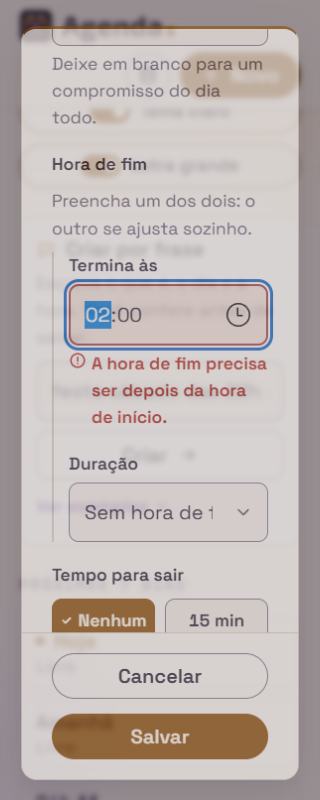
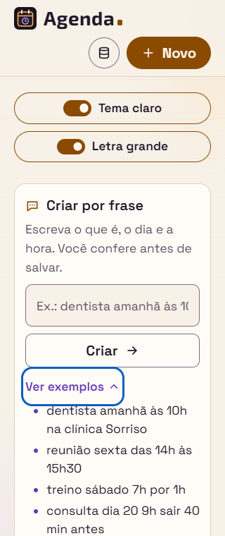
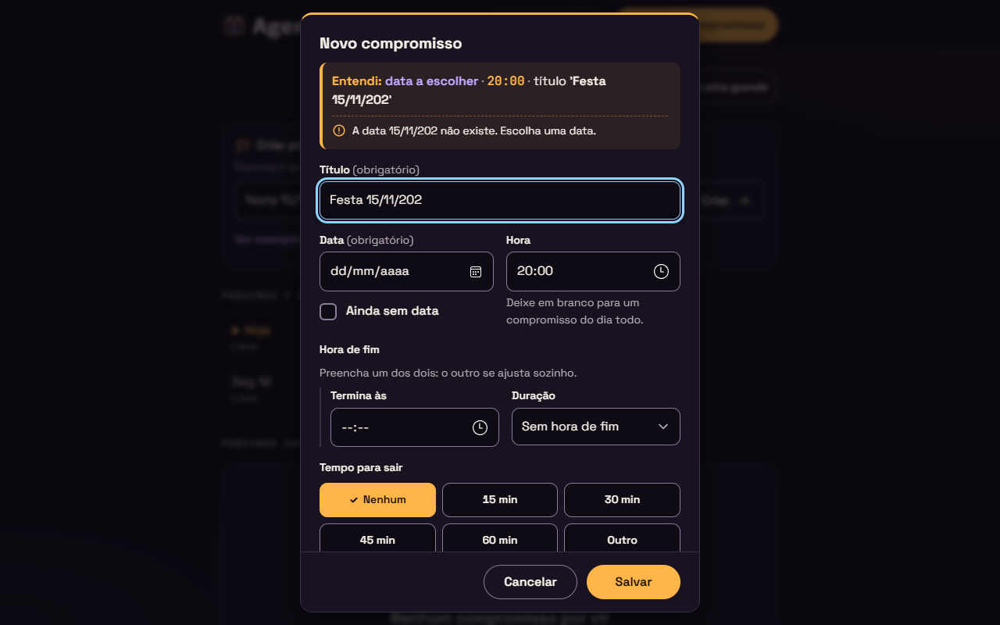
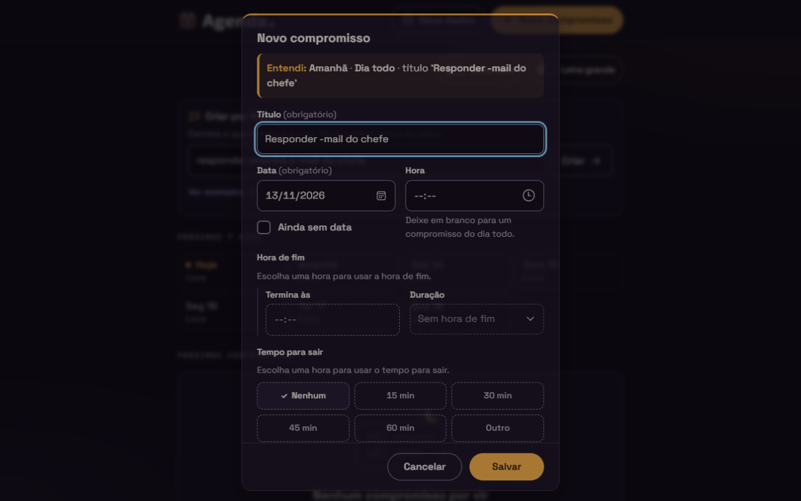
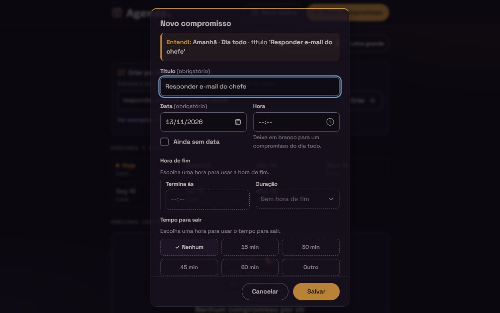

# Relatório de teste — Agenda, Etapa 4 (Entrega 4b)

- **Data:** 2026-11-11
- **O que foi testado:** a página `index.html` da Agenda com as mudanças da Entrega 4b, ainda sem commit, comparadas com o commit da Entrega 4a (`48ba5de`): `js/frase.js` (intervalo, duração, "sair ... antes", "levar ...", local com "no"/"na" e as correções da 4a), `js/app.js` (preenchimento do formulário, erros já visíveis ao abrir, tira "Entendi" com as partes novas e a nota dos 20 itens), `index.html` ("Ver exemplos" e `#entendi-nota-itens`), `css/style.css` (seção 12g) e `README.md`. Testei contra a Agenda **US29** (hora de fim), **US30** (tempo para sair), **US31** ("levar" vira o checklist, com o ajuste "3 itens + e mais N itens"), **US32** (local), a tabela das **28 frases da 4b**, a tabela das **52 frases da 4a** de novo, o bloco "Correções da Entrega 4a que entram na 4b", as mudanças da Etapa 4 nas stories anteriores (US03, US12, US17 e US19), os requisitos gerais da Etapa 4 e a "Captura rápida (Etapa 4)" da seção 3 dos [requisitos](../requisitos.md). O visual foi comparado com a seção 17 do [design](../design.md), com a opção A nas 4 decisões da 17.11 e o roteiro da 17.10.
- **Onde:** Microsoft Edge 157 (Chromium) **headless**, com perfil próprio numa pasta temporária, controlado por script, numa **cópia** do site servida por um servidor local fora de `trabalhos/`. Fuso `America/Sao_Paulo` e relógio **parado** em quinta-feira, 12/11/2026, às 14:00 (o "agora" das tabelas). Larguras 320, 360 e 1280px, nos dois temas e nas duas letras. Também testei alto contraste (cores forçadas), movimento reduzido e `localStorage` bloqueado e cheio. A lógica da frase foi conferida também em Node, com um script meu, com os resultados esperados escritos a partir das regras (o script do dev só foi rodado como apoio: 120 de 120). **Não testei:** celular de verdade, leitor de tela de verdade (NVDA ou Narrador) e o GitHub Pages (a 4b ainda não foi publicada).

## Resultado

**Aprovado com pendências.** As 28 frases da 4b, as 52 da 4a e **146 frases minhas** (226 no total) deram o resultado das regras, em Node e no formulário aberto no navegador. No navegador foram **3.295 conferências**: campos preenchidos, erros já visíveis, foco, tira "Entendi" (texto visto e texto lido), notas, "Ver exemplos", teclado, árvore de acessibilidade, larguras, contraste, `localStorage`, Salvar/Cancelar e uma regressão rápida. As 4 que falharam são do meu roteiro, não da Agenda (explico em "Como foi testado"). Nenhum critério de aceite falhou. Ficam pendências de gravidade **baixa**: os marcadores da lista "Ver exemplos" não aparecem (problema 1) e quatro casos de regra em que a decisão é do PO (problemas 2 a 5, ligados às decisões 1, 2, 5 e 6 do dev). Não corrigi nada no código.

## Verificações

| Área | Resultado | Observação |
|---|---|---|
| Celular a 360px | Passou | Sem rolagem horizontal e nada saindo da janela a 320, 360 e 1280px, nos 2 temas × 2 letras, com a página (com "Ver exemplos" aberto) e com o formulário aberto pelas frases #5, #8, #12, #15, #21, #22, #23 e #27, por "levar" com 5 itens e por um local e um item compridos. "até 10:00", "duração 90 min", "sair 30 min antes" e "e mais 17 itens" nunca se partem a 360px. A 320px com a letra grande, "sair 780 min antes" (183px) não cabe na linha da tira (179px) e quebra: é o caso que o design 17.3.1 já previa (abaixo de 360px), sem rolagem. Altura da tira a 360px com a letra grande: 178px (#15), 208px (#22), 277px (#27), dentro das contas da 17.3.5. "Ver exemplos" com 44px de altura. |
| Teclado | Passou | Ordem do Tab: "Seus dados" → "Novo compromisso" → "Tema claro" → "Letra grande" → campo da frase → "Criar" → **"Ver exemplos"**. Enter e Espaço no "Ver exemplos" abrem e fecham a lista e **não** abrem o formulário; a seta gira. Contorno de foco de 3px no "Ver exemplos". Aberto pela frase, o foco vai para o primeiro campo com erro, na ordem Título → Termina às → Duração → Minutos (duração) → Minutos antes (#5 → "Termina às", #8 → Duração, #12 → "Minutos antes", "por 0 min" → Minutos da duração, "amanhã 23h por 2h sair 800 min antes" → Título). Esc e "Cancelar" fecham sem salvar, a frase fica e o foco volta ao campo. Salvar limpa o campo e devolve o foco a ele. |
| Acessibilidade | Passou | Pela árvore de acessibilidade: aberta pela #22, a janela é "Novo compromisso" com a descrição "Entendi: Amanhã, 09:00, até 10:00, sair 30 min antes, local 'Centro', levar 'RG', título 'Dentista'." (sem "ponto"). A #27 lê "… levar 'a', 'b', 'c' e mais 17 itens, título 'Mudança'. A lista 'O que levar' aceita até 20 itens. Os outros ficaram de fora." A #5 lê a tira e o "Termina às" tem `aria-invalid="true"` e a descrição "A hora de fim precisa ser depois da hora de início.". O `#itens-aviso` continua **vazio** ao abrir pela frase (também 500 ms depois, com #15 e #27): nada de "RG adicionado." por item; ao usar "Adicionar" à mão, o aviso continua funcionando. Sem `aria-live` na tira. "Ver exemplos" é um `summary` com o estado "recolhido"/"expandido" (`expanded=false/true`). Movimento reduzido: a transição da seta cai para 0,01 ms. Alto contraste: a tira e a nota dos 20 itens aparecem. |
| Contraste | Passou | Medi as cores calculadas pelo navegador, com os fundos compostos, nos dois temas. Menor valor de texto: 5.97 (valores de tempo em âmbar no tema claro). Tabela abaixo. |
| Erros | Passou | Console sem erros e sem avisos em todos os cenários, inclusive com `<script>`, `` e `<svg onload>` no título, no local e nos itens (nenhum `alert` rodou e nenhum elemento foi criado), emoji e 9 frases "venenosas" de 200 caracteres ("das 1 às das 1 às…", "levar a, levar a, …", "na na na…", "no levar na levar…"). Em Node, as venenosas levam menos de 0,4 ms. Nenhum arquivo deu 404. `localStorage` bloqueado e cheio: comportamento certo (abaixo). |

### Contrastes medidos

| Elemento | Escuro | Claro | Mínimo | Design (17.9) |
|---|---|---|---|---|
| "até", "duração", "sair", "antes", "local", "levar", aspas, local e itens | 13.68 | 14.76 | 4.5 | 13.7 · 14.8 |
| Tempos em mono âmbar ("10:00", "90 min", "30 min", "780 min") | 8.95 | 5.97 | 4.5 | 9.0 · 6.0 |
| "e mais 17 itens" | 7.11 | 6.87 | 4.5 | 7.1 · 6.9 |
| Nota dos 20 itens (texto · ícone) | 13.68 · 8.95 | 14.76 · 5.97 | 4.5 · 3 | 13.7 · 9.0 / 14.8 · 6.0 |
| "Ver exemplos" e a seta | 8.99 | 7.50 | 4.5 | ≈8.6 · 7.5 |
| Exemplos da lista | 15.79 | 16.59 | 4.5 | 15.8 · 16.6 |
| Erros já visíveis (Termina às, Duração, Minutos, Minutos antes) | 7.24 | 6.42 | 4.5 | iguais à 2.1 e à 15.13 |

## Critérios de aceite

**Agenda US29: Hora de fim pela frase**
- [x] Intervalo: "das 10h às 11h", "das 10 às 11", "das 10h30 às 12h", "das 9h até 10h", "das 9 até as 10" (também "até às 10" e em maiúsculas sem acento) e "das 2 às 4 da tarde". Os números dentro do intervalo são horas mesmo sem "h".
- [x] Duração: "por 1h", "por 1h30", "por 1 hora", "por 2 horas", "por 45 min", "por 90 minutos", "por meia hora" e "durante 3 horas".
- [x] Intervalo: Hora com o primeiro horário, "Termina às" com o segundo e a Duração ajustada ("1 h", "2 h", "30 min" ou "Outro" com os minutos: "das 10 às 11h30" → "Outro" 90). Hora sozinha antes do intervalo: vale ela e o intervalo fica no título ("reunião amanhã 9h das 10h às 11h" → título "Reunião das 10h às 11h"). Sem data, a D1 usa o primeiro horário ("treino das 9h às 10h" → amanhã; "reunião das 14h às 15h" → hoje; "das 22h às 23h" às 22:01 de 31/12 → 01/01/2027).
- [x] "da tarde" depois do segundo horário vale para o primeiro quando ele é menor ou igual ("das 2 às 4 da tarde" → 14:00–16:00; "das 1 às 3 da tarde" → 13:00–15:00) e não vale quando é maior ("das 11 às 1 da tarde" → 11:00–13:00; "das 12 às 2 da tarde" → 12:00–14:00).
- [x] Duração com hora: 30, 60 e 120 marcam a opção; outro valor marca "Outro" com o número; "Termina às" calculado ("7h por 1h30" → 08:30).
- [x] Duração sem hora fica no título e os números dela não viram hora ("estudar amanhã por 2 horas" → "Estudar por 2 horas"; "reunião por 10h" → "Reunião por 10h", sem hora).
- [x] Intervalo e duração: vale o primeiro ("reunião amanhã 10h por 1h das 14h às 15h" → duração 60 e o intervalo no título; "reunião amanhã das 10h às 11h por 2 horas" → intervalo e "Por 2 horas" no título).
- [x] Limites: "das 22h às 2h" → Hora 22:00, "Termina às" 02:00, Duração "Sem hora de fim" e o erro de fim já visível; "22h por 3 horas" → "Outro" 180, "Termina às" vazio e o erro da meia-noite já visível; "por 0 min" e "por 24 horas" (1440) → "Outro", o número e "Digite um número de minutos entre 1 e 1439." já visível. "23h por 59 min" entra (23:59) e "23h por 1h" dá o erro da meia-noite.
- [x] A tira ganha "até 11:00" ou "duração 90 min" logo depois da hora, também com erro ("até 02:00", "duração 180 min", "duração 0 min").

**Agenda US30: Tempo para sair pela frase**
- [x] "sair 30 min antes", "sair 30 minutos antes", "sair 1h antes", "sair 1 hora antes", "sair 1h30 antes", "sair meia hora antes" (e "sair 45 minutos antes", "sair 2 horas antes").
- [x] 15, 30, 45 e 60 marcam a plaquinha; outro valor marca "Outro" com o número em "Minutos antes" (40, 90, 120, 720).
- [x] Sem hora, o pedaço fica no título e o grupo continua desativado ("dentista amanhã sair 30 min antes"). O "1h30" de "sair 1h30 antes" não vira hora.
- [x] Fora de 1 a 720 ("sair 13h antes" = 780, "sair 0 min antes", "sair 721 minutos antes"): "Outro", o número e "Digite um número de minutos entre 1 e 720." já visível, com o foco em "Minutos antes".
- [x] Com dois, vale o primeiro ("… sair 30 min antes sair 15 min antes" → 30, o outro no título).
- [x] A tira mostra sempre em minutos ("sair 90 min antes", "sair 780 min antes").

**Agenda US31: "levar ..." vira o checklist**
- [x] "levar RG", "levar RG e cartão", "levar RG, pedido médico e cartão do convênio" (e com ponto e vírgula).
- [x] Os itens vão até o próximo pedaço reconhecido (data, hora, intervalo, duração, "sair", local) ou até o fim ("levar RG amanhã 10h" → "RG"; "levar caderno na escola" → "caderno"; "levar refri e salgado às 20h" → 2 itens). Um pedaço reconhecido mas não usado também fecha a lista ("dentista amanhã levar RG sair 30 min antes", sem hora → item "RG" e "sair…" no título).
- [x] Item limpo, com as letras como foram digitadas, cortado em 60 caracteres; item vazio ignorado ("RG, , cartão" → 2 itens; "levar ,, ; ," → "levar" fica no título); itens iguais permitidos ("RG, RG").
- [x] Até 20 itens; com 21 ou 22, entram 20 e aparece a nota "A lista 'O que levar' aceita até 20 itens. Os outros ficaram de fora.". Com exatamente 20, sem nota. A nota aparece junto com a dica "Não encontrei data nem hora…" ("comprar pão levar a, …, v"), nesta ordem.
- [x] "levar" no começo fica no título ("Levar o carro na oficina amanhã", "LEVAR documentos sábado", "  levar RG amanhã" com espaços antes). "levar" sem nada depois fica no título ("Mudança levar").
- [x] Só o primeiro "levar" conta ("levar RG levar cartão" → um item "RG levar cartão"). Funciona sem data e sem hora ("comprar pão levar sacola").
- [x] Os itens aparecem na lista com "Remover", dá para remover e acrescentar; com 20, "Novo item" e "Adicionar" ficam desativados com a dica "Limite de 20 itens.". Salvos com `feito: false`. "Cancelar" descarta tudo.
- [x] Tira: até 4 itens, todos; com 5 ou mais, os 3 primeiros e "e mais N itens" ("levar 'RG', 'cartão', 'exames' e mais 2 itens"; #27 "… e mais 17 itens"). A contagem usa os itens que entraram (20).

**Agenda US32: Local com "no" ou "na"**
- [x] "na clínica Sorriso", "no centro", "na casa da vó".
- [x] O local vai até o próximo pedaço ("almoço na casa da vó sábado meio-dia" → "Casa da vó"; "consulta no hospital às 9 amanhã" → "Hospital").
- [x] "no"/"na" de uma data são da data ("reunião na sexta 15h"; "show no estádio no dia 15" → local "Estádio"; "na próxima segunda na sala 2" → "Sala 2").
- [x] "no"/"na" no começo ficam no título ("Na casa da vó"); só o primeiro conta ("Casa na praia", "Escritório no 3º andar").
- [x] Local limpo, com a primeira letra maiúscula, cortado em 100 caracteres ("NA CLÍNICA" → "CLÍNICA"; "Escritório, sala 3").
- [x] "reunião na" fica no título; "nossa" não é "no" (palavra inteira).
- [x] Risco aceito (D4): "pensar na vida amanhã" → local "Vida".
- [x] A tira ganha "local 'Clínica Sorriso'".

**Correções da Entrega 4a que entram na 4b**
- [x] "para ter aula" não vira terça (título "Para ter aula", com a dica); "pra dom" e "até dom" também não. "na/no/nesta/neste/próxima/próximo" + "ter"/"dom" continuam valendo, e "ter"/"dom" com hora logo depois também ("para dom 10h missa", "academia ter das 9 às 10").
- [x] "comprar vitamina E amanhã" → "Comprar vitamina E"; "plano E sexta" → "Plano E". (Mas veja os problemas 2 e 3: o critério tem um efeito colateral.)
- [x] "15/11/27" → 15/11/2027 (também "dia 15/11/27" e "festa 15/11/27 20h"); "31/02/27" e "29/02/27" dão o aviso de data que não existe; "29/02/28" existe.
- [x] "15/11/0050" e "15/11/0999" viram data que não existe, com o aviso "A data 15/11/0050 não existe. Escolha uma data." e a tira "data a escolher" (antes mostrava 1950).

**Mudanças nas stories anteriores e requisitos gerais da Etapa 4**
- [x] US03: erros da US12 e da US19 já visíveis ao abrir, com `aria-invalid`, e o foco no primeiro campo com erro. "Escolha uma data." continua só ao salvar ("festa 31/02 das 20h às 22h"). Salvar com valor inválido não grava e põe o foco no campo do erro; corrigir o campo esconde o erro.
- [x] US12, US17, US19: os campos vêm preenchidos como se fosse à mão e continuam editáveis (mudar "Termina às" para 11:00 na #22 ajusta a Duração para "2 h"; "Remover" funciona).
- [x] A linha não muda quando a pessoa corrige os campos.
- [x] 360px, letra grande, dois temas: sem rolagem horizontal e sem nada cortado no painel e na tira.
- [x] Teclado: Tab chega ao campo da frase depois de "Letra grande" e ao "Criar" logo depois; "Ver exemplos" vem depois do "Criar".
- [x] Leitor de tela: a tira é lida uma vez, sem "·"; o checklist não é anunciado item por item.
- [x] Contraste AA nos dois temas.
- [x] Tudo é texto ("até", "duração", "sair", "local", "levar", "e mais N itens", a nota).
- [x] Só JavaScript puro: nada de biblioteca, `fetch` ou rede no `frase.js`.
- [x] Frases de até 200 caracteres abrem sem demora e sem erro no console.
- [x] Continua `versao: 2`, sem chave nova, só chaves `agenda:`. Abrir e cancelar as 106 frases não muda nenhuma chave.

**Design, seção 17 (roteiro 17.10)**
- [x] Tira com as partes na ordem data · hora · fim · sair · local · levar · título; tempos em mono âmbar; local e itens em 600 na cor do texto; "e mais N itens" em texto suave.
- [x] Nota dos 20 itens em `#entendi-nota-itens`, depois da nota da 4a, ligada e desligada em toda abertura: "Novo compromisso" e "Editar" depois da #27 não mostram nenhuma nota.
- [x] Campos sem destaque novo (decisão 3) e erro só no campo (decisão 4): a tira mostra "até 02:00" normal.
- [x] "Ver exemplos" recolhido, começa fechado, abre e fecha com Enter, Espaço e clique, sem abrir o formulário. **Os 5 exemplos, copiados para o campo, preenchem o que prometem** (local; intervalo 14:00–15:30 com "Outro" 90; duração "1 h" com fim 08:00; "dia 20 9h" com "Outro" 40; 2 itens).
- [ ] Lista dos exemplos com marcadores lilás e recuo (17.7 e 17.8): não aparecem (problema 1, baixa).

**Regressão rápida (Entregas 2a a 4a)**
- [x] Tabela da 4a: as 52 frases dão o mesmo resultado, com as mesmas linhas.
- [x] "Novo compromisso" à mão com Duração "1 h", "Sair" 30 min e item "RG": "RG adicionado." é anunciado; salva e o card mostra "09:00 – 10:00", "Sair às 08:30" e "O que levar (0 de 1)"; a faixa da semana conta sábado.
- [x] Salvar a #22 grava `duracaoMin: 60`, `antecedenciaMin: 30`, `local: "Centro"` e `itens: [{ texto: "RG", feito: false }]`; o card mostra "Sair às 08:30" e o checklist.
- [x] "Editar" e "Agendar" abrem sem a tira e sem descrição; "Agendar" põe o foco na Data.
- [x] "Tema claro" e "Letra grande" continuam depois de recarregar.
- [x] `localStorage` bloqueado: a frase abre preenchida e salvar fecha e limpa o campo (só na memória). `localStorage` cheio: "Não foi possível salvar o compromisso." dentro do formulário, que continua aberto com os 3 itens, e a frase continua no campo.

## As 8 decisões do dev

| # | Decisão | Avaliação | Precisa do PO? |
|---|---|---|---|
| 1 | "e" solto só sai quando é a única coisa entre dois pedaços ou entre um pedaço e a ponta ("reunião e amanhã" → "Reunião e") | **Aceitável como solução provisória.** O critério da correção ("só é tirado um 'e' colado a um pedaço reconhecido") se contradiz com o próprio exemplo: em "vitamina E amanhã" o "E" também está colado em "amanhã". A regra do dev é a única que cumpre o exemplo, mas muda um resultado da 4a: "reunião e amanhã e" dava "Reunião" e agora dá "Reunião e" (problema 2). A US27 e a "Limpeza" da seção 3 continuam dizendo "saem do começo e do fim … um 'e' solto". | **Sim.** O PO escolhe a regra e atualiza a US27 e a seção 3. |
| 2 | Separador de itens só "e"/"E", nunca "é"; "levar vitamina E" vira "vitamina" | "é" nunca separar: **aceitável** (ninguém separa itens com "é"; "levar o que é meu" fica um item só). "E" maiúsculo separar: o "E" **some** de tudo (não fica no item nem no título), o contrário do que a correção da 4a quis para o título (problema 3). | **Sim**, junto com a 1. |
| 3 | "levar"/"no"/"na" no começo contam só no começo literal da frase | **Aceitável.** É a leitura literal da US31/US32. "amanhã levar RG" e "10h levar RG" viram item com "sem título", mas o erro "Digite um título." já aparece e a pessoa vê. Espaços antes contam como começo ("  levar RG amanhã" → título). | Não (só registrar). |
| 4 | Intervalo + duração: se a hora veio do intervalo, a duração fica no título | **Aceitável.** Quando o intervalo vem primeiro, é o que a US29 manda ("vale o primeiro"). Quando a duração vem antes ("por 2h das 10h às 11h"), a regra ao pé da letra daria a duração, mas o intervalo é um pedaço só (hora e fim); usar a hora dele e jogar fora o "às 11h" faria algo sumir sem a pessoa ver. A escolha do dev deixa "Por 2h" no título, visível. | Só registrar no requisito. |
| 5 | "das 2 da noite às 4" não é intervalo; "das 1 às 2 da noite" = 01:00–02:00 com "da noite" no título | A segunda parte é **aceitável** e segue a tabela ("da …" fora da tabela não é entendido; vale o que a tabela reconhece sem ele). A primeira é **inconsistente** com a segunda: o resultado é Hora **04:00** (pelo "às 4" no fim) e o título "Festa das 2 da noite" (problema 5). Pela mesma regra, o esperado seria 02:00–04:00 com "da noite" no título. | **Sim** (baixa). |
| 6 | Local terminando em "e" colado a pedaço: o "e" sai | **Aceitável** em "festa na casa do João e amanhã 20h" → "Casa do João". Mas é a mesma família da 1 e da 2: "consulta na ala E amanhã 9h" → local "Ala", e o "E" some (problema 3). | **Sim**, junto com a 1. |
| 7 | "às 10 levar RG": "levar" confirma a hora | **Aceitável.** A regra da palavra seguinte aceita "outro pedaço reconhecido", e a seção 3 (regra 5) lista o "levar" como um tipo de pedaço. Também dá o resultado que a pessoa espera. | Não (só registrar). |
| 8 | Dica "Não encontrei data nem hora": intervalo conta como hora; duração e "sair" sozinhos não | **Aceitável.** Bate com a US29 ("o intervalo conta como o pedaço de hora"), com a regra "sem nenhum pedaço de data e de hora" e com as frases #9, #13 e #23 da tabela. | Não. |

## Problemas encontrados

Nenhum problema de gravidade alta. Pendências:

**1. "Ver exemplos": a lista aparece sem os marcadores e sem o recuo do design** (gravidade: baixa; status: pendente)
- **Página:** `index.html`, painel "Criar por frase".
- **Passos:** abrir a página a 360px e apertar "Ver exemplos".
- **Esperado:** pela 17.7 e pela 17.8, cada exemplo com um marcador (bolinha lilás, `li::marker`) e a lista recuada (`padding-left: var(--esp-5)`, `list-style: disc`).
- **Obtido:** os 5 exemplos ficam colados à esquerda, sem marcador (`list-style-type: none` e `padding-left: 0px` calculados). O reset antigo `ul[class] { list-style: none; padding: 0; }` (linha 155 do CSS) é mais específico (0,1,1) do que `.frase-exemplos-lista` (0,1,0) e ganha. Com os exemplos compridos quebrando em 2 linhas a 320px com a letra grande, fica mais difícil ver onde um termina e o outro começa. O texto continua legível, e a lista continua sendo uma lista para o leitor de tela no Chrome e no Edge (no Safari, uma lista com `list-style: none` pode perder o papel de lista).
- **Correção sugerida:** trocar o seletor por `ul.frase-exemplos-lista` (ou `.frase .frase-exemplos-lista`). O erro já vem do CSS de referência do design (17.8.1), então vale a artista corrigir lá também.

**2. "e" antes de um pedaço agora fica no título** (gravidade: baixa; status: pendente, decisão do PO)
- **Página:** formulário aberto pela frase.
- **Passos:** escrever "reunião e amanhã" (ou "reunião e amanhã e") e apertar Enter.
- **Esperado:** pela correção da 4a ("só é tirado um 'e' colado a um pedaço reconhecido"), o "e" colado em "amanhã" sairia: "Reunião". Pela mesma frase do critério, o "E" de "vitamina E amanhã" também sairia, o que o próprio critério proíbe.
- **Obtido:** "Reunião e" nas duas frases (na 4a, "reunião e amanhã e" dava "Reunião"). A tira mostra "título 'Reunião e'" antes de salvar.
- **Correção sugerida (para o PO):** escolher a regra e escrever na US27 e na "Limpeza" da seção 3. Opções: (a) manter a regra do dev; (b) tirar o "e" colado num pedaço só quando ele é **minúsculo** ("reunião e amanhã" → "Reunião"; "vitamina E amanhã" → "Vitamina E"), o que cumpre os dois exemplos.

**3. "E" maiúsculo some do item e do local** (gravidade: baixa; status: pendente, decisão do PO)
- **Página:** formulário aberto pela frase.
- **Passos:** escrever "dentista amanhã 10h levar vitamina E" e, depois, "consulta na ala E amanhã 9h".
- **Esperado:** nada some sem a pessoa ver ("Só sai do título o que virou campo"); na 4b o João aprovou manter o "E" de "vitamina E" no título.
- **Obtido:** item "vitamina" (o "E" vira separador e o item vazio depois dele é ignorado) e local "Ala" (decisão 6). O "E" não fica nem no item/local nem no título. A tira mostra "levar 'vitamina'" e "local 'Ala'", então a pessoa vê antes de salvar.
- **Correção sugerida (para o PO, junto com o problema 2):** só o "e" minúsculo separa itens e sai do fim do local; ou, no mínimo, um "e" que sobraria sozinho no fim fica no texto.

**4. Ano com 1 ou 3 algarismos não é lido como data, e com hora vai para hoje sem aviso** (gravidade: baixa; status: pendente, decisão do PO)
- **Página:** formulário aberto pela frase.
- **Passos:** escrever "festa 15/11/202 20h" (um erro de digitação de "2027").
- **Esperado:** a correção diz que "ano com menos de 4 algarismos válidos (< 1000)" vira data que não existe, com o aviso. "202" tem 3 algarismos e é menor que 1000.
- **Obtido:** a data inteira não é reconhecida (só anos de 2 e de 4 algarismos são lidos). Com a hora, a D1 manda para **hoje** às 20:00, sem aviso; a tira mostra "Hoje · 20:00 · título 'Festa 15/11/202'". Sem hora ("festa 15/11/202"), aparece a dica "Não encontrei data nem hora". O exemplo do critério ("15/11/0050") funciona; por isso não marquei como critério que falhou. A tabela "Quando um número conta como dia ou hora" da seção 3 também ainda fala só em "ano de 4 dígitos".
- **Correção sugerida:** o PO decide se "/A" e "/AAA" viram data que não existe (com o aviso) e atualiza a tabela da seção 3 com o ano de 2 algarismos.

**5. "das 2 da noite às 4" vira 04:00** (gravidade: baixa; status: pendente, decisão do PO)
- **Página:** formulário aberto pela frase.
- **Passos:** escrever "festa das 2 da noite às 4".
- **Esperado:** pela tabela de conversão, "2 da noite" não é entendido e "vale só o que a tabela já reconhece sem ele", como o dev fez em "das 1 às 2 da noite" (01:00–02:00, "da noite" no título).
- **Obtido:** não é intervalo; o "às 4" no fim vira a Hora 04:00 (amanhã, pela D1) e o título fica "Festa das 2 da noite". A pessoa vê na tira, mas o horário é diferente do que ela quis dizer, e o resultado não segue o mesmo raciocínio da outra metade da decisão 5.
- **Correção sugerida:** o PO escolhe entre manter (é raro) ou tratar como "das 2 às 4" com "da noite" no título (02:00–04:00).

### Observações (não são problemas)

- **A. A 320px com a letra grande**, "sair 780 min antes" quebra em duas linhas porque é mais larga (183px) que a linha da tira (179px). O design 17.3.1 já previa isso abaixo de 360px; a 360px nada se parte. Também a 320px com a letra grande a lista "Duração" mostra "Sem hora de f…" cortado; isso vem da Entrega 3a, não da 4b, e a 360px aparece inteiro.
- **B. Vírgulas com espaço antes na árvore de acessibilidade** ("Entendi: Amanhã , 09:00 , …"): é a mesma observação A da 4a; na fala não muda nada.
- **C. Resultados que seguem as regras mas podem surpreender** (todos aparecem na tira antes de salvar): "aula de 10h às 11h amanhã" → 10:00, título "Aula de às 11h" (só "das … às" é intervalo); "dentista por volta das 10h amanhã" → título "Dentista por volta das"; "às 10 levar RG dentista" → item "RG dentista" e "sem título"; "no centro levar RG dentista amanhã 9h" → título "No centro" e item "RG dentista". Sugestões para uma etapa futura.
- **D. O dev aceita um pouco mais do que as regras:** "por 1h30min" e "sair 1h30min antes" (90). Não atrapalha nada.
- **E.** O CSS da 12g é igual ao da 17.8.1, letra por letra. O `README.md` descreve certo as novidades ("das 10h às 11h", "por 1h30", "sair 30 min antes", local, "levar", "Ver exemplos" e "15/11/27").

## Prints

## Como foi testado (o que foi de verdade e o que foi por leitura)

- **Lógica da frase (Node, script meu):** carreguei `js/datas.js`, `js/frase.js` e `js/armazenamento.js` num contexto isolado, com o fuso `America/Sao_Paulo`, e comparei `entenderFrase` e `linhaDoEntendi` (título, data, hora, fim, duração, sair, local, itens, itens de fora, "Ainda sem data", dica, aviso e a linha) com resultados que escrevi a partir das regras: as 52 frases da 4a, as 28 da 4b, 22 das correções e 124 minhas (intervalos com e sem "h", "até as", "da manhã/tarde/noite" nos dois horários, fim igual ao início, intervalo depois de uma hora, duas durações, durações nos limites 0, 59, 1439 e 1440, "por 3 km", "por 2 dias", "sair" nos limites 0, 720 e 721, "sair cedo", "sair … depois", "levar" no começo e no meio, 4, 5, 20, 21 e 22 itens, item de 65 letras, itens vazios e repetidos, "levaram", local com número, com vírgula, cortado em 100, "nossa", "em casa", HTML e emoji, a virada do ano). Resultado: 226 de 226 iguais às regras, cada uma em menos de 50 ms. Rodei mais 24 "sondas" para avaliar as decisões do dev (as saídas estão na tabela das decisões e nos problemas 2 a 5).
- **No navegador (Edge headless, por script):** as 52 frases da 4a, as 28 da 4b e 26 minhas abertas pelo campo (Enter ou clique), conferindo cada campo do formulário, os erros, o `aria-invalid`, o foco, a tira, as notas, o `aria-describedby`, o `#itens-aviso`, Esc e o `localStorage`; os textos dos erros; a árvore de acessibilidade; o Tab e o "Ver exemplos"; os 5 exemplos; 12 combinações de largura, tema e letra com 10 frases cada; o contraste; Salvar, corrigir e salvar, salvar inválido; `localStorage` bloqueado e cheio; frases venenosas; alto contraste e movimento reduzido; a regressão rápida. Total: 3.295 conferências. As 4 falhas são do roteiro:
  - "movimento reduzido: seta sem transição": a transição é `0.01ms` (o padrão da seção 13 do CSS), não `0s`;
  - "partes curtas inteiras" a 320px com a letra grande (escuro e claro): o "sair 780 min antes" que não cabe (observação A);
  - "card 09:00 – 10:00": o meu teste lia o `textContent` do card, que inclui o texto só para o leitor de tela ("Das 09:00 às 10:00"); o print e a 4a mostram "09:00 – 10:00".
- **Por leitura do código:** o `diff` de `index.html`, `js/app.js`, `css/style.css` e `README.md`, e o `js/frase.js` inteiro. A causa do problema 1 (especificidade do `ul[class]`).
- O script do dev (`teste-frase-4b.js`) deu 120 de 120, mas não usei os esperados dele.
- Os scripts ficaram na pasta temporária, fora do projeto. O site foi testado numa cópia, servida de fora de `trabalhos/`. O Edge foi aberto com perfil próprio e fechado no fim (nenhum processo sobrou). Não mexi no código da Agenda e não fiz commit.

## Conferência manual (para o João)

1. No celular, escrever "dentista sexta das 9h às 10h no centro levar RG sair 30 min antes" e tocar em "Ir": conferir a tira e, no formulário, "Termina às" 10:00, Duração "1 h", "30 min" marcado, Local "Centro" e o item "RG".
2. Com o NVDA ou o Narrador, abrir pela frase "exame sexta 7h levar RG, pedido médico e cartão do convênio" e ouvir a tira **uma vez**, sem "RG adicionado" para cada item.
3. Abrir "Ver exemplos" com Enter e com Espaço e confirmar que o formulário **não** abre.

## Rodada 2 — 2026-11-11

- **O que foi testado de novo:** as correções do dev para os problemas 1 a 5 da rodada 1, conforme as "Decisões do João depois do teste da 4b" no [requisitos](../requisitos.md). Nesta rodada só mudaram `js/frase.js` e `css/style.css`. Conferi isso comparando os arquivos com a cópia da rodada 1. Os outros arquivos (`index.html`, `js/app.js`, `datas.js`, `armazenamento.js`) estão iguais.
- **Onde:** como na rodada 1. Edge headless com perfil temporário, numa cópia nova do site fora de `trabalhos/`. O relógio ficou parado em qui 12/11/2026 14:00. A lógica foi testada em Node com o meu script.

### Resultado

**Reprovado.** Volta para o dev por **um** problema de gravidade alta, que tem uma correção pequena e apareceu nesta rodada: um "e" no começo de uma palavra com hífen, logo depois de um pedaço, é cortado do título. "responder amanhã e-mail do chefe" vira "Responder -mail do chefe", e "amanhã e-mail" vira "Mail" (problema 6). Todo o resto passou:
- os problemas 1 a 5 da rodada 1 foram corrigidos conforme as decisões do João;
- as 226 frases da rodada 1 e mais 32 novas dão o resultado das regras (258 de 258);
- a regressão de tela repetida passou.

### Verificações

| Área | Resultado | Observação |
|---|---|---|
| Celular a 360px | Passou | "Ver exemplos" aberto, nos 2 temas × 2 letras, a 320, 360 e 1280px: sem rolagem horizontal, com a lista dentro do painel. O roteiro de larguras da rodada 1 deu o mesmo resultado. |
| Teclado | Passou | "Ver exemplos" abre e fecha com Enter nas 12 combinações. A ordem do Tab e o foco no primeiro campo com erro estão iguais aos da rodada 1. O "ano 202" ao salvar põe o foco na Data, com "Escolha uma data.". |
| Acessibilidade | Passou | A árvore de acessibilidade está igual à da rodada 1. A lista dos exemplos agora tem `list-style: disc`, então continua sendo uma lista também no Safari. |
| Contraste | Passou | O marcador lilás dá 8.99 no tema escuro e 7.50 no claro (mínimo de 3). O texto dos exemplos dá 15.79 no escuro e 16.59 no claro. O resto está igual à rodada 1. |
| Erros | Passou | Console sem erros e sem 404. As frases "venenosas" levam menos de 0,5 ms. |

### Conferência das correções

- [x] **Problema 1 (marcadores): corrigido.** O seletor agora é `ul.frase-exemplos-lista`. Com isso, a lista tem marcador (bolinha lilás) e recuo de 24px (30px com a letra grande), nos dois temas e a 320, 360 e 1280px. Quando um exemplo quebra em duas linhas, a segunda linha fica alinhada com o texto, depois do marcador.
- [x] **Problemas 2 e 3 ("e" minúsculo): corrigidos** conforme a decisão:
  - "reunião e amanhã" e "reunião e amanhã e" → "Reunião";
  - "reunião E amanhã" → "Reunião E";
  - "comprar vitamina E amanhã" → "Comprar vitamina E", e "comprar vitamina e amanhã" → "Comprar vitamina";
  - "pão e leite amanhã" → "Pão e leite" (o "e" do meio não está colado a um pedaço);
  - "reunião e", sem nenhum pedaço → "Reunião e";
  - "reunião amanhã e sexta" → "Reunião sexta" (atualizei a minha expectativa, que agora segue a regra aprovada);
  - "levar vitamina E" → item "vitamina E"; "levar vitamina E e cartão" → "vitamina E" e "cartão"; "levar arroz E feijão" e "LEVAR RG E CARTÃO" → um item só;
  - "na ala E amanhã 9h" → local "Ala E", e "na ala e amanhã 9h" → local "Ala".
- [x] **Problema 4 (ano): corrigido.**
  - "15/11/202", "15/11/2", "dia 15/11/202", "31/02/202", "15/11/0050" e "15/11/0999" viram data que não existe, com o aviso ("A data 15/11/202 não existe. Escolha uma data."), a tira "data a escolher" e o campo Data vazio.
  - "festa 15/11/202 20h" agora dá "Entendi: data a escolher · 20:00 · título 'Festa 15/11/202'", com o aviso, e não vai mais para hoje. Salvar mostra "Escolha uma data." e não grava nada.
  - "15/11/27" continua 2027, e "15/11/1000" fica como foi escrito. Em "15/11/202 ou 20/11" vale a data válida, sem aviso.
- [x] **Problema 5 (período fora da tabela): corrigido.**
  - "das 2 da noite às 4" → 02:00 às 04:00, com Duração "2 h" e o título "Festa da noite".
  - "das 1 às 2 da noite" → 01:00 às 02:00.
  - "das 2 da noite às 4 da manhã" → 02:00 às 04:00 (decisão do dev, abaixo).
  - "das 2 da noite às 4 da tarde" → 02:00 às 16:00.
  - "das 8 da noite às 2 da noite" → 20:00 às 02:00, com o erro do fim e "da noite" no título.
  - "das 12 da manhã às 3 da tarde" → 12:00 às 15:00, com "da manhã" no título.
- [x] **Intervalo junto com duração** (decisão registrada): "reunião amanhã por 2h das 10h às 11h" → vale o intervalo, e o título fica "Reunião por 2h".
- [x] **Regressão:** rodei de novo o roteiro de tela inteiro da rodada 1 (3.295 conferências), com o mesmo resultado. Ele tem 5 falhas, e nenhuma é da Agenda:
  - as 4 da rodada 1 (transição de 0,01 ms, "sair 780 min antes" a 320px com a letra grande, `textContent` do card);
  - uma vez, o foco foi para "Novo compromisso" num Esc dado 60 ms depois de abrir. Explico na observação F.

  O roteiro novo da rodada 2 teve 62 conferências, e só falhou o caso do problema 6.

**Decisão nova do dev** ("se o primeiro horário tem período fora da tabela, o período do segundo não passa para ele"): **aceitável.** A regra da US29 diz que o período do segundo horário vale para o primeiro "se o primeiro não tiver o seu", e aqui o primeiro tem o seu (só que ele é ignorado). Por isso, "das 2 da noite às 4 da manhã" → 02:00 às 04:00 e "das 2 da noite às 4 da tarde" → 02:00 às 16:00. Vale anotar no requisito, mas não precisa do PO.

### Problemas encontrados

**6. Um "e" no começo de palavra com hífen é cortado logo depois de um pedaço** (gravidade: **alta**; status: pendente, volta para o dev)
- **Página:** formulário aberto pela frase.
- **Passos:** escrever "responder amanhã e-mail do chefe" e apertar Enter. Também "amanhã e-mail".
- **Esperado:** pela US27 e pela decisão do João, só sai o "e" que é uma **palavra** de ligação colada a um pedaço. O "e" de "e-mail" é parte de uma palavra, e o título deveria ser "Responder e-mail do chefe" (ou "E-mail").
- **Obtido:** "Responder -mail do chefe" e "Mail". Parte do que a pessoa digitou some do título, e isso quebra o critério "o título é a frase original sem os pedaços que viraram campo". A tira mostra o título errado antes de salvar, mas não diz que algo foi cortado. Antes desta rodada, o resultado era "Responder e-mail do chefe". "mandar e-mail amanhã" não é afetado (o "e-mail" vem antes do pedaço), e um "e-" dentro de item ou de local também não ("levar RG e-título", "na casa e-ventos").
- **Causa:** em `js/frase.js`, a `E_NO_COMECO` (`/^[\s,.;:\-–]*e(?=[\s,.;:\-–]|$)/`) aceita o hífen **depois** do "e" como fim de palavra. Por isso o "e" de "e-mail" conta como um "e" solto.
- **Correção sugerida:** no lookahead da `E_NO_COMECO`, aceitar só espaço, vírgula, ponto, ponto e vírgula, dois-pontos ou o fim (sem `-` e `–`), por exemplo `(?=[\s,.;:]|$)`. Vale conferir também a `E_NO_FIM` com o mesmo cuidado. Depois, testar de novo "responder amanhã e-mail do chefe", "reunião amanhã e" e "reunião amanhã e, depois".

### Observações (não são problemas)

- **F. Esc muito rápido no teste automático.** No roteiro completo, e numa sonda com 60 aberturas, o foco foi para "Novo compromisso" em vez do campo da frase, sempre na **segunda** abertura depois de carregar a página. O Esc foi dado cerca de 60 ms depois de abrir. Com qualquer espera a mais (ou só lendo o estado antes do Esc), isso não acontece em nenhuma abertura. O `app.js` não mudou nesta rodada e passou no mesmo roteiro na rodada 1, então parece uma corrida do teste automático. Fica para o João conferir à mão: abrir pela frase e apertar Esc; o foco deve voltar para o campo.
- **G.** Quando o "e" sai do começo do trecho, a pontuação colada nele sai junto: "reunião amanhã 10h, e conversar" → "Reunião conversar" (a vírgula some). Segue a regra e é só estética.

### Prints

### Como foi testado

- **Em Node:** rodei o mesmo script da rodada 1, com as 226 frases (uma expectativa atualizada: "reunião amanhã e sexta" → "Reunião sexta"). Acrescentei 32 frases novas, escritas pelas regras aprovadas. Resultado: 258 de 258. O problema 6 apareceu numa sonda de casos com hífen e foi confirmado no navegador.
- **No navegador:** o roteiro completo da rodada 1 (3.295 conferências) e um roteiro novo de 62 conferências. O roteiro novo cobre: "Ver exemplos" com marcadores em 12 combinações, contraste do marcador, aviso do ano no formulário e ao salvar, intervalos, "e" e "E" no formulário, console e 404.
- Os scripts ficaram na pasta temporária, fora do projeto. Nenhum navegador nem servidor ficou aberto. Não mexi no código e não fiz commit.

## Rodada 3 — 2026-11-11

- **O que foi testado de novo:** a correção do problema 6. Comparei os arquivos com a cópia da rodada 2, e só o `js/frase.js` mudou: as expressões `E_NO_COMECO` e `E_NO_FIM` não aceitam mais o hífen nem o travessão colados no "e".
- **Onde:** como nas rodadas anteriores. Usei Node para a lógica e o Edge headless, com perfil temporário, numa cópia do site fora de `trabalhos/`, com o relógio parado em qui 12/11/2026 14:00.

### Resultado

**Aprovado com pendências.** O problema 6 foi corrigido, e nada que já passava quebrou. Nenhum critério de aceite falha. Ficam só as observações de gravidade baixa das rodadas anteriores:
- "sair 780 min antes" quebra em duas linhas a 320px com a letra grande (previsto pelo design);
- "Sem hora de f…" cortado na Duração a 320px com a letra grande (vem da 3a);
- espaços antes das vírgulas na árvore de acessibilidade;
- o Esc muito rápido do teste automático (observação F), que desta vez não apareceu em nenhuma abertura;
- a vírgula que sai junto com o "e" (observação G).

### Conferência

- [x] **Problema 6: corrigido.** "responder amanhã e-mail do chefe" agora dá o título "Responder e-mail do chefe", no Node e no formulário, na tira e no campo Título (print abaixo).
- [x] **Lógica (Node):** 281 de 281 iguais às regras. São as 258 das rodadas 1 e 2 e mais 23 frases minhas com hífen e com o "e", escritas pela regra "só o 'e' minúsculo que é uma palavra inteira, colado a um pedaço, é ligação":
  - "amanhã e-mail" e "e-mail amanhã" → "E-mail";
  - "amanhã E-mail" → "E-mail", e "amanhã e–mail" (com travessão) → "E–mail";
  - "reunião amanhã 10h e-mail" → "Reunião e-mail"; "pegar e-ticket sexta 9h" → "Pegar e-ticket"; "festa amanhã e-vento" → "Festa e-vento";
  - "enviar e-mail e amanhã" → "Enviar e-mail"; "reunião pré-e amanhã" → "Reunião pré-e";
  - "levar e-mail impresso" → item "e-mail impresso"; "levar RG e e-mail impresso" → "RG" e "e-mail impresso"; "levar RG e-título" → um item só;
  - "na sala e-learning", antes e depois da data → local "Sala e-learning";
  - a regra do "e" solto continua valendo: "reunião amanhã e", "reunião e amanhã", "reunião – e – amanhã" e "reunião, e amanhã" → "Reunião"; "reunião amanhã e, depois" → "Reunião, depois"; "comprar vitamina E amanhã" → "Comprar vitamina E"; "na casa do João e amanhã 20h" → local "Casa do João".
- [x] **Tela:** o roteiro da rodada 2 (62 conferências) passou inteiro, inclusive a frase do e-mail, o aviso do ano, os intervalos e os marcadores do "Ver exemplos" nas 12 combinações de tema, letra e largura.
- [x] **Regressão:** o roteiro completo da rodada 1 (3.295 conferências) também passou. Ele tem as mesmas 4 falhas, que são do próprio roteiro e não da Agenda (explicadas na rodada 1). Console sem erros e sem 404.

- **Como foi testado:** usei os mesmos scripts das rodadas 1 e 2, na pasta temporária, mais as frases da rodada 3. Nenhum navegador nem servidor ficou aberto. Não mexi no código e não fiz commit.

## Aulas do Módulo 6 — 2026-11-13

- **O que foi testado:** as 4 aulas novas da Agenda na Labs (`aulas/agenda/modulo-6/aula-01.md` a `aula-04.md`) e as mudanças nestes arquivos:
  - `data/aulas.json`: módulo `agenda-m6` e 4 aulas;
  - `data/glossario.json`: 3 termos novos (falsy, Boolean e função de comparação);
  - `data/projetos.json`: trabalho do professor da 4b e linha do tempo da Agenda;
  - `README.md` da raiz: 43 aulas.

  O teste foi feito antes do commit da Labs, do mesmo jeito que o das aulas do Módulo 5 (relatório `etapa-4a.md`). Segui o guia `docs/guias/aulas.md` e a regra do João de que nenhum exercício manda mexer no código de um projeto. **Não corrigi nada nas aulas**: só descrevo os problemas e a correção sugerida.
- **Onde:** no Edge headless, com perfil temporário, controlado por script. O site da Labs foi servido por um servidor local, com marked e highlight.js carregados pelo CDN. Testei a 1280px, 360px e 320px, nos temas escuro e claro ("papel"). Comparei os links fixos com o repositório local da Agenda, que está no commit `82a924620f02ffdf84c28af3ecfb5a9103c676d2`, sem nenhuma mudança. Esse commit está em `origin/main`.

### Resultado

**Reprovado.** Volta para o professor por **um** problema de gravidade alta, com correção pequena: na aula 6.2, o termo `[[map]]` abre o balão do `Map` ("mapa — Estrutura que guarda um valor para cada chave…"), e não o do `map` ("mapear — Cria uma lista nova…"). É a pendência conhecida do glossário (observação B do Módulo 5) acontecendo de verdade, e justo num dos três passos centrais da aula (problema 1).

Todo o resto passou:
- os 8 exemplos rodam e o Console mostra exatamente o que o texto diz, linha por linha, com o anúncio certo;
- os 12 quizzes funcionam, e a resposta marcada como certa está certa;
- os 18 links fixos usam o commit `82a9246` e mostram o que o texto diz;
- os exercícios só mexem no exemplo da aba Aulas.

Também há dois detalhes de texto de gravidade baixa (problemas 2 e 3).

### Verificações

| Área | Resultado | Observação |
|---|---|---|
| Celular a 360px e 320px | Passou | Sem rolagem horizontal nas 4 aulas (antes e depois de Rodar os 8 exemplos), em `aulas.html#agenda-m6` e em `detalhe-projeto.html?id=agenda`. Os blocos de código terminam dentro da tela e rolam por dentro. O balão do glossário cabe na tela a 360px (de 16 a 344px). |
| Teclado | Passou | O Tab passa por Rodar, Editar, os termos do glossário, os links fixos, as alternativas do quiz e o checklist, com foco visível em todos. Cada balão abre com Enter e fecha com Esc, e o foco fica no termo. O quiz responde com Enter, e o "Tentar de novo" funciona com Espaço. Os botões "Agenda" e "João Saccucci Labs" de `aulas.html` trocam com Enter e Espaço. (O roteiro acusou de novo o "foco sem contorno" no `body` no fim do Tab, que é a observação A antiga. A aula 6.1 não tem nenhum termo de glossário, então o roteiro também acusou "Tab não achou glossário" nela; não é erro.) |
| Acessibilidade | Passou, menos o problema 1 | Os componentes são os mesmos da Labs. O aviso do Rodar conta certo ("6", "5", "4", "3", "3", "10", "4" e "2 linhas no console"). Depois de responder, as alternativas ficam com `aria-disabled="true"`, e todas as explicações aparecem. O título da aba segue o padrão (`Aula 6.4 · Ordenar com sort e uma função de comparação \| João Saccucci Labs`). O sumário tem as 5 seções de cada aula. O leitor de tela também lê a explicação errada do `map` (problema 1). |
| Contraste | Passou | Medido nas cores calculadas, nos dois temas (escuro / claro): termo do glossário 16,7 / 15,3; código no texto 15,6 / 13,9; texto 7,9 / 6,7; rótulo do Linha por linha 14,8 / 5,3. Tudo acima de 4,5. |
| Erros | Passou | Sem erro no console nas 4 aulas, em `aulas.html`, no detalhe da Agenda, em 3 aulas de amostra (a primeira e a última da Labs e a 5.1 da Agenda) e com um id que não existe (`agenda-m6-aula-09` mostra "Aula não encontrada." e "Ver todas as aulas"). O único 404 foi o `/favicon.ico`, que o navegador pede na raiz do servidor de teste. Os 4 JSON de `data/` são válidos. |
| Caracteres invisíveis | Passou | Conferi os 4 `.md` caractere por caractere: nenhum de U+0300 a U+036F, U+200B a U+200F, U+202A a U+202E, U+2060, U+FEFF nem espaço sem quebra (U+00A0). Nenhum `\r`. |

### Conferências

**1. `aulas.html`, progresso e vitrine**
- [x] No botão "Agenda" aparece o "Módulo 6 — Entrega 4b: a frase entende mais", logo depois do Módulo 5. Ele tem as 4 aulas (6.1 a 6.4, `tempoLeitura` 6, 7, 7 e 7) e os links `aula.html?id=agenda-m6-aula-01` a `-04`. São 24 cards da Agenda e 19 da Labs.
- [x] Progresso: no começo, aparecem "Agenda, 0 de 24 concluídas" e "0 de 4 concluídas" em cada um dos 6 módulos. Depois de marcar a 6.1 e a 6.4 como concluídas, aparecem "Agenda, 2 de 24 concluídas" e, no Módulo 6, "2 de 4 concluídas". Os Módulos 1 a 5 continuam em 0 de 4, e a Labs em 0 de 19.
- [x] O `aulas.html#agenda-m6` mostra o módulo na tela a 1280px, 360px e 320px.
- [x] O `detalhe-projeto.html?id=agenda` (a 1280px e a 360px) mostra o trabalho do professor da 4b ("Etapa 4, Entrega 4b: 4 aulas curtas…", com "Aulas — Agenda, Módulo 6" → `aulas.html#agenda-m6` e o Glossário), a linha nova da linha do tempo ("4 aulas da Entrega 4b, com exemplo Rodar e quiz, no Módulo 6 da Agenda.") e os links dos Módulos 1 a 5. Clicando no link do Módulo 6 e depois no card 6.4, a aula 6.4 abre.
- [x] README da raiz: 43 aulas está certo (19 da Labs e 24 da Agenda).

**2. Cada aula em `aula.html`**
- [x] Têm Em resumo (2 linhas), Erro comum, Dica "Para ir além (opcional)" e Em entrevista.
- [ ] **Glossário com o balão certo em todos os termos**: falhou no `map` da 6.2 (problema 1). Termos de cada aula:
  - aula 1: nenhum (o guia não exige);
  - aula 2: split, array, expressão regular, **map**, filter, slice, trim, splice;
  - aula 3: falsy, Boolean;
  - aula 4: sort, função de comparação, localeCompare.
  - Os 3 termos novos mostram a explicação certa. Nenhum repete um termo que já existia, nem ignorando maiúsculas. **`Boolean` não colide com nada**: só existe um termo "boolean" em minúsculas. O único par repetido continua sendo `map`/`Map`.
  - Nenhum `[[` ou `]]` sobra no texto. Os únicos `[[` da página da 6.3 são os de `const casos = [["0", 0], …` dentro do código, que é JavaScript de verdade.
- [x] O código aparece colorido. Há 8 exemplos com Rodar (2 em cada aula), com 14, 9, 9, 7, 11, 8, 4 e 15 linhas. Todos têm até 15 linhas e não dependem do código da Agenda.
- [x] O Linha por linha está ligado a cada exemplo e cita as linhas certas:
  - 6.1: L1, 2, 3, 4–5, 6, 7, 9–12, 13, 14 e L1–4, 5, 6, 7, 8, 9;
  - 6.2: L2, 3, 4, 6, 7, 8, 9 e L3, 4, 5, 6, 7;
  - 6.3: L1–4, 5–8, 9, 10, 11 e L1–2, 3–5, 6, 7, 8;
  - 6.4: L1, 2, 3, 4 e L1, 2–6, 7, 8–13, 14, 15. As posições da frase "dentista na clínica amanhã levar RG" (9 a 18, 20 a 25 e 27 a 34, com o `fim` uma posição depois) conferem.
- [x] O Rodar mostra exatamente o que o texto diz, linha por linha (igual no Node):
  - 6.1 (exemplo 1): `90`, `120`, `45`, `30`, `120` e `null`;
  - 6.1 (exemplo 2): `false`, `true`, `600 690`, `90` e `1439`;
  - 6.2 (exemplo 1): `["RG","carteirinha","exames"]`, `["RG","exames"]`, `["vitamina E"]` e `["caderno","estojo"]`;
  - 6.2 (exemplo 2): `["RG","exames","carteirinha"] 2`, `["RG"]` e `5`;
  - 6.3 (exemplo 1): `duração 90 min | duração 90 min`, `sem duração | duração 0 min` e `sem duração | sem duração`;
  - 6.3 (exemplo 2): as 8 linhas da tabela (`0 -> false` … `lista vazia [] -> true`), `2` e `[3,5]`;
  - 6.4 (exemplo 1): `[1,10,9]`, `[1,9,10]`, `[10,9,1]` e `["B","a","b","á"]`;
  - 6.4 (exemplo 2): `local, data, levar` e `"dentista"`.
- [x] Editar abre o código num campo de texto, o código editado roda, e Restaurar volta ao original (nos 8 exemplos).
- [x] Quizzes: 3 em cada aula. Todos têm 3 alternativas, menos o primeiro da 6.3, que tem 4. Cada um tem **exatamente uma certa**: a B em todos, menos o terceiro da 6.2 (C) e o primeiro da 6.3 (C).
  - Testei cada quiz duas vezes, em páginas limpas: clique na certa ("Certa!") e Enter numa errada ("Errada. A resposta certa é a …"). Nos dois casos, todas as explicações aparecem e o quiz trava. O "Tentar de novo" limpa a resposta.
  - Conferi as respostas certas:
    - "2h15" = 135; `"9:00" < "10:00"` é `false` por comparar texto; sem o `|| 0`, `emMinutos("2h")` dá `NaN` (rodei: `NaN`);
    - `"a,,b".split(",")` dá `["a", "", "b"]`; o `map` vem antes do `filter` por causa do pedaço só de espaços; 23 − 20 = 3;
    - `"0"` entra no `if`; o `!== null` é por causa da duração 0; `[3, 0, 5].filter(Boolean)` dá `[3, 5]`;
    - `[10, 9, 1].sort()` dá `[1, 10, 9]`; positivo põe `b` antes; sem o `sort`, o título sai `"dentista na clínica  amanhã"` (rodei), com "na clínica" e "amanhã" de volta, como a resposta diz.

**3. Navegação**
- [x] A 5.4 agora leva à 6.1, a 6.1 volta para a 5.4, e a 6.4 não tem "próxima".

**4. Links fixos** (18 links, todos com o hash completo `82a924620f02ffdf84c28af3ecfb5a9103c676d2` e nenhum com `/blob/main/`)
- [x] Aula 1:
  - `frase.js#L439-L463`: o comentário e a `lerTempo` inteira ("meia hora", "1h30", "2 horas", "45 min"), que devolve `{ minutos, fim }` (ou `null`);
  - `#L465-L488`: a `duracaoEm` e a `sairEm`, as duas chamando a `lerTempo`;
  - `#L414-L427`: o intervalo com "da tarde" e o `primeiro.horas * 60 + primeiro.minutos <= …` (linha 422);
  - `#L682-L687`: o comentário da `entenderFrase` sobre `fim`, `duracaoMin` ("Pode estar fora do limite (0, mais de 1439…)") e `antecedenciaMin` (ver problema 3).
- [x] Aula 2:
  - `frase.js#L658-L667`: o comentário e a `separarItens`, com a mesma regex do exemplo e a `limparTexto(item, MAXIMO_DO_TEXTO_DO_ITEM, false)`. As constantes ficam no `armazenamento.js` (linhas 124 e 125): `MAXIMO_DE_ITENS = 20` e `MAXIMO_DO_TEXTO_DO_ITEM = 60`, como a aula diz;
  - `#L749-L758`: o `slice(0, MAXIMO_DE_ITENS)` e o `itensDeFora`;
  - `#L828-L833`: o `slice(0, ITENS_NA_LINHA_COM_RESUMO)`. Com `ITENS_NA_LINHA_SEM_RESUMO = 4` e `ITENS_NA_LINHA_COM_RESUMO = 3` (linhas 786 e 787), "só os 3 primeiros quando há 5 itens ou mais" está certo;
  - `#L576-L584`: o comentário do "e" minúsculo, com o hífen ("e-mail") e as regex `E_NO_COMECO` e `E_NO_FIM`.
- [x] Aula 3:
  - `frase.js#L813-L822`: o comentário "(decisão 4)" e os dois `!== null` (duração e "sair");
  - `#L682-L687`: "Pode estar fora do limite (0, …)";
  - `#L734`: `[pecaData, pecaHora, pecaDuracao, pecaSair].filter(Boolean)`;
  - `#L736-L745`: o local com `if (limpo !== "")`;
  - `#L713-L715`: o `hora && !intervalo ? …` (linha 714). A `hora` é mesmo `"HH:MM"` ou `null` (linha 708).
- [x] Aula 4:
  - `frase.js#L760-L761`: o comentário "Só sai do título o que virou campo" e o `usadas.sort(function (a, b) { return a.inicio - b.inicio; })`;
  - `#L734`: a lista com data, hora, duração e "sair";
  - `#L736-L758`: o local e o "levar", com os dois `usadas.push`;
  - `#L592-L606`: a `tirarPecas`, com `frase.slice(posicao, peca.inicio)` (linha 597);
  - `#L519-L521`: o `forEach` que guarda a peça com o maior `fim`.

**5. Conteúdo**
- [x] As afirmações batem com o código da Agenda no commit `82a9246`, menos as dos problemas 2 e 3. Conferi no Node, com a `entenderFrase` de verdade e o "agora" de quinta, 12/11/2026, 14:00:
  - "reunião 10h por 13h" dá `duracaoMin` 780 (a `lerTempo` não barra);
  - "dentista na clínica amanhã levar RG" dá o título "Dentista" e o item "RG";
  - "dentista amanhã levar e-mail impresso" dá um item só, "e-mail impresso";
  - "dentista amanhã levar vitamina E" dá o item "vitamina E".
- [x] As aulas citadas existem: 5.1 (regex), 5.3 (lookahead) e 6.1 (minutos), que é deste módulo.
- [x] **Nenhum exercício manda mexer no código da Agenda ou da Labs.** Todos os itens de "Para praticar" (3 por aula) mexem no exemplo da aba Aulas. Rodei cada um no editor do próprio exemplo:
  - 6.1: o caso "1 hora e meia" dá `90`; o caso "2 horas" (com uma regex nova antes da L6) dá `120`; de 08:45 a 12:00 dá `195`. O Erro comum também confere: sem os `Number`, "1h30" dá `"6030"`;
  - 6.2: com `|\sou(?=\s)`, "RG ou CNH, exames" dá `["RG","CNH","exames"]`; sem o `filter`, mudam só as linhas 7 e 9 (`["RG","","exames",""]` e `["caderno","estojo",""]`); com `MAXIMO = 10`, a L5 mostra os 5 itens e `0`. O Erro comum também confere: sem o `return`, os itens saem `undefined` (o `JSON.stringify` mostra `null`);
  - 6.3: `{}` dá `true` e `false` dá `false`; com o teste `n !== null`, `[3, 0, null, 5]` dá `[3,0,5]`; `textoDaDuracaoCerto(undefined)` dá `duração undefined min`, que é o que a pergunta quer mostrar. O `0 || 30` dá `30` e o `0 ?? 30` dá `0`, como a Dica diz;
  - 6.4: sem a L7, a L14 mostra `data, local, levar` e a L15 `"dentista na clínica  amanhã"` (igual à resposta do quiz); com `b.inicio - a.inicio`, a L14 mostra `levar, data, local`; `["10:00", "9:30", "08:15"].sort()` dá `["08:15","10:00","9:30"]`, fora de ordem, como a pergunta quer mostrar.
- [x] Tamanho: de cerca de 770 a 830 palavras fora do código; `tempoLeitura` de 6 ou 7; 3 itens em "Para praticar" em cada aula; quiz nas 4 aulas.

### Problemas encontrados

**1. Aula 6.2: o termo `[[map]]` abre a explicação do `Map`** (gravidade: **alta**; status: pendente, volta para o professor)
- **Onde:** `aula-02.md`, linha 12 (`2. **[[map]]** ("mapear"): …`).
- **Passos:** abrir `aula.html?id=agenda-m6-aula-02`, ir até "O conceito" e clicar (ou dar Enter) no termo **map** do passo 2.
- **Esperado:** o balão "mapear — Cria uma lista nova transformando cada item da lista original."
- **Obtido:** o balão "**mapa** — Estrutura que guarda um valor para cada chave, como um id. Com get e set, acha e troca um item quase na hora." O `js/aula.js` guarda os termos num `Map` com a chave em minúsculas (linha 241), e o `Map` (posição 78 do `glossario.json`) vem depois do `map` (posição 13), então sobrescreve o `map`. É a observação B do relatório do Módulo 5 ("um `[[map]]` numa aula futura ainda mostraria 'mapa'"). Aqui ela ensina errado justamente um dos três passos da aula, logo depois do texto dizer "mapear". O leitor de tela lê a mesma explicação errada.
- **Correção sugerida (só na aula):** na linha 12, tirar os colchetes e deixar `**map**` (o texto já traduz "mapear" e explica o que ele faz). **Não** trocar a ordem do `glossario.json`, porque isso quebraria o `[[Map]]` da aula 5.3. A correção de verdade (o `aula.js` preferir o termo com as mesmas maiúsculas) continua como pendência da Labs, para o dev numa etapa da Labs.

**2. Aula 6.3: "por 0 min" sozinho não dá `duracaoMin` 0** (gravidade: baixa; status: pendente)
- **Onde:** `aula-03.md`, linha 15 ("E se a pessoa escrever "por 0 min"? A resposta é `0`.") e o segundo quiz, linha 91 ("Porque "por 0 min" dá duracaoMin 0…").
- **Passos:** rodar a `entenderFrase` do commit `82a9246` com "dentista por 0 min" e com "dentista às 10h por 0 min".
- **Esperado:** o texto diz quando a duração é entendida.
- **Obtido:** "dentista por 0 min" dá `duracaoMin: null` e o título "Dentista por 0 min", porque a duração só vale com hora (`frase.js`, linhas 710 a 714). Só "dentista às 10h por 0 min" dá `duracaoMin: 0`. A ideia da aula continua certa; só o exemplo está incompleto.
- **Correção sugerida:** trocar "por 0 min" por "às 10h por 0 min" na linha 15 e no quiz (ou acrescentar "com uma hora, como em "às 10h por 0 min"").

**3. Aula 6.1, Dica "Para ir além": "com a mensagem de sempre" não está no trecho do link** (gravidade: baixa; status: pendente)
- **Onde:** `aula-01.md`, linha 79.
- **Passos:** ler "O comentário da `entenderFrase` explica que quem mostra o erro é o formulário, com a mensagem de sempre" e abrir o link `frase.js#L682-L687`.
- **Esperado:** o trecho do link diz isso sobre a duração.
- **Obtido:** nas linhas 682 a 687, a duração só tem "Pode estar fora do limite (0, mais de 1439, ou passar de 23:59)". O "o formulário mostra o erro" está ali, mas na linha 683, sobre o `fim`. A frase "quem decide o erro é o formulário, que mostra a mensagem de sempre" está no comentário da `lerTempo` (linhas 441 e 442), que é o primeiro link da mesma aula.
- **Correção sugerida:** "O comentário da `lerTempo` explica que quem decide o erro é o formulário, com a mensagem de sempre ([linhas 439 a 442](…#L439-L442)), e o da `entenderFrase` avisa que a duração pode estar fora do limite ([linhas 684 e 685](…#L684-L685))", com o mesmo commit `82a9246`.

### Observações (gravidade baixa, nenhuma impede a aprovação depois da correção do problema 1)

- **A. Foco no `body` no fim do Tab.** É o mesmo comportamento antigo das aulas dos Módulos 3 a 5, e não é destas aulas.
- **B. Glossário `map`/`Map` no `js/aula.js`.** Agora apareceu de verdade (problema 1). Continua pendente para uma etapa da Labs; até lá, as aulas devem evitar `[[map]]`.
- **Conferir à mão (João):** depois do commit da Labs, abrir a aula 6.1 no GitHub Pages e clicar num link fixo (por exemplo, `frase.js#L439-L463`), para ver se o GitHub abre com as linhas destacadas.

### Como foi testado

- **No navegador (Edge headless, por script):** 218 conferências automáticas, um roteiro curto de progresso e uma sonda dos balões da 6.2 a 1280px e a 360px (com print do balão errado do `map`). As 8 falhas do roteiro foram conferidas uma por uma:
  - 4 vezes "foco sem contorno" em `modo-foco`: é o `body` depois que o Tab passa do fim da página (observação A);
  - "console de `aulas.html` com 404": era o `/favicon.ico`;
  - "Tab não achou glossário" na 6.1: a aula não tem termos;
  - "sobrou `[[` na aula 6.3": era o `[["0", 0], …` do código, dentro do bloco de código;
  - "balões da 6.2": o `map` com a explicação do `Map` (**problema 1**). Na mesma conferência, o "expressão regular" saiu vazio por um atraso do roteiro; na sonda, ele abre com a explicação certa.

  Rodei os exercícios de "Para praticar" no editor do próprio exemplo e respondi cada quiz em páginas limpas, uma vez com clique na certa e outra com Enter numa errada.
- **Em Node:** rodei os 8 exemplos fora do site, e a saída foi igual à do Rodar. Rodei a `entenderFrase` do commit `82a9246` com as frases citadas nas aulas. Contei as palavras, procurei os `[[termos]]` de cada aula no `glossario.json` e conferi os caracteres dos 4 `.md`.
- **Só por leitura:** a conferência do conteúdo com o código da Agenda no commit `82a9246`.
- Os scripts e os prints ficaram na pasta temporária, fora do projeto. Nenhum navegador nem servidor de teste ficou aberto no fim. Não mexi nas aulas, nos JSON nem no código da Agenda, e não fiz commit.

### Rodada 2 — 2026-11-13

- **O que foi testado de novo:** as correções do professor para os 3 problemas da rodada 1. Rodei de novo o roteiro inteiro das 4 aulas, com as mesmas 218 conferências. Ele está igual ao da rodada 1, só com os 2 links novos da aula 6.1 e sem o `map` na lista de termos da 6.2.

**Resultado: Aprovado com pendências.** Os 3 problemas foram corrigidos, e nada mais quebrou. Ficam só as observações A e B da rodada 1, de gravidade baixa e anteriores a estas aulas.

- [x] **Problema 1 (alta): corrigido.** A linha 12 da `aula-02.md` agora é `2. **map** ("mapear"): …`, sem colchetes. Na página, o "map" aparece em negrito, sem balão. Os 7 termos que sobraram na aula (split, array, expressão regular, filter, slice, trim e splice) abrem com Enter, com a explicação certa, e fecham com Esc. Nenhum `[[map]]` sobrou nas 4 aulas.
- [x] **Problema 2 (baixa): corrigido.**
  - A linha 15 da `aula-03.md` usa "dentista às 10h por 0 min" e explica que, sem hora, a duração fica `null`. Isso confere com a `entenderFrase` do commit `82a9246`: "dentista às 10h por 0 min" dá `duracaoMin: 0`, e "dentista por 0 min" dá `null`.
  - O segundo quiz agora diz "às 10h por 0 min". Ele continua com a B certa e funciona com clique e com Enter.
- [x] **Problema 3 (baixa): corrigido.**
  - A Dica da `aula-01.md` (linha 79) atribui a frase do formulário ao comentário da `lerTempo`, com o link `frase.js#L439-L442`. Essas linhas têm "quem decide o erro é o formulário, que mostra a mensagem de sempre".
  - A frase "a duração pode estar fora do limite" agora tem o link `#L684-L685`. Essas linhas têm "duracaoMin: … Pode estar fora do limite (0, mais de 1439, ou passar de 23:59)".
  - Os 2 links usam o commit `82a924620f02ffdf84c28af3ecfb5a9103c676d2`. Agora a aula 6.1 tem 5 links fixos, e as aulas somam 19. Nenhum usa `/blob/main/`.
- **O que não mudou:** os 8 exemplos dão a mesma saída e o mesmo anúncio da rodada 1, tanto no navegador quanto no Node. Os 12 quizzes, os exercícios de "Para praticar", a rolagem a 360px e 320px, o teclado, o contraste nos dois temas, o console, o progresso ("2 de 24") e a vitrine continuam passando. Os 4 `.md` continuam sem caracteres invisíveis. As 7 falhas do roteiro são todas do próprio roteiro, já explicadas na rodada 1:
  - 4 vezes "foco sem contorno" no `body`;
  - o `/favicon.ico`;
  - "Tab não achou glossário" na 6.1, que não tem termos;
  - o `[["0", 0], …` dentro do código da 6.3.
- **Como foi testado:** no Edge headless, por script, e em Node para os exemplos e os caracteres. Os scripts ficaram na pasta temporária, nenhum navegador ficou aberto, não mexi nas aulas e não fiz commit.
