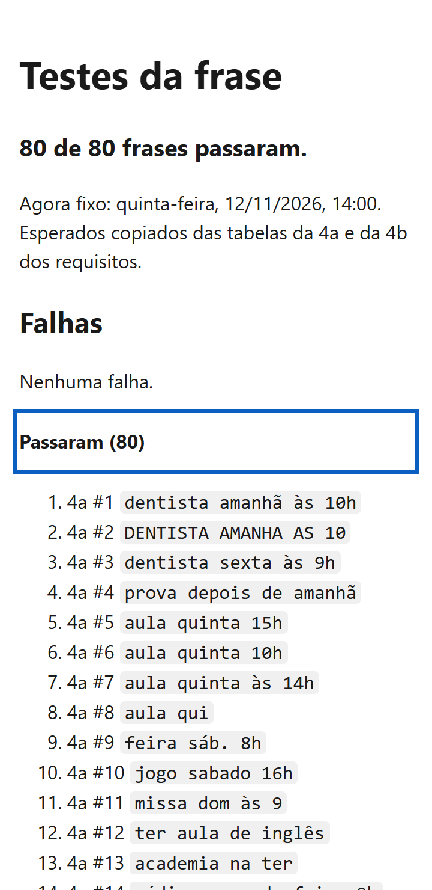
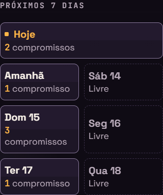
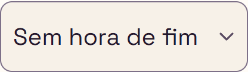

# Relatório de teste — Agenda, Etapa 5 (Entrega 5, acabamento)

- **Data:** 2026-11-13
- **O que foi testado:** as mudanças da Entrega 5 da Agenda, ainda sem commit, comparadas com o último commit do repositório `agenda`. Os arquivos são `testes.html` e `js/testes-frase.js` (novos), `js/frase.js` (US33), `css/style.css` (seção "12h", US35) e `README.md` (linha "Testes" e o print), além de `readme/agenda-computador.png` (US37). Testei contra a Agenda **US33 a US37** e os **requisitos gerais da Etapa 5**, na seção "Etapa 5" dos [requisitos](../requisitos.md). O print da US37 foi conferido depois do primeiro teste, com a versão final. O visual foi comparado com a seção 18 do [design](../design.md).
- **Onde:** Microsoft Edge (Chromium) **headless**, com perfil próprio numa pasta temporária, controlado por script (playwright-core). O site foi servido por um servidor local que só lê a pasta `trabalhos/agenda` e foi aberto também direto do disco (`file://`). O fuso foi `America/Sao_Paulo`. Na página principal, o relógio ficou **parado** em quinta-feira, 12/11/2026, às 14:00 (o "agora" das tabelas). Usei a emulação de celular (tela de toque, escala 2) a 320 e 360px e o modo de computador a 1280px, nos 2 temas × 2 letras. A lógica foi conferida também em Node. **Não testei:** celular de verdade, leitor de tela de verdade e o GitHub Pages (a Entrega 5 ainda não foi publicada).

## Resultado

**Aprovado.** A `testes.html` dá **80 de 80** no servidor local e no `file://`. Os 80 esperados dela são iguais às tabelas da 4a e da 4b, conferidos um por um por um script meu que lê o `requisitos.md`. Numa cópia fora de `trabalhos/`, a página acusou as falhas que eu provoquei. As 80 frases e mais 4 da US33 deram o resultado das tabelas no formulário aberto, em 4 combinações de largura, tema e letra (336 aberturas, 0 falhas). "1 compromisso" ficou numa linha a 360px e "Sem hora de fim" ficou inteiro a 320px com a letra grande. O `#erro-salvar` apareceu inteiro, acima da barra, nos 16 casos. Nenhum critério de aceite falhou. Ficam só observações de gravidade baixa. O print da US37, feito depois, também passou em todos os critérios.

## Verificações

| Área | Resultado | Observação |
|---|---|---|
| Celular a 360px | Passou | Sem rolagem horizontal a 320, 360 e 1280px, nos 2 temas × 2 letras, com a página, com o formulário aberto pelas 84 frases e com a `testes.html` (com e sem falhas, com a lista "Passaram" aberta). Todos os controles têm 44px ou mais. A exceção é o link de texto "João Saccucci Labs" no rodapé, que não mudou nesta entrega. Medidas da US35 abaixo. |
| Teclado | Passou | Na `testes.html`, o Tab chega ao "Passaram (80)". Ele tem contorno azul de 3px e 44px de altura, e o Enter abre a lista. Na Agenda, o Esc logo depois de abrir pela frase devolveu o foco ao campo nas 336 aberturas, com a frase no campo. O Esc de "Novo compromisso", "Editar", "Remarcar" e "Agendar" devolve o foco ao botão que abriu. |
| Acessibilidade | Passou | A `testes.html` tem `lang="pt-BR"`, um `h1` "Testes da frase", um `h2` "Falhas" e um `h3` "Falhou: …" por falha. "Passou" e "Falhou" são texto, não só cor. A lista "Passaram" é um `details`/`summary`, que já anuncia o estado. Na Agenda, os nomes e a estrutura não mudaram nesta entrega. |
| Contraste | Passou | Na `testes.html`: texto 17.40, texto dentro do `code` 15.27, "Falhou" em vermelho 6.57 e contorno do foco 6.15 (calculado pelas cores do CSS). Na Agenda não entrou cor nova: a seção "12h" só muda medidas. O `#erro-salvar` usa as cores de sempre nos dois temas. |
| Erros | Passou | Console sem erros e sem avisos na `testes.html` (servidor e `file://`) e na Agenda, nos 12 cenários de medida, nas 336 aberturas e nos 16 testes de `localStorage` cheio. Nenhum 404. A `testes.html` pede só os 4 arquivos dela, nada da internet: no `index.html`, as fontes do Google continuam como antes. |

## Critérios de aceite

**Agenda US33: A pontuação fica quando o "e" de ligação sai**
- [x] Sai só a palavra "e". A vírgula, o ponto e vírgula e o traço ficam ("reunião amanhã 10h; e conversar" → "Reunião; conversar"; "… 10h – e conversar" → "Reunião – conversar").
- [x] "reunião amanhã 10h, e conversar" → "Reunião, conversar", em Node e no formulário (fecha a observação G do `etapa-4b.md`).
- [x] Continuam iguais: "reunião amanhã e, depois" → "Reunião, depois"; "reunião, e amanhã", "reunião e amanhã", "reunião amanhã e" e "reunião – e – amanhã" → "Reunião"; "comprar vitamina E amanhã" → "Comprar vitamina E"; "responder amanhã e-mail do chefe" → "Responder e-mail do chefe"; "festa na casa do João e amanhã 20h" → local "Casa do João" e título "Festa". Aceito a correção do texto do requisito feita pelo dev. A frase antiga, "na casa do João e amanhã 20h", começa com "na", e "no"/"na" no começo da frase não abrem local (US32). O exemplo certo é o da tabela de decisões do `etapa-4b.md`, que é a frase com "festa".
- [x] A mesma regra vale para o local e para os itens: "festa na casa do João, e amanhã 20h" → local "Casa do João"; "dentista levar RG; e amanhã 10h" → item "RG"; "dentista levar RG e cartão, e amanhã 10h" → itens "RG" e "cartão".
- [x] As 80 frases continuam iguais: 80 de 80 na `testes.html` e no formulário. Comparei também o `frase.js` antigo com o novo em 40.000 frases sorteadas (com "e", "E", pontuação, datas, horas, local e "levar"). Só 72 deram resultado diferente, e em todas a diferença é só a pontuação que agora fica. Nenhuma deu erro.

**Agenda US34: Esc logo depois de abrir pela frase**
- [x] **Conferência manual do João** em 2026-11-13, no site publicado. Ele recarregou a página antes de cada vez, abriu o formulário pela frase, fechou com Esc, abriu de novo e apertou Esc o mais rápido possível. Nas **5 vezes** o foco voltou para o campo "Criar por frase".
- [x] Esperado em todas: o foco volta, a frase fica e nada é salvo. Repeti o roteiro por script, 5 vezes com recarga: foco no campo, frase no campo, nenhum compromisso novo.
- [x] Não houve falha, então não entra problema para o dev.
- [x] **Observação F do `etapa-4b.md`: fechada como "corrida do teste automático", sem mudança no código.** Também não apareceu nas 336 aberturas desta rodada (Esc cerca de 70 ms depois de abrir).
- [x] O Esc de "Novo compromisso", "Editar", "Remarcar" e "Agendar" continua igual: o foco volta ao botão que abriu.

**Agenda US35: Letra grande e telas pequenas**
- [x] A 360px com a letra grande, nos dois temas, "1 compromisso" fica numa linha só (print abaixo). O espaço dos lados da plaquinha é 8px, também nos dias "Livre". "3 compromissos" quebra, como o design 15.8 permite. A 1280px e com a letra normal, o espaço continua 15px e 12px.
- [x] A 320px com a letra grande, a "Duração" mostra **"Sem hora de fim" inteiro**, sem "…", com a emulação de celular nos dois temas (print abaixo). A pedido do dev, medi o espaço: o `select` tem 208px, o espaço do texto tem **158px** e "Sem hora de fim" a 20px mede **155,2px**, então sobram ≈2,8px. Com o erro (`aria-invalid`, borda de 2px), o espaço continua 158px (9px e 37px de espaço interno). "30 min" (64px) e "Outro" (54px) cabem com folga. A seta fica a 8px da borda e o filete a 8px. A 360px nada mudou: 15px/55px, 169px de espaço para o texto. A folga é pequena, mas o critério é sobre o celular e lá passa. A janela estreita de computador com barra de rolagem (o caso do corte que o dev citou) não dá para reproduzir no Edge headless, porque nele a barra não ocupa espaço. Fica como observação A.
- [x] **`#erro-salvar`:** com o `localStorage` cheio, "Não foi possível salvar o compromisso." aparece inteiro e acima da barra Cancelar/Salvar. Conferi 16 casos: 320 × 568 e 360 × 640, letra normal e grande, os dois temas, formulário aberto por "Novo compromisso" e pela frase #22 da 4b. O ponto do meio do aviso é do próprio aviso (nada por cima). A base do aviso fica de 19 a 30px acima do topo da barra. Nenhuma correção foi necessária.
- [x] Sem rolagem horizontal, nada cortado e 44px de toque a 320, 360 e 1280px, nos 2 temas × 2 letras (a exceção é o link de texto do rodapé, que já existia).

**Agenda US36: Página de testes da frase (`testes.html`)**
- [x] `testes.html` na raiz e `js/testes-frase.js`, em HTML, CSS e JavaScript puros. Não tem biblioteca, `fetch`, Node nem build.
- [x] Carrega os mesmos `js/datas.js`, `js/armazenamento.js` (só pelas constantes do checklist) e `js/frase.js` do site, por caminho relativo. Não carrega o `app.js`. Funciona no servidor local e no `file://` (80 de 80 nos dois). No GitHub Pages ainda não foi publicada.
- [x] O "agora" fixo é `new Date(2026, 10, 12, 14, 0)`, passado para a `entenderFrase`.
- [x] Roda as 80 frases (52 + 28). A #27 da 4b é escrita por inteiro, de "a" a "v".
- [x] Confere cada coluna que tem valor na tabela, a linha "Entendi" (inteira, ou o trecho quando a tabela usa "…"), a dica e os avisos. A comparação é do texto exato. **Os esperados batem com as tabelas nos 80 casos:** um script meu lê as duas tabelas do `requisitos.md` e compara frase, título, data, hora, "Sem data", fim/duração, tempo para sair, local, o que levar, linha e avisos. Deu zero diferenças.
- [x] O que é só da tela fica de fora. "vazio", "vazia" e "desativado" contam como sem valor.
- [x] Os esperados estão escritos na própria página (`CASOS_4A` e `CASOS_4B`).
- [x] Resumo logo abaixo do `h1`: "80 de 80 frases passaram.". Na cópia com falhas: "77 de 80 frases passaram. 3 falharam.".
- [x] A lista das falhas vem logo abaixo. Sem falhas, aparece "Nenhuma falha.". As que passaram ficam recolhidas em "Passaram (80)".
- [x] Se a `entenderFrase` dá erro numa frase, a página não para. Na cópia, forcei um erro na 4a #8, que apareceu como "Erro: erro de propósito", e as outras 79 continuaram.
- [x] Não lê nem grava o `localStorage`. Contei as chamadas a `getItem`, `setItem`, `removeItem`, `clear` e `key` ao abrir a página: foram **zero**. As 4 chaves que eu tinha gravado antes (3 da `agenda:` e 1 de fora) ficaram iguais, com os mesmos valores. Nada é enviado para a internet: só 5 pedidos, todos ao servidor local.
- [x] Não aparece para quem usa o site: o `index.html` não cita `testes`, e a página tem `<meta name="robots" content="noindex">`.
- [x] `lang="pt-BR"`, `h1` "Testes da frase", sem rolagem horizontal a 360px (as frases quebram), contraste AA, console sem erros e nenhum 404. O CSS é o da 18.4, igual, num `<style>` próprio, e tem o favicon.
- [x] Com o `frase.js` da Etapa 5 dá 80 de 80. **A página acusa falha:** numa cópia fora de `trabalhos/`, troquei o título esperado da 4a #1 para "Dentistx" e o fim e o tempo para sair da 4b #22. A página mostrou "Falhou: 4a #1" com "Título / Esperado: Dentistx / Obtido: Dentista". Mostrou também "Falhou: 4b #22" com "Fim / Duração / Esperado: 10:00 / 2 h / Obtido: 10:00 / 1 h" e "Tempo para sair / Esperado: 45 min / Obtido: 30 min" (print abaixo).

**Agenda US37: Imagem da Agenda no README** (conferida depois do print, 2026-11-13)
- [x] O README mostra o print logo depois da descrição curta e do link do site, antes da linha "Testes".
- [x] O arquivo é `readme/agenda-computador.png`, numa pasta só dele, com caminho relativo (`readme/agenda-computador.png`), então aparece no GitHub. O `index.html`, o `style.css` e os `js/` não citam `readme` nem a imagem.
- [x] Só dados fictícios: "Reunião do TCC" (Biblioteca, sala 3), "Aula de Estrutura de Dados" (Bloco B), "Pagar a mensalidade da faculdade", "Dentista" (Clínica Sorriso) e a frase "almoço com a turma sábado 12h na cantina". Não aparece nome de pessoa, telefone nem endereço real. Só a página, sem abas, favoritos, barra de endereço ou cursor. O PNG não tem metadados de texto (só os blocos IHDR, IDAT e IEND).
- [x] Mostra o campo "Criar por frase", a faixa "Próximos 7 dias" (dias com compromisso e dias "Livre") e a lista com compromissos de mais de um dia ("Hoje" e "Amanhã"). Também aparecem o tema escuro, a letra normal, nenhum aviso flutuante, nenhuma faixa de lembrete e o "Ver exemplos" fechado, como pede a 18.6.
- [x] O texto alternativo em português descreve a tela: "Agenda no tema escuro: campo Criar por frase com uma frase digitada, faixa dos próximos 7 dias e compromissos agrupados por dia, …".
- [x] Tamanho: PNG de 1280 × 1424 e **195 KB** (199.799 bytes), abaixo dos 500 KB.
- [x] Feita com a versão final: aparecem a faixa com 8px dos lados e o resto igual ao site testado.
- [x] O README continua legível e com a linha "Testes", curta e com o endereço. A árvore de pastas ganhou `testes.html` e `readme/agenda-computador.png`.

**Requisitos gerais da Etapa 5**
- [x] Regressão: 80 de 80 no formulário aberto e na `testes.html`.
- [x] Os dados continuam na `versao: 2`, sem chave nova. Depois das 336 aberturas, o `localStorage` só tinha as chaves `agenda:` que eu mesmo gravei. O código novo não usa `localStorage.clear()`.
- [x] Só HTML, CSS e JavaScript puros. Nada é enviado para a internet.
- [x] Nenhum dado pessoal nos casos de teste, no README nem na imagem (só dados fictícios e sem metadados).

## Problemas encontrados

Nenhum problema encontrado.

### Observações (gravidade baixa, não impedem a aprovação)

- **A. Folga pequena da "Duração" a 320px com a letra grande.** Na emulação de celular, "Sem hora de fim" cabe com ≈2,8px de folga (155,2px de texto para 158px de espaço). Uma fonte de sistema um pouco mais larga, ou uma janela estreita de computador com barra de rolagem que ocupa espaço (caso citado pelo dev), ainda pode mostrar "…". A US35 fala do celular, e lá passa. Se o João vir "…" num celular de verdade, a artista pode tirar mais 2 ou 3px do espaço da direita.
- **B. Pontuação repetida que a US33 deixa ficar.** A regra manda manter a pontuação dos dois lados do "e". Por isso "reunião e, amanhã 10h, e conversar" vira "Reunião,, conversar", e "no centro 15/11 - - - e levar -" vira "No centro - - - levar". Está certo pela regra, porque a limpeza de sempre não junta sinais repetidos. A pessoa vê isso na linha "Entendi" antes de salvar. Se o PO quiser, numa etapa futura a limpeza pode juntar sinais repetidos.
- **C. A `testes.html` só confere a dica e os avisos quando a tabela os cita.** Numa frase em que a tabela não fala de aviso, um aviso a mais não seria acusado. A US36 pede exatamente isso ("quando 'O que mais conferir' traz…"), então está certo. Fica só como sugestão para o futuro.
- **D. Altura do print.** O design 18.6 pedia uma área de 1280 × 1100. O print tem 1280 × 1424 e mostra também os dois cards de "Amanhã" por inteiro. Fica abaixo de 500 KB e mostra tudo o que a US37 pede, então só fica registrado.

## Prints

## Como foi testado

- **Esperados × tabelas (Node, script meu):** li as tabelas "Frases de teste da Entrega 4a" e "da 4b" direto do `requisitos.md` e comparei com `CASOS_4A` e `CASOS_4B` do `testes-frase.js`, campo por campo. Resultado: 52 + 28 linhas, 0 diferenças.
- **`testes.html` no navegador:** abri pelo servidor local (com emulação de celular a 360px) e pelo `file://`. Conferi resumo, listas, título, `lang`, `noindex`, scripts carregados, pedidos de rede, 404, console, rolagem, Tab e Enter no "Passaram". Gravei 4 chaves no `localStorage` antes de abrir e contei as chamadas ao `localStorage` durante a abertura.
- **Falha provocada:** fiz uma cópia de `testes.html`, `favicon.svg` e `js/` na pasta temporária. Troquei 3 esperados (4a #1 e 4b #22) e pus um erro forçado na 4a #8.
- **US33 (Node):** testei as frases do critério, mais 12 com local, itens e pontuação, e comparei o `frase.js` antigo com o novo em 40.000 frases sorteadas.
- **Regressão no formulário:** abri as 80 frases e mais 4 da US33 pelo campo, a 360 escuro/normal, 320 claro/grande, 1280 claro/normal e 360 escuro/grande. Conferi título, data, hora, "Ainda sem data", "Termina às" e Duração, tempo para sair, local, itens, linha "Entendi", dica e avisos. Fechei com Esc, conferindo o foco e a frase. Também conferi a rolagem, o console, o 404 e as chaves do `localStorage`.
- **US35:** fiz 12 combinações (320/360/1280 × 2 temas × 2 letras) com emulação de celular, e de novo em modo computador. Medi a faixa da semana (espaço interno, linhas e altura), o `select` da Duração (largura, espaço interno, seta, filete e a largura de cada opção, com e sem erro) e os controles abaixo de 44px. Para o `#erro-salvar`, foram 16 casos com o `localStorage` cheio.
- **US34:** registrei a conferência manual do João. Repeti o roteiro por script e testei o Esc dos outros 4 jeitos de abrir o formulário.
- Os scripts e as cópias ficaram na pasta temporária, fora do projeto. O Edge rodou com perfil próprio e foi fechado no fim, junto com os servidores (nenhum processo sobrou). Não mexi no código da Agenda e não fiz commit.
