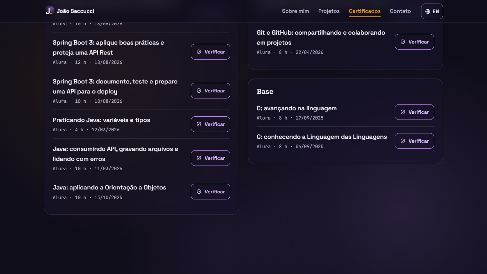
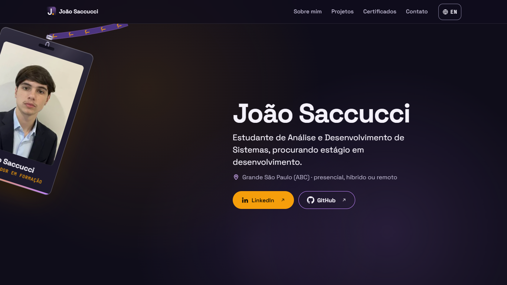
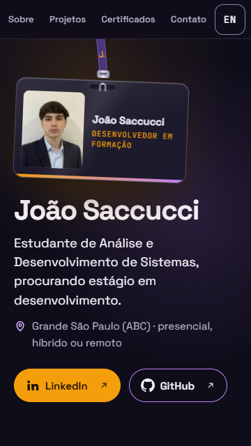
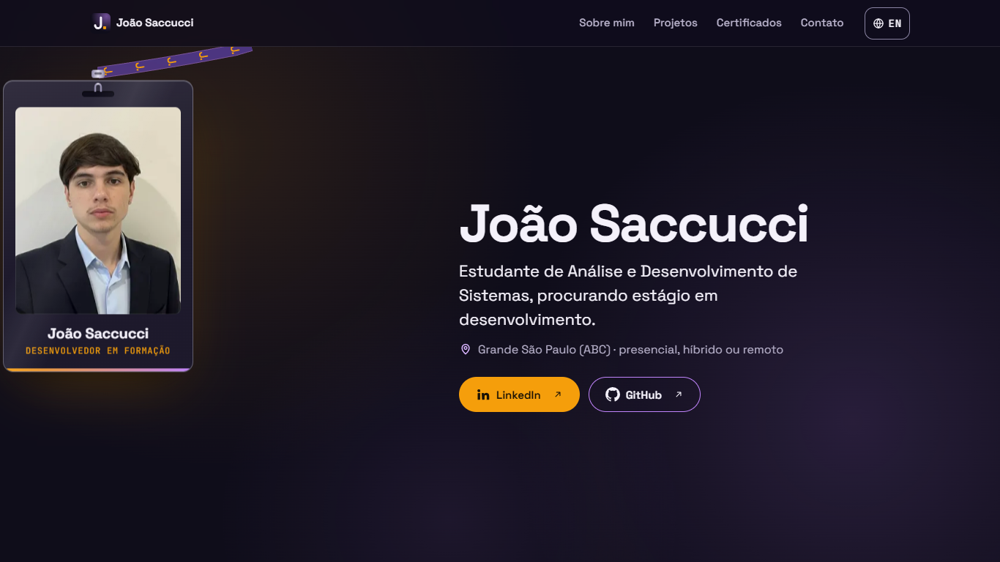

# Relatório de teste — Portfólio, Etapa 1

- **Data:** 2026-11-14
- **O que foi testado:** a página `index.html` do Portfólio (com `css/style.css`, `js/idioma.js`, `js/efeitos.js`, `js/cracha.js`, `js/main.js`, `favicon.svg`, as fontes, as imagens de `img/` e o `testes.html`) contra as Portfólio US01 a US14 e os requisitos gerais ([requisitos](../requisitos.md)), o checklist da seção 14 do [design](../design.md) e o `README.md` do projeto (da US15, só se o README aponta para os lugares certos da Labs).
- **Onde:** Microsoft Edge 157 (Chromium), controlado por scripts (Playwright), num servidor local que imita o endereço do GitHub Pages (`/portfolio/`). Larguras de 320 a 1920px (320, 360, 375, 412, 600, 767, 768, 959, 960, 1024, 1280, 1366, 1440 e 1920), nos dois idiomas. Toque simulado (eventos de toque de verdade, pelo protocolo do DevTools) a 360px, movimento reduzido simulado, JavaScript desligado e `main.js` com erro 404 de propósito. Ainda **não** testado no GitHub Pages, porque o repositório ainda não foi publicado.
- **Conferido por conta própria** (sem usar os testes do dev): cerca de 470 conferências automáticas no navegador, axe-core, Lighthouse, um "conta-gotas" automático em mais de 2.000 prints, os 22 endereços externos, os metadados das imagens e o código dos repositórios Buscador-Cep e ScreenMatch.

## Resultado

**Reprovado.** Quase tudo passou: conteúdo, idiomas, efeitos, crachá, movimento reduzido, página sem JavaScript, contraste e privacidade. Mas um critério dos requisitos gerais falhou: com Shift+Tab (e em um caso com Tab), o link que recebe o foco fica **escondido atrás do menu fixo**, então o foco não fica "sempre visível" (problema 1, gravidade alta). A correção é pequena (uma regra de CSS). Os outros 4 problemas são de gravidade baixa.

**Atualização (Rodada 2, no fim do arquivo):** o dev corrigiu os problemas 1 a 4, e o 5 ficou como está, aprovado pelo João. O resultado final é **Aprovado com pendências**.

## Verificações

| Área | Resultado | Observação |
|---|---|---|
| Celular a 360px | Passou | Sem rolagem horizontal de 320 a 1920px, nos dois idiomas, e nenhum elemento passa da tela. O menu cabe em uma linha a 360px ("Sobre", "Projetos", "Certificados", "Contato", "EN"). Todos os links e botões têm pelo menos 44 × 44px. A 360 × 640 e a 1366 × 768, o nome, a frase e os dois botões aparecem sem rolar. O terminal quebra as linhas sem rolagem. |
| Teclado | **Falhou** | Tudo é alcançável com Tab, numa ordem lógica (Pular → marca → abas → idioma → LinkedIn/GitHub → projetos → outros → 11 "Verificar" → contato → rodapé). O contorno azul-céu de 3px aparece em tudo, e o crachá nunca recebe foco. **Mas com Shift+Tab alguns links ficam inteiros atrás do menu fixo** (problema 1). |
| Acessibilidade | Passou | O axe não encontrou nenhuma violação (WCAG 2.0, 2.1 e 2.2 A/AA e boas práticas, nos dois idiomas, a 1366 e a 360px). A página tem um só `h1`, e os títulos seguem a ordem `h2` → `h3`. Tem `header`, `nav`, `main`, `section` e `footer`, e o "Pular para o conteúdo" leva o foco ao `main`. Os 24 links dizem o destino e avisam "(abre em nova aba)". O `alt` das imagens descreve o que elas mostram. Os SVG decorativos e o crachá (menos a foto) ficam escondidos do leitor de tela. Com `prefers-reduced-motion`, nada se mexe. |
| Contraste | Passou | Medido com um "conta-gotas" automático: o script esconde só as letras, tira print e lê os pixels atrás de cada texto, em 11 momentos da animação das manchas, com a luz do mouse em 4 posições, a 1366, 1920, 768 e 360px. O menor contraste foi 4,89:1, no comentário cinza do terminal (`…` e `••••••••`, cor permitida só ali). Fora do terminal, o pior foi 6,6:1 (cargo âmbar do crachá), e o texto suave ficou com 7,2:1 ou mais. Bordas: lilás 5,4:1 e botão de idioma 4,7:1. |
| Erros | Passou | Console sem erros nem avisos em todos os cenários (os dois idiomas, `localStorage` bloqueado ou cheio, valor inválido guardado, movimento reduzido e sem JS). Nenhum 404. Nenhum pedido a outro site (fontes, scripts e imagens são do próprio projeto). Com o `main.js` em 404, em até 3s tudo aparece, inclusive com o inglês guardado. |

## Critérios de aceite

**Portfólio US01: Página única com menu de navegação**
- [x] Seções na ordem Topo, Sobre mim, Projetos, Certificados, Contato/rodapé.
- [x] Um só `h1` ("João Saccucci"), e cada seção tem um `h2` visível.
- [x] `nav` com Sobre mim, Projetos, Certificados e Contato. `#sobre`, `#projetos`, `#certificados` e `#contato` funcionam abertos direto (a 1366 e a 360px).
- [x] Menu fixo no topo, sempre visível, sem abas que escondem conteúdo.
- [x] O clique desliza suavemente (`scroll-behavior: smooth`), e com movimento reduzido pula direto (`auto`).
- [x] A aba da seção atual recebe `aria-current="true"`, texto âmbar e uma **barrinha de 2px** (o sinal que não depende de cor). No Topo, nenhuma aba fica marcada, e no fim da página o Contato é marcado.
- [x] O título da seção fica abaixo do menu (241px a 1366, com o menu terminando em 64px).
- [x] No celular, o menu é uma linha de abas sem botão de abrir e fechar (decisão 5), então não precisa de `aria-expanded`.
- [x] O botão de idioma fica no menu.
- [x] "Pular para o conteúdo" aparece com o primeiro Tab (16px, 16px) e leva o foco ao `main`.
- [x] `header`, `nav`, `main`, `section` e `footer`.
- [x] `title` e `meta description` próprios, que acompanham a troca de idioma.

**Portfólio US02: Topo**
- [x] Ordem: foto (`alt` "Foto de João Saccucci"), `h1`, a frase e a região exatas do requisito, e os botões LinkedIn e GitHub.
- [x] GitHub → `https://github.com/JoaoSaccucci`. LinkedIn → a URL da seção 6 dos requisitos.
- [x] Nova aba, `rel="noopener noreferrer"` e "(abre em nova aba)" escondido para o leitor de tela.
- [x] Sem rolar a 360 × 640 e a 1366 × 768, nos dois idiomas.
- [x] A foto tem `width`/`height` e está em WebP (14 KB e 6 KB), sem EXIF. CLS medido: 0.
- [x] Sem efeito de digitação, sem números e sem botão de currículo.

**Portfólio US03: Sobre mim**
- [x] Os 4 parágrafos são **idênticos** ao texto aprovado da seção 3.1 (comparados letra por letra com o `requisitos.md`).
- [x] "Estudando agora" fica numa cápsula com moldura, rótulo em negrito e parágrafo próprio (continua destacado sem cor).
- [x] Em inglês, aparece a tradução aprovada pelo João.
- [x] Sem barras nem porcentagens.
- [x] Largura máxima de 62ch no computador, e sem rolagem horizontal no celular.

**Portfólio US04: Projetos em destaque**
- [x] Ordem: Labs / empresa-ia, Agenda, Buscador-Cep, ScreenMatch.
- [x] Cada cartão tem `h3`, imagem ou terminal, descrição nos dois idiomas, tecnologias em texto e os botões certos. *(Ver o problema 5, sobre o tamanho das descrições.)*
- [x] Buscador-Cep e ScreenMatch mostram **só** "Ver código".
- [x] Nomes acessíveis com o projeto ("Ver site da Agenda (abre em nova aba)").
- [x] Nova aba + `rel` + aviso em todos.
- [x] O cartão da Labs diz "a empresa em que os funcionários são agentes de IA".
- [x] O ScreenMatch diz "Projeto feito durante um curso da Alura".
- [x] Todos os links abrem a página certa (ver "Links externos").
- [x] **Terminais fiéis ao código real.** Buscador-Cep: o texto do pedido, o `toString` do `record Endereco` e o arquivo `01001-000.json` batem com `Principal.java`, `Endereco.java`, `GeradorDeArquivo.java` e o JSON do repositório. ScreenMatch: o pedido, a URL impressa, o JSON da API, `TituloOmdb[...]`, "Titulo já convertido", o `toString` do `Titulo` (duração = os 2 primeiros caracteres de "60 min"), a lista no fim e "O programa finalizou corretamente!" batem com `PrincipalComBusca.java`, `TituloOmdb.java`, `Titulo.java` e o `filmes.json` do repositório. **A chave da API do OMDb aparece mascarada** (`apikey=••••••••`) e não está em nenhum arquivo do portfólio nem da Labs.

**Portfólio US05: Outros projetos**
- [x] Título "Outros projetos" e uma lista `ul`/`li`.
- [x] jogo_de_forca (C) e jogo-do-numero-secreto (HTML), cada um só com nome, linguagem e link.
- [x] Sem imagem e sem descrição, bem menores que os cartões.
- [x] Nova aba e nome acessível ("Ver código do jogo_de_forca (abre em nova aba)").

**Portfólio US06: Certificados**
- [x] Os 4 grupos estão na ordem certa, cada um com `h3`.
- [x] **Os 11 certificados batem com as tabelas da seção 3.3** em nome, instituição, carga, data e link (comparados por script com o `requisitos.md`). Em inglês, a data fica no formato "Oct 22, 2026".
- [x] "Verificar" abre em nova aba, com `rel` e um nome acessível completo ("Verificar o certificado AWS Academy Graduate – Cloud Foundations (abre em nova aba)").
- [x] O destaque da AWS vem com a palavra "Destaque"/"Featured" e fica em primeiro lugar, com a largura toda, ícone e botão âmbar.
- [x] Dentro de cada grupo, os certificados vão do mais recente para o mais antigo.
- [x] Nenhum PDF nem imagem de certificado.
- [x] Os 11 links abrem a página certa: o título de cada página da Alura tem o nome do curso, e o link da Credly vai para o selo "AWS Academy Graduate - Cloud Foundations".
- [x] A 360px, os nomes longos quebram linha e o "Verificar" fica embaixo.

**Portfólio US07: Contato e rodapé**
- [x] O título "Contato", a frase aprovada (nos dois idiomas) e os botões LinkedIn/GitHub com as mesmas regras do Topo.
- [x] Sem formulário, e-mail, telefone, endereço, CPF ou PDF.
- [x] "© 2026 João Saccucci" e "Feito com HTML, CSS e JavaScript puros · Ver o código", com link para `github.com/JoaoSaccucci/portfolio` (o endereço já responde).

**Portfólio US08: Português e inglês**
- [x] Na primeira visita, abre em `pt-BR`.
- [x] O botão mostra "EN" (nome acessível "EN, Read in English", `lang="en"`) e, em inglês, "PT" ("PT, Ler em português", `lang="pt-BR"`).
- [x] **Todo** o texto muda: menu, títulos, Topo, Sobre mim, descrições, grupos, rótulos, rodapé, `alt`, `.sr-only`, `aria-label`, `title`, `meta description` e datas. Todos os `data-en` foram aplicados, e o que fica sem tradução são só nomes (João Saccucci, projetos, tecnologias, agentes, cursos e endereços), como manda a seção 6. *(Ver o problema 4, sobre o `lang` dos nomes de cursos.)*
- [x] `lang` do `html` muda para `en` e volta para `pt-BR`.
- [x] Sem recarregar a página, a rolagem não muda (1500 → 1500) e o foco continua no botão.
- [x] A escolha fica em `portfolio:idioma`, e essa é a única chave usada. As chaves `jsl:` e `agenda:` continuam intactas.
- [x] Na visita seguinte, abre em inglês sem que o português apareça em nenhum quadro (conferido quadro a quadro).
- [x] Com o `localStorage` bloqueado ou cheio, a troca funciona e o console continua limpo.
- [x] Com um valor inválido ("fr"), a página abre em português.
- [x] Sem JS, a página fica toda em português e o botão de idioma fica escondido.
- [x] O inglês foi aprovado pelo João em 2026-11-14 (o estilo não foi revisado, como pedido).

**Portfólio US09: Manchas e luz**
- [x] Três manchas (âmbar e lilás) se movem devagar, com 32, 38 e 44s.
- [x] Ficam atrás de tudo, com `pointer-events: none` e `aria-hidden`, e o contraste fica AA em todos os momentos medidos.
- [x] A luz âmbar segue o mouse (some ao sair da janela). Ela não existe sem mouse nem com movimento reduzido.
- [x] As manchas não causam rolagem horizontal nem aumentam a página.
- [x] São decorativas (`aria-hidden="true"`).

**Portfólio US10: Surgir ao rolar e tela que acende**
- [x] Títulos, textos, cartões, grupos e o painel do contato surgem com `opacity` e `translateY`.
- [x] Usa `IntersectionObserver` e acontece uma vez só (`unobserve`).
- [x] A "tela que acende" aparece nos 4 projetos.
- [x] Nada fica escondido: abrir `#projetos` (e as outras seções) mostra a seção inteira, e o que já está na tela aparece na hora.
- [x] O conteúdo continua no HTML (leitor de tela e Ctrl+F).
- [x] Um elemento que recebe foco ainda escondido aparece (opacidade 1 em menos de 1s).

**Portfólio US11: Cartão que inclina**
- [x] Inclina até 2,7° no eixo X e 3,6° no Y (limites de 3° e 4°), com brilho.
- [x] Ao tirar o mouse, volta ao normal.
- [x] Só com mouse. No celular, o cartão fica parado e o **primeiro toque** em "Ver site" já abre a nova aba.
- [x] Com o cartão inclinado, o botão continua clicável.
- [x] Com foco de teclado dentro, o cartão fica reto, mesmo com o mouse em cima.

**Portfólio US12: Movimento reduzido e sem JavaScript**
- [x] Com movimento reduzido, nenhuma animação roda (`document.getAnimations()` vazio). Tudo fica visível na posição final: crachá parado, sem física e sem arrasto, com a fita do CSS e cursor normal, sem luz, sem tilt e sem translateY no hover. Ligar o movimento reduzido no meio de um arrasto para a física na hora, e desligar faz ela voltar.
- [x] Sem JS, tudo fica visível e legível em português, os links funcionam e o menu leva às seções pelo `#`.
- [x] A rolagem suave é desligada com movimento reduzido.

**Portfólio US13: Leve e fluida**
- [x] As animações usam `transform` e `opacity`. Durante o arrasto do crachá, o trace mostra **0 "Layout"** (só pintura do canvas).
- [x] No celular, não há `backdrop-filter`, há 2 manchas, sem luz e sem tilt.
- [x] As imagens são WebP com `width`/`height` e `srcset`. Os prints usam `loading="lazy"`, e a foto usa `fetchpriority="high"`.
- [x] Nenhum arquivo de outro site.
- [x] **Lighthouse (rodou nesta máquina, no Edge 157, modo celular, servidor local):** Desempenho 97, Acessibilidade 100, Boas práticas 100 e SEO 100. FCP 1,8s, LCP 2,4s, CLS 0 e TBT 0ms. *(Repetir no Chrome, no endereço publicado.)*

**Requisitos gerais**
- [x] Celular a desktop: de 320 a 1920px, sem rolagem horizontal, com 44px de toque.
- [ ] **Teclado: foco sempre visível.** Falhou com Shift+Tab (problema 1). A ordem lógica e o contorno estão certos.
- [x] Títulos em ordem, `alt` descritivo, decorativos escondidos e ícones com texto.
- [x] Nada depende só de cor (barrinha no menu, palavra "Destaque" e tecnologias em texto).
- [x] Contraste AA, inclusive por cima das manchas e da luz.
- [x] Links externos: os 24 links (22 endereços diferentes) abrem em nova aba, com `rel` e aviso.
- [x] Erros: console limpo e nenhum 404, nos dois idiomas.
- [x] Privacidade: nenhuma das imagens (`joao-*.webp`, prints, `og.png` e o print do README) tem EXIF, GPS ou XMP. Os WebP têm só o perfil de cor (ICCP), e os PNG só IHDR, IDAT e IEND. No site e no README, nenhum e-mail, telefone, CPF, endereço ou PDF, nenhuma chave e nenhuma senha. A busca por "chefe" e "boss" (sem diferenciar maiúsculas) em todos os arquivos do projeto não achou nada, e o mesmo vale para o texto, `alt`, `aria-label`, `.sr-only`, `title` e `meta` gerados nos dois idiomas.
- [x] Só HTML, CSS e JS puros (o `testes.html` do dev passou 31/31).
- [x] Caminhos relativos e funcionamento em `/portfolio/`. *(Conferir de novo no GitHub Pages.)*

**Portfólio US14: README**
- [x] O repositório tem só código, README, `testes.html` e o print do README (sem requisitos, design ou relatórios).
- [x] O README tem: o que é, o link do site, as tecnologias, as funções (idiomas, efeitos, acessibilidade, movimento reduzido), como rodar, como atualizar os dados, a estrutura e uma imagem do site (`readme/portfolio-computador.png`, 1366 × 768, sem metadados).
- [x] Nenhum dado pessoal proibido.

**Portfólio US15 (só o README):**
- [x] Os links do README apontam para os lugares certos da Labs: `detalhe-projeto.html?id=portfolio` e `aulas.html` existem, e os documentos ficam em `docs/projetos/portfolio`. O detalhe só vai funcionar depois que o Portfólio entrar no `projetos.json` (passo da US15, depois do commit).

**Checklist do design (seção 14)**
- [x] A 360px, nos dois idiomas, o menu fica em uma linha, sem nada cortado.
- [x] Topo sem rolar a 360 × 640 e a 1366 × 768.
- [x] Conta-gotas nos pontos claros: texto suave com 7,2:1 ou mais.
- [x] O `#C084FC` só aparece em bordas, pontos e na faixa do crachá. O `#8A84A3` como texto só aparece no terminal (`.t-coment`).
- [ ] Foco azul-céu visível em tudo e cartão reto com foco: o contorno está certo, **mas alguns focos ficam atrás do menu** (problema 1).
- [x] Com movimento reduzido, nada se mexe.
- [x] Sem JS, tudo visível, e com o `main.js` em 404 tudo aparece em até 3s.
- [x] No celular: sem `backdrop-filter`, 2 manchas, sem luz, sem tilt e o primeiro toque funciona.
- [x] O terminal tem o texto real, sem rolagem horizontal, e é legível a 360px.
- [x] O destaque da AWS diz "Destaque"/"Featured" e vem em primeiro.
- [x] O favicon carrega, e o `og.png` (1200 × 630, 247 KB) mostra o crachá, a foto e o cargo. *(O Post Inspector fica para depois da publicação.)*
- [x] Nenhum "chefe" nem "boss". O organograma diz "DECIDE E APROVA" / "DECIDES AND APPROVES".
- [ ] Crachá no computador: a fita sai de trás do menu, o balanço de entrada para (visível até 4,6s a 1366 e 5,0s a 1920), o cursor muda de `grab` para `grabbing`, o giro não passa de 18° (máximo medido: 17,99°), o crachá nunca sobe até o menu e não cria rolagem horizontal. **Mas uma parte dele sai da tela** quando é arrastado até a borda (problema 2), e depois de um puxão ele demora 7 a 8s para parar (problema 3).
- [x] Crachá no celular (toque simulado): o crachá é horizontal; arrastar com o dedo (para cima, para baixo e para os lados) move o crachá sem rolar a página; começar o gesto na fita, no texto ou ao lado do crachá rola a página normalmente. `touch-action: none` só no `.cracha`. *(Conferir num Android real.)*
- [x] Desempenho do crachá: o laço dorme (0 `requestAnimationFrame` em 1,5s parado), não roda com o Topo fora da tela (rolando até os Projetos no meio do balanço) e o arrasto não gera "Layout".
- [x] Crachá com movimento reduzido e sem JS: parado, reto, com a fita do CSS e o "J.", e com rolagem normal.
- [x] Acessibilidade do crachá: o Tab não para nele (nem em nada dentro dele). Para o leitor de tela, só a foto tem nome ("Foto de João Saccucci" / "Photo of João Saccucci"), porque o texto é `aria-hidden`. Em inglês, o cargo vira "Developer in training".

## Problemas encontrados

**1. O foco do teclado fica escondido atrás do menu fixo (Shift+Tab)**
- **Página:** `index.html` (CSS em `css/style.css`).
- **Passos:** abrir a página a 1366 × 768; rolar até o fim e pôr o foco em "Ver o código" do rodapé; apertar **Shift+Tab** várias vezes, voltando pelos certificados e projetos. (Também com Tab, a 1366px, do último certificado de "Java e Spring Boot" para o "Verificar" do PostgreSQL, que fica na outra coluna, mais acima.)
- **Esperado:** o elemento com foco aparece inteiro, com o contorno azul-céu, abaixo do menu (requisitos gerais: "foco **sempre visível**"; WCAG 2.4.11).
- **Obtido:** o navegador rola só até o elemento encostar no topo da janela, que fica **atrás do menu fixo** (64px no computador, 56px no celular). Casos medidos:
  - 1366, Shift+Tab: "Verificar" do PostgreSQL (0 a 44px) e do Spring Boot 3 (14 a 58px), inteiros atrás do menu;
  - 1366, Tab: "Verificar" do PostgreSQL de 36 a 80px, metade atrás do menu;
  - 360, Shift+Tab: "Verificar" do Praticando Java e do Spring Boot 3 e "Ver código do ScreenMatch";
  - 1920, Shift+Tab: "Verificar" do C: avançando, "Ver código da Agenda" e "Ver site da Agenda".
- **Gravidade:** alta (quebra o critério "foco sempre visível" dos requisitos gerais).
- **Onde corrigir (sugestão):** em `css/style.css`, perto da linha 83, pôr `html { scroll-padding-top: calc(var(--altura-menu) + 16px); }` e diminuir o `scroll-margin-top` de `.secao` (linha 324) e de `.contato` (linha 881) para algo como `8px`. Sem essa troca, o espaço para os títulos das seções fica dobrado, porque as duas regras se somam. Conferido injetando essas duas regras só no teste, sem mexer no projeto: 0 casos de foco escondido a 1366, 360 e 1920, com Tab e com Shift+Tab, e os títulos das seções continuam abaixo do menu.
- **Status:** corrigido pelo dev em 2026-11-14 (`css/style.css`: `scroll-padding-top`/`scroll-padding-bottom` no `html` e `scroll-margin-top: 8px` em `.secao` e `.contato`). Conferido na Rodada 2.

**2. Ao ser arrastado até a borda, uma parte do crachá sai da tela**
- **Página:** `index.html`, Topo (código em `js/cracha.js`, linhas 75 e 76, `minX`/`maxX`).
- **Passos:** a 1366 × 768, segurar o crachá com o mouse e arrastar bem para a esquerda (além da borda da janela); soltar e ver o balanço.
- **Esperado:** "a borda do crachá fica a 4px da borda da tela", e o crachá "não sai da tela" (design, 8.5 e checklist da seção 14).
- **Obtido:** o limite vale para o centro da presilha e não conta o giro. Com 18° de giro, o canto de baixo de um crachá de ~400px de altura vai ~124px para o lado. A 1366, até **115px** do crachá ficam fora da tela (a foto e o "João Saccucci" aparecem cortados), também durante o balanço depois de soltar. A 800px, 16px ficam fora. Não aparece rolagem horizontal (o `overflow-x: clip` do Topo corta), e o crachá volta sozinho.
- **Gravidade:** baixa (é visual, temporário e só acontece quando a pessoa puxa até a borda; nenhum critério das user stories quebra).
- **Onde corrigir (sugestão):** em `medir()`, aumentar a folga de `minX`/`maxX` com a parte que o giro joga para o lado (por exemplo, `altura do crachá × Math.sin(ANG_MAX)`), ou diminuir o ângulo máximo quando a presilha está perto da borda.
- **Status:** corrigido pelo dev em 2026-11-14 (`js/cracha.js`: `limiteDeGiro()` e uma "parede" para a ponta solta). Conferido na Rodada 2.

**3. Depois de um puxão, o crachá demora 7 a 8 segundos para parar**
- **Página:** `index.html`, Topo (`js/cracha.js`, linha 57, `amortecimento: 0.975`).
- **Passos:** a 1366 ou a 1920px, depois que o balanço de entrada para, puxar o crachá ~150px para o lado e soltar.
- **Esperado:** "parada em ~5s (computador)" (design, 8.5).
- **Obtido:** o movimento visível (mais que 1px ou 0,3°) continua por 7,2s a 1366 e por 7,7s a 1920, e o laço só dorme depois de 8,0 a 8,4s. O **balanço de entrada está certo**: o movimento visível acaba em 4,6s (1366), 5,0s (1920) e 4,2s (360). Como o movimento depois do puxão começa pela pessoa, ele não fere o critério 2.2.2 da WCAG.
- **Gravidade:** baixa.
- **Onde corrigir (sugestão):** um amortecimento um pouco mais forte só depois de soltar, ou aceitar e registrar o tempo no design.
- **Status:** corrigido pelo dev em 2026-11-14 (`js/cracha.js`: `amortecimentoSolto` só depois de soltar). Conferido na Rodada 2.

**4. Em inglês, os nomes dos cursos em português não têm `lang="pt-BR"`**
- **Página:** `index.html`, Certificados (`span.cert__nome` nas linhas 446 a 549 e os textos `.sr-only` dos "Verificar").
- **Passos:** trocar para inglês e ouvir os certificados com um leitor de tela (ou inspecionar o `lang`).
- **Esperado:** quando um trecho está em outro idioma, ele ganha o `lang` desse idioma, para o leitor de tela pronunciar certo (WCAG 3.1.2). Pela decisão do item 3, os nomes ficam em português.
- **Obtido:** a página fica com `lang="en"`, e "Spring Boot 3: desenvolva uma API Rest em Java", "Praticando Java: variáveis e tipos" e os outros são lidos com a voz em inglês. O axe não acusa esse caso.
- **Gravidade:** baixa.
- **Onde corrigir (sugestão):** `lang="pt-BR"` nos `span.cert__nome` (o nome fica igual nos dois idiomas, então o atributo pode ficar fixo). No texto escondido "Verify the ... certificate" é mais difícil, porque o `data-en` troca o texto inteiro. Dá para aceitar como está.
- **Status:** corrigido pelo dev em 2026-11-14 (`index.html`: `lang="pt-BR"` nos 11 `.cert__nome` e no nome do curso dentro do texto escondido). Conferido na Rodada 2.

**5. Algumas descrições de projeto passam de 3 linhas no computador**
- **Página:** `index.html`, Projetos, a 1366px.
- **Passos:** abrir a 1366 × 768 e contar as linhas das descrições, nos dois idiomas.
- **Esperado:** "uma descrição curta (até cerca de 3 linhas no computador)" (US04).
- **Obtido:** em português, Labs e ScreenMatch têm 4 linhas (Agenda e Buscador-Cep têm 3). Em inglês, as 4 descrições têm 4 linhas.
- **Gravidade:** baixa ("cerca de" 3 linhas, a leitura não fica prejudicada e o texto em inglês foi aprovado pelo João).
- **Onde corrigir (sugestão):** encurtar um pouco as duas descrições em português, se o João quiser, ou aceitar 4 linhas.
- **Status:** mantido como está: o João aprovou os textos. Fica como pendência aceita.

### Observações (não são problemas)

- **O que o dev precisa corrigir para aprovar:** só o problema 1. Os problemas 2 a 5 podem ficar como pendências.
- **Afirmações do dev conferidas:** o "axe sem violações" se confirmou. Os "135/135 testes" não foram usados (os testes deste relatório foram escritos à parte), mas o `testes.html` passou 31/31. O Lighthouse **rodou** nesta máquina com o Edge 157, quando aberto com porta de depuração fixa (o `chrome-launcher` não consegue abrir esse Edge, por isso deu erro para o dev). Ficou Desempenho 97 e Acessibilidade 100, acima da meta (90 e 95).
- **O axe marca o contraste como "incompleto"** (7 a 11 itens, por causa do gradiente). Esses itens foram conferidos com o conta-gotas automático da tabela de Verificações.
- **Durante a "tela que acende"** (menos de 1s, uma vez só), a linha âmbar de luz passa por cima das letras do terminal. É o efeito pedido no design e não conta como problema de contraste.
- **LinkedIn:** o endereço responde com o código 999 a pedidos automáticos (o LinkedIn bloqueia robôs). O endereço confere com a seção 6 dos requisitos, mas precisa ser aberto à mão uma vez.
- **Os outros 21 endereços externos** abrem a página certa (código 200). O `github.com/JoaoSaccucci/portfolio` já existe.
- **Para o João (fora do portfólio):** no repositório público ScreenMatch, o `PrincipalComBusca.java` tem a chave da API do OMDb escrita no código. No portfólio ela aparece mascarada, mas vale pensar em trocar a chave e tirá-la do código daquele repositório.
- **Para o product-owner:** a seção 3.1 dos requisitos ainda diz "registrar aqui o texto aprovado" para o inglês do Sobre mim. O texto está no site (`data-en` em `index.html`), mas não foi copiado para o `requisitos.md`.
- **Seguir um link do menu:** o foco continua no link, e o próximo Tab segue a partir da seção de destino (comportamento normal do navegador), como o design permite (7.2).
- **Testes que ficam para depois da publicação:**
  - abrir `https://joaosaccucci.github.io/portfolio/` e conferir o favicon, o CSS, o JS, as fontes e as imagens sem 404;
  - rodar o **Lighthouse no Chrome** (modo celular), no endereço publicado;
  - testar num **Android real** (Chrome): arrastar o crachá com o dedo, rolar encostando fora do crachá (na fita e no texto), o primeiro toque nos botões e a fluidez da rolagem;
  - passar o endereço no **Post Inspector do LinkedIn**, para ver o `og.png` e o título;
  - abrir o link do LinkedIn à mão;
  - depois da US15, conferir os links do README que levam à Labs.

---

## Rodada 2

- **Data:** 2026-11-14
- **O que foi testado:** as correções dos problemas 1 a 4, mais uma regressão: rolagem horizontal de 320 a 1920px, console, os dois idiomas, página sem JS, movimento reduzido, crachá com mouse e com toque, teclado, axe e conteúdo. O dev mudou só `css/style.css`, `js/cracha.js` e `index.html` (conferido pela data de cada arquivo).
- **Onde:** o mesmo da Rodada 1 (Edge 157 controlado por scripts, servidor local em `/portfolio/`). Usei os mesmos testes, escritos pelo testador, e mais um teste novo para o crachá e o `lang`, com cerca de 560 conferências no total.

### Resultado

**Aprovado com pendências.** O único problema de gravidade alta (foco atrás do menu) foi corrigido, e os problemas 2, 3 e 4 também. Sobra só o problema 5 (descrições com 4 linhas), mantido porque o João aprovou os textos, e a lista de testes para depois da publicação.

### Verificações

| Área | Resultado | Observação |
|---|---|---|
| Celular a 360px | Passou | Sem rolagem horizontal e nada fora da tela nas 14 larguras, de 320 a 1920px, nos dois idiomas (200/200). Topo sem rolar a 360 × 640 e a 1366 × 768. |
| Teclado | Passou | Com Tab e com Shift+Tab, a 1366, 360 e 1920px, **nenhum** foco fica atrás do menu nem cortado embaixo (6/6). O "Verificar" do PostgreSQL agora aparece inteiro. Os títulos das seções abertos por `#` continuam logo abaixo do menu, e o contorno de 3px aparece em tudo. |
| Acessibilidade | Passou | O axe continua sem violações nos dois idiomas. Em inglês, os 11 nomes de cursos têm `lang="pt-BR"`. O nome acessível do botão fica "Verify the Spring Boot 3: desenvolva uma API Rest em Java certificate (opens in a new tab)", com só o nome do curso em `pt-BR`, e volta a "Verificar o certificado ... (abre em nova aba)" em português. |
| Contraste | Passou | As cores não mudaram nesta rodada (só `scroll-padding` no CSS), então valem as medidas da Rodada 1. |
| Erros | Passou | Console limpo e nenhum 404 em todos os cenários. |

### Conferência dos problemas da Rodada 1

1. **Foco atrás do menu: corrigido.** `css/style.css`, linhas 88 e 89 (`scroll-padding-top: calc(var(--altura-menu) + 16px)` e `scroll-padding-bottom: 16px`), e `scroll-margin-top: 8px` nas linhas 331 (`.secao`) e 888 (`.contato`). Com Tab e Shift+Tab, a 1366, 360 e 1920px, 0 casos. Com `#sobre`, `#projetos`, `#certificados` e `#contato` abertos direto, o título fica abaixo do menu (241px a 1366, com o menu terminando em 64px).
2. **Crachá saindo da tela: corrigido.** Arrastei o crachá até a borda esquerda, até a borda direita, na diagonal, para baixo e com um puxão médio, a 1366, 1920, 1024, 800, 360 e 320px (no celular, com toque). O crachá ficou sempre inteiro dentro da tela, durante o arrasto e no balanço depois de soltar (medido em todos os quadros: 0 quadros fora). Perto da borda, o giro diminui e o crachá fica quase reto (print abaixo). Depois de tudo, ele volta ao repouso reto (menos de 0,2° e menos de 0,3px de diferença).
3. **Tempo para parar depois de um puxão: corrigido.** O movimento visível agora acaba em 3,3 a 5,3s a 1366, 1024, 800, 360 e 320px, e em 3,8 a 5,7s a 1920px (antes eram 7,2 a 7,7s). O balanço de entrada continua igual: 4,6s (1366), 5,0s (1920) e 4,2s (360).
4. **`lang` dos cursos em inglês: corrigido.** `index.html`: os 11 `.cert__nome` com `lang="pt-BR"`, e no texto escondido do "Verificar" o nome do curso fica num `span lang="pt-BR"`, entre "the" e "certificate (opens in a new tab)".
5. **Descrições com 4 linhas:** mantido, aprovado pelo João.

### Regressão

- [x] Rolagem horizontal: nenhuma, de 320 a 1920px, nos dois idiomas.
- [x] Console: limpo em todos os cenários (os dois idiomas, `localStorage` bloqueado e cheio, sem JS, movimento reduzido e `main.js` em 404).
- [x] Idiomas: todos os `data-en` aplicados, `title` e `meta` traduzidos, datas "Oct 22, 2026", foco e rolagem mantidos na troca, sem o português piscar na visita seguinte, e um valor inválido abre em português.
- [x] Sem JS: tudo em português e visível, crachá parado e menu funcionando pelos `#`. Com o `main.js` em 404, tudo aparece em até 3s.
- [x] Movimento reduzido: nenhuma animação rodando, crachá parado e sem arrasto. Ligar o movimento reduzido no meio de um arrasto para a física na hora.
- [x] Crachá no computador: arrasto com `grab`/`grabbing`, giro de no máximo 18°, nunca sobe até o menu, o laço dorme, não roda com o Topo fora da tela, sem "Layout" no arrasto, e o botão direito não arrasta.
- [x] Crachá no celular (toque simulado): arrastar com o dedo, para os 4 lados, não rola a página. Começar o gesto no texto, na fita ou ao lado do crachá rola a página normalmente.
- [x] Conteúdo: o Sobre mim e os 11 certificados continuam idênticos aos requisitos, nenhum pedido a outro site, e todos os alvos de toque com 44px ou mais.

### Pendências que ficam

- Problema 5 (descrições com 4 linhas a 1366px), aceito pelo João.
- Os testes para depois da publicação continuam os mesmos da Rodada 1:
  - abrir o site publicado e conferir que não há 404;
  - Lighthouse no Chrome;
  - Android real (crachá com o dedo, rolagem, primeiro toque);
  - Post Inspector do LinkedIn (`og.png`);
  - abrir o link do LinkedIn à mão;
  - os links do README que levam à Labs, depois da US15.
- Observações da Rodada 1 que não são do dev: a chave do OMDb escrita no repositório público ScreenMatch (para o João) e o texto em inglês do Sobre mim, que ainda não foi copiado para a seção 3.1 do `requisitos.md` (para o product-owner).
