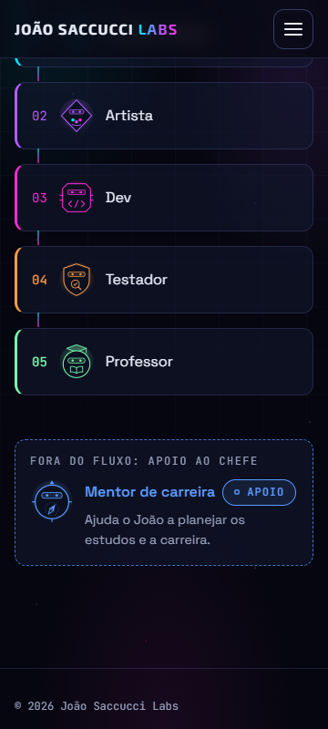
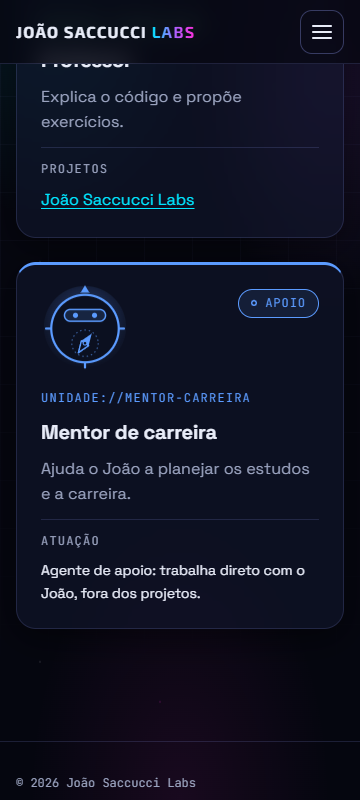
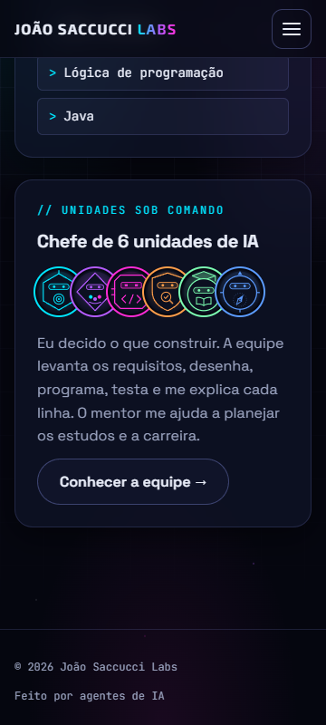

# Relatório de teste — Etapa 5

- **Data:** 2026-11-03
- **Testador:** agente testador (primeiro relatório da empresa)
- **O que foi testado:** US25 (cartão do Sobre), US26 (testador na equipe e no fluxo), US28 (mentor na Equipe como apoio), US29 (mentor fora do fluxo no Início) e os requisitos gerais da Etapa 5.
- **Páginas:** `index.html`, `equipe.html`, `sobre.html` e, para conferir que nada quebrou, `lista-projetos.html`, `detalhe-projeto.html`, `aulas.html` e `aula.html`.
- **Onde:** Microsoft Edge (Chromium) em modo headless, controlado pelo protocolo de depuração (CDP), com o site servido por um servidor local simples (equivalente ao Live Server). Larguras: 360, 768, 1024 e 1280px. Ainda **não** foi testado no GitHub Pages, porque a etapa não foi publicada.

## Resultado

**Aprovado** (depois do reteste de 2026-11-03). Todos os critérios de aceite das US25, US26, US28 e US29 passaram nas 4 larguras, sem erros no console. As 4 pendências de gravidade baixa do primeiro teste foram corrigidas e retestadas, sem regressão (ver a seção "Reteste").

> Primeiro teste: "Aprovado com pendências", com 4 pendências de gravidade baixa, nenhuma delas quebrando critério de aceite.

## Verificações

| Área | Resultado | Observação |
|---|---|---|
| Celular a 360px | Passou | Início, Equipe e Sobre sem rolagem horizontal e sem nenhum elemento vazando da tela (conferido elemento por elemento). O fluxo fica em lista vertical com o traço entre as etapas; o selo "Apoio" desce de linha no bloco do mentor; os 6 mini avatares cabem numa linha. Também sem rolagem a 768, 1024 e 1280px. |
| Teclado | Passou | Tudo o que é clicável é alcançado com Tab, na ordem da tela, com o contorno ciano de 2px. O bloco do mentor e o selo não recebem foco (são só texto, como pede o design). No reteste, o menu do celular passou a fechar com Esc em todas as páginas (problema 2, corrigido). |
| Acessibilidade | Passou | Avatares novos com `alt` certo em todas as páginas. O leitor de tela lê o fluxo como lista de **5** itens e o mentor fica fora dela. O card do mentor é lido como "Mentor de carreira, Apoio, Ajuda o João…, Atuação, Agente de apoio…". A ficha do Sobre é lida como "Estudando agora: JavaScript e Java". Com `prefers-reduced-motion`, nenhuma animação nem transição fica ligada nas 3 páginas. No reteste, nenhuma página pula nível de título (problema 1, corrigido na Equipe e em Projetos). |
| Contraste | Passou | Tudo acima do mínimo AA, medido com as cores computadas no navegador (ver tabela abaixo). |
| Erros | Passou | Console sem erros em todas as páginas e larguras. Nenhum 404 de arquivo do site (os 39 links de entregáveis do detalhe respondem). Com `agentes.json` ou `projetos.json` faltando ou com JSON quebrado, a Equipe mostra a mensagem amigável "Ops! Não conseguimos carregar os dados." (com `role="alert"`), sem erro solto. |

### Contraste medido (cores computadas, fundo composto dos cards de vidro sobre `#05060F`)

| Elemento | Texto / fundo | Razão | Mínimo |
|---|---|---|---|
| Nome "Mentor de carreira" (Início) | `#5B9BFF` / `#0C1021` | 6.82:1 | 4.5:1 |
| Selo "APOIO" (12px, Início e Equipe) | `#5B9BFF` / `#141E37` | 5.97:1 | 4.5:1 |
| "FORA DO FLUXO: APOIO AO CHEFE" e papel do mentor | `#9AA3BF` / `#0C1021` | 7.53:1 | 4.5:1 |
| Número "04" do testador (Início) | `#FF9E4A` / `#0C1021` | 9.21:1 | 4.5:1 |
| `UNIDADE://MENTOR-CARREIRA` (12px) | `#5B9BFF` / `#0C1021` | 6.82:1 | 4.5:1 |
| `UNIDADE://TESTADOR` (12px) | `#FF9E4A` / `#0C1021` | 9.21:1 | 4.5:1 |
| Texto de "Atuação" | `#E8ECF8` / `#0C1021` | 16.0:1 | 4.5:1 |
| "Estudando agora" (`dt`) / "JavaScript e Java" (`dd`) | `#9AA3BF` e `#E8ECF8` / `#05060F` | 8.05:1 e 17.1:1 | 4.5:1 |
| Nome "Testador" na linha do tempo | `#FF9E4A` / `#0C1021` | 9.21:1 | 4.5:1 |
| Borda tracejada do bloco do mentor (não é texto) | azul 70% / `#0C1021` | 3.74:1 | 3:1 |
| Borda de cima dos cards do mentor e do testador | `#5B9BFF` e `#FF9E4A` / fundo | 7.29:1 e 9.85:1 | 3:1 |

### Casos de borda testados (dados trocados só na memória do navegador, sem mexer nos arquivos)

| Caso | O que aconteceu |
|---|---|
| `agentes.json` sem o campo `apoio` | O mentor vira agente do fluxo: card sem selo, com "Projetos / Nenhum projeto ainda". Correto pela regra do campo. |
| `apoio: false` nos outros e `apoio: "true"` (texto) no mentor | Ninguém vira apoio: só `apoio === true` conta. |
| Trabalho do mentor em `projetos.json` por engano | O card continua com "Atuação" e o texto de apoio. |
| 7º agente de apoio com `<b>` no nome | Aparece com selo, e o nome é mostrado como texto (o HTML é escapado). |
| `agentes.json` com 404, `agentes.json` com JSON quebrado, `projetos.json` com 404 | Mensagem amigável na Equipe e no detalhe do projeto. |
| JSON nenhum carregando | Início e Sobre continuam inteiros (o fluxo, o mentor e os mini avatares estão no HTML). |
| `detalhe-projeto.html?id=nao-existe` e sem `id` | "Projeto não encontrado." com link para voltar. |
| `aula.html?id=nao-existe` | "Aula não encontrada." com link para todas as aulas. |
| Modo de alto contraste do Windows (`forced-colors`) | O selo continua com o texto "Apoio" e a borda. |

### Prints (360px)

## Critérios de aceite

**US25: Cartão do Sobre com o que estou estudando**
- [x] O campo "Acesso: Nível máximo" foi removido (o texto não aparece mais na página).
- [x] "Estudando agora: JavaScript e Java" é o primeiro item da ficha, com a mesma fonte, tamanho e cor de "Base" e "Foco".
- [x] Escrito direto no HTML, sem JSON e sem JS.
- [x] Dentro do `dl`/`dt`/`dd`: o leitor de tela lê "Estudando agora: JavaScript e Java".
- [x] A 360px, sem rolagem horizontal e sem desalinhar os outros campos.
- [x] "Chefe de 6 unidades de IA" com os 6 mini avatares (alt "Testador" e "Mentor de carreira" nos novos), cada um com o anel na sua cor.

**US26: Testador na equipe e no fluxo**
- [x] `agentes.json` tem o `testador` com nome, papel, cor `#FF9E4A` e avatar.
- [x] Avatar próprio em `img/agentes/testador.svg` e cor diferente dos outros, com 9.2:1 sobre o vidro.
- [x] O fluxo do Início tem 5 etapas na ordem Product Owner → Artista → Dev → Testador → Professor, com o avatar e a cor do testador (`#FF9E4A`, igual ao JSON).
- [x] A 360px o fluxo fica em lista vertical, sem rolagem horizontal. A partir de 768px fica em 5 colunas na mesma linha e com a mesma altura.
- [x] A Equipe mostra o card do testador igual aos outros do fluxo, com "Projetos" calculado a partir do `projetos.json` (agora com "João Saccucci Labs", depois do trabalho registrado neste teste).
- [x] O detalhe do projeto e a linha do tempo mostram o testador com nome, avatar e cor laranja, sem mudar o JS (avatar da linha do tempo com `alt=""`, como manda o design).

**US27: Relatório de teste em cada entrega** (tarefa deste relatório)
- [x] As 5 áreas foram conferidas e o relatório está em `docs/testes/etapa-5.md`, na estrutura do guia.
- [x] É o relatório da própria Etapa 5, testando as US25, US26, US28 e US29.
- [x] Cada problema tem passos, esperado, obtido, gravidade e status.
- [x] Não há problema de gravidade alta. O primeiro resultado foi "Aprovado com pendências". Depois do reteste, ficou "Aprovado", e o professor pode começar.
- [x] `data/projetos.json` ganhou o trabalho do testador com o relatório como entregável e um evento na linha do tempo (2026-11-03).
- [x] No detalhe do projeto, o relatório aparece como entregável do testador e o link `docs/testes/etapa-5.md` responde (conferido no servidor local; no GitHub Pages, conferir depois do push).
- [ ] O relatório é legível abrindo o `.md` no GitHub (conferir depois do push).
- [x] Sem senhas, chaves, dados pessoais ou qualquer coisa da pasta de carreira. Os prints não mostram dados pessoais.

**US28: Mentor de carreira na Equipe como agente de apoio**
- [x] `agentes.json` tem o `mentor-carreira` com nome, papel, cor `#5B9BFF`, avatar e `"apoio": true`.
- [x] Avatar próprio em `img/agentes/mentor-carreira.svg` e cor diferente dos outros, com 6.8:1 sobre o vidro.
- [x] O card tem o selo com o texto "Apoio", no canto de cima, sem cobrir o avatar, o `UNIDADE://` nem o nome, nas 4 larguras.
- [x] No lugar de "Projetos", aparece "Atuação" com "Agente de apoio: trabalha direto com o João, fora dos projetos.", sem itálico e nunca com "Nenhum projeto ainda".
- [x] Com um trabalho do mentor no `projetos.json` por engano, o card continua com "Atuação".
- [x] Os cards do fluxo continuam como antes, e agente sem `apoio` é tratado como do fluxo.
- [x] Ordem do JSON, com o mentor por último. As divisórias "Projetos"/"Atuação" ficam na mesma altura em cada linha da grade (1, 2 e 3 colunas). A 1024px ou mais são 3 colunas (3 + 3).
- [x] Nada do trabalho do mentor aparece no site nem tem link.

**US29: Mentor fora do fluxo na página inicial**
- [x] Logo abaixo do fluxo há o bloco "Fora do fluxo: apoio ao chefe" (título `h3` em texto), com avatar, nome e papel do mentor, na cor dele.
- [x] O bloco fica separado do fluxo por 48px, com borda tracejada, sem `::before`/`::after` (nenhuma linha ou seta), e com o selo "Apoio" em texto. Ele fica fora do `<ol>`.
- [x] Escrito direto no HTML, com a cor `#5B9BFF` igual ao `agentes.json`.
- [x] Avatar com `alt="Avatar do Mentor de carreira"`.
- [x] A 360px sem rolagem horizontal, e a animação de entrada fica desligada com `prefers-reduced-motion`.

**Requisitos gerais da Etapa 5**
- [x] Nenhuma biblioteca nova (só HTML, CSS, JS puro e JSON).
- [x] Funciona a 360px sem rolagem horizontal, por teclado com foco visível, com contraste AA e respeitando `prefers-reduced-motion`.
- [x] Os avatares novos têm `alt` em todas as páginas em que aparecem (Início, Equipe, Sobre, detalhe e linha do tempo).
- [x] Nada da pasta de carreira está no repositório (conferido no `git status`).
- [x] O `README.md` do site fala da equipe de 6 agentes e do novo fluxo.
- [ ] Funciona publicado no GitHub Pages, com caminhos relativos. Os caminhos novos são todos relativos e a raiz tem `.nojekyll` (os `.md` são servidos como arquivo), mas só dá para confirmar depois do push.

## Problemas encontrados

### 1. Equipe: os títulos pulam do `h1` para o `h3`
- **Página:** `equipe.html`
- **Passos:** abrir a Equipe e listar os títulos com uma extensão de acessibilidade (ou pelo atalho de títulos do leitor de tela, tecla H no NVDA).
- **Esperado:** títulos em ordem, sem pular nível (ex.: `h1` Equipe → `h2` nome do agente → `h3` Projetos/Atuação).
- **Obtido:** `h1` Equipe → `h3` Product Owner → `h4` Projetos… O nível `h2` não existe. Já era assim desde a Etapa 1; a Etapa 5 só seguiu o padrão (o card do mentor usa `h3` e `h4` Atuação, igual aos outros).
- **Gravidade:** baixa (não quebra critério de aceite da Etapa 5).
- **Status:** Corrigido — retestado em 2026-11-03. Agora é `h1` Equipe → `h2` "Agentes" (só para leitor de tela, `.sr-only`) → `h3` nome → `h4` Projetos/Atuação. A página Projetos tinha o mesmo pulo e também foi corrigida (`h2` "Lista de projetos").

### 2. Menu do celular não fecha com Esc
- **Página:** todas (menu hambúrguer, abaixo de 768px). Testado na Equipe a 360px.
- **Passos:** em 360px, dar Tab até o botão do menu, apertar Enter (o menu abre) e depois apertar Esc.
- **Esperado:** o guia de teste pede "Esc fecha o que abre": o menu fecharia e o foco voltaria ao botão.
- **Obtido:** o menu continua aberto (`aria-expanded="true"`). Só fecha clicando de novo no botão. Já era assim antes desta etapa (o `js/comum.js` não trata a tecla Esc).
- **Gravidade:** baixa.
- **Status:** Corrigido — retestado em 2026-11-03 nas 7 páginas com menu. Esc fecha o menu, volta `aria-expanded="false"` e devolve o foco ao botão.

### 3. `projetos.json` sem o registro das outras tarefas da Etapa 5
- **Página:** `detalhe-projeto.html?id=joao-saccucci-labs`
- **Passos:** abrir o detalhe do projeto e olhar os trabalhos e a linha do tempo.
- **Esperado:** como nas etapas anteriores, os trabalhos do product-owner (requisitos da Etapa 5), do artista (2 cores, 2 avatares, seção 13 do design) e do dev (implementação da Etapa 5) registrados, com eventos na linha do tempo.
- **Obtido:** da Etapa 5, só aparece o trabalho do testador (adicionado por este teste). Os avatares novos não aparecem como entregáveis do artista.
- **Gravidade:** baixa (é registro do projeto, não critério de aceite das US testadas).
- **Status:** Corrigido — retestado em 2026-11-03. Os trabalhos do product-owner, do artista (com os 2 avatares) e do dev da Etapa 5 aparecem no detalhe, com 3 eventos novos na linha do tempo. O entregável do testador se chama "Relatório de teste — Etapa 5".

### 4. `CLAUDE.md` da raiz ainda mostra o fluxo antigo
- **Página:** fora do site (`CLAUDE.md` na raiz do repositório), item da "Nota: tarefa fora do site" da Etapa 5.
- **Passos:** abrir o `CLAUDE.md` e ler a seção "Fluxo de trabalho".
- **Esperado:** PO → artista → dev → **testador** → professor, com o mentor de carreira fora do fluxo.
- **Obtido:** a lista continua com 4 passos (product-owner, artista, dev, professor), sem testador e sem mentor. Os arquivos `.claude/agents/testador.md` e `mentor-carreira.md` já existem.
- **Gravidade:** baixa (não é critério de aceite de user story).
- **Status:** Corrigido — retestado em 2026-11-03. O fluxo tem 5 passos, com o testador como passo 4, e o mentor aparece num parágrafo à parte, fora do fluxo. O `README.md` da raiz mostra os 2 agentes novos e o fluxo novo.

## Reteste (2026-11-03)

Mesmo ambiente do primeiro teste (Edge headless + servidor local), a 360, 768 e 1280px.

| O que foi retestado | Resultado |
|---|---|
| Problema 1: ordem dos títulos | Passou. Nenhum nível pulado em nenhuma das 7 páginas (Início, Projetos, detalhe, Equipe, Aulas, aula e Sobre). Em Projetos: `h1` Projetos → `h2` Lista de projetos → `h3` nome do projeto. Os dois `h2` novos ficam escondidos na tela (1×1px, `position: absolute`), vêm antes da lista e não mudam o layout. |
| Problema 2: Esc no menu do celular (360px) | Passou nas 7 páginas. Esc fecha o menu com o foco no botão ou num link do menu, e o foco volta ao botão. Esc com o menu fechado não faz nada. O clique continua abrindo e fechando. A 1280px, Esc não esconde o menu nem tira o foco do link. |
| `aula.html`, que tem um Esc próprio | Passou. Esc fecha a gaveta do sumário e o foco volta ao botão "Sumário". Esc fecha o balão do glossário e o foco fica na palavra. O Esc do menu não atrapalha nenhum dos dois, porque só age quando o menu está aberto. |
| Problema 3: registro no `projetos.json` | Passou. São 46 endereços de entregáveis e imagens no `projetos.json`, e todos respondem sem 404. No detalhe, os 67 links de entregáveis abrem, nenhuma imagem está quebrada e as âncoras `#...-m1/m2/m3` das Aulas existem. |
| Problema 4: `CLAUDE.md` e `README.md` da raiz | Passou (conferido lendo os arquivos). |
| Regressão | Nenhuma. Nenhuma rolagem horizontal e nenhum erro no console nas 7 páginas, nas 3 larguras. |

### Observações (não são problemas)
- No card de trabalho do detalhe do projeto, o avatar do testador tem `alt="Avatar do Testador"`, enquanto a tabela da seção 13.2 do design fala em `alt=""` ali. É o mesmo comportamento de todos os agentes desde a Etapa 1 (o JS do detalhe não mudou, como pede a US26). Na linha do tempo o `alt` é `""`, como no design. Vale o artista confirmar qual dos dois fica valendo.
- O Chrome/Edge entrega ao leitor de tela os textos com `text-transform: uppercase` já em maiúsculas ("FORA DO FLUXO: APOIO AO CHEFE", "APOIO", "ATUAÇÃO"). Os leitores mais usados leem as palavras normalmente, e o site inteiro já usa esse padrão nos rótulos, então não foi tratado como problema.
