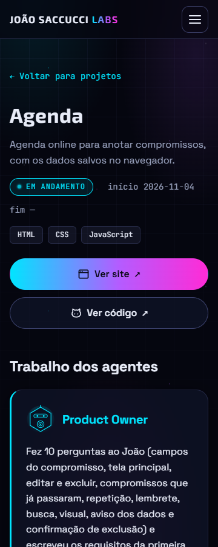
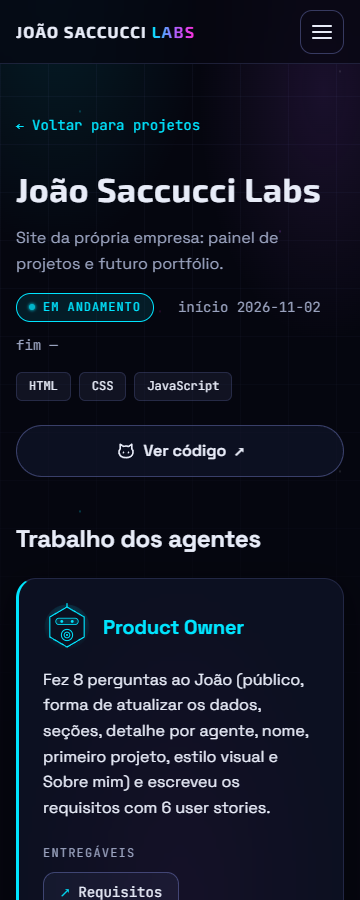
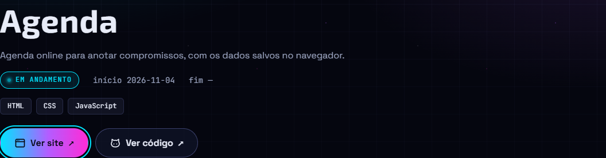

# Relatório de teste — Etapa 6

- **Data:** 2026-11-04
- **Testador:** agente testador
- **O que foi testado:** a parte da Labs da Etapa 6. São a US30 (regra no `CLAUDE.md`), a US31 (`.gitignore` e Git no repositório certo), a US32 (guias comuns e agentes revisados), a US33 ("Ver site" e "Ver código"), a US35 (passo a passo do repositório), a US37 (Agenda na vitrine), a US38 (READMEs) e os requisitos gerais da Etapa 6. A US36 (README da Agenda) já foi testada no [relatório da Agenda](../projetos/agenda/testes/etapa-1.md); aqui só conferi de novo que o repositório e o site respondem.
- **Fora desta rodada:** a US34 (aulas da Agenda com link fixo) ainda não foi feita pelo professor. Ela fica **não testável** nesta rodada e não conta para o resultado.
- **Páginas:** `detalhe-projeto.html?id=agenda`, `detalhe-projeto.html?id=joao-saccucci-labs`, `lista-projetos.html`, `equipe.html`, `index.html`, `aulas.html` e `sobre.html`.
- **Onde:** Microsoft Edge (Chromium) em modo headless, controlado pelo Playwright, com a raiz do `empresa-ia` servida por um servidor local simples (o mesmo caminho do GitHub Pages: `/trabalhos/joao-saccucci-labs/`). Larguras: 1280, 360 e 320px. Os links externos (GitHub e o site da Agenda) foram abertos de verdade. A Labs ainda **não** foi testada no GitHub Pages, porque as mudanças não foram commitadas.

## Resultado

**Aprovado.** Todos os critérios testáveis das US30 a US33 e das US35 a US38 passaram nas 3 larguras. Não houve erro no console causado pela etapa, e os 9 links externos e os 3 docs relativos da Agenda respondem. Não achei nenhum problema da Etapa 6. Há só observações (ver o fim), entre elas uma falha antiga que não é desta etapa.

## Verificações

| Área | Resultado | Observação |
|---|---|---|
| Celular a 360px | Passou | As 7 páginas ficam sem rolagem horizontal a 360px e também a 320px e 1280px. Abaixo de 480px, "Ver site" e "Ver código" ficam um embaixo do outro e ocupam a linha inteira (328px a 360px; 288px a 320px), sem texto cortado. Nada vaza da tela. |
| Teclado | Passou | No detalhe da Agenda, o Tab segue a ordem da tela: menu → "Voltar para projetos" → "Ver site" → "Ver código" → entregáveis. O foco aparece com o contorno ciano de 2px (afastado 3px do botão) nos dois botões. Enter no "Ver código" abre o repositório numa aba nova, e a página nova não consegue mexer na Labs (`window.opener` é `null`). |
| Acessibilidade | Passou | O leitor de tela lê os botões como "Ver site (abre em nova aba)" e "Ver código (abre em nova aba)". O ícone e a setinha `↗` ficam escondidos dele (`aria-hidden="true"`). Os entregáveis com `https://` também avisam "(abre em nova aba)", e os entregáveis relativos não avisam nada, como pede o design. Os títulos seguem a ordem h1 → h2 → h3. Com `prefers-reduced-motion`, a setinha não se mexe no hover. |
| Contraste | Passou | O texto dos dois botões passa do mínimo AA no ponto mais claro e no mais escuro do fundo, parados e com o mouse em cima (ver a tabela abaixo). |
| Erros | Passou | Nenhum erro de JS e nenhum 404 de arquivo do site nas 7 páginas. O `projetos.json` é um JSON válido, e todos os agentes citados nele existem em `agentes.json`. Os 9 endereços `https://` do JSON respondem 200. Se o JSON não carrega, aparece "Ops! Não conseguimos carregar os dados."; com um id que não existe, aparece "Projeto não encontrado.". Uma vez apareceu um 404 de `favicon.ico`, que já existia antes desta etapa (observação 1). |

### Contraste medido

Para medir, escondi o texto do botão, tirei um print do fundo que fica atrás dele e comparei cada ponto com a cor do texto que o navegador calculou.

| Elemento | Texto / fundo | Razão (pior / melhor ponto) | Mínimo |
|---|---|---|---|
| "Ver site" (parado e com mouse em cima) | `#05060F` / gradiente ciano → roxo → magenta | 5.64:1 / 11.9:1 | 4.5:1 |
| "Ver código" (parado e com mouse em cima) | `#E8ECF8` / vidro escuro | 14.5:1 / 16.0:1 | 4.5:1 |
| Contorno de foco | `#00E5FF` / `#05060F` | ~13:1 | 3:1 |

O ícone e a setinha usam a cor do texto (`currentColor`), então têm o mesmo contraste.

### Prints

## Critérios de aceite

### US30: Regra de projetos independentes no escritório
- [x] O `CLAUDE.md` tem a seção "Projetos independentes (a partir da Etapa 6)": repositório, site e README próprios; código em `trabalhos/<projeto>/`; docs em `trabalhos/joao-saccucci-labs/docs/projetos/<projeto>/`; a Labs continua no `empresa-ia`; sem submódulos.
- [x] HTML, CSS e JS puros como padrão, e as exceções aprovadas nos requisitos de cada projeto.
- [x] Regra de nomes de repositório e proibição do nome `joaosaccucci.github.io`.
- [x] Entrega em dois repositórios (uma proposta só, projeto primeiro, `empresa-ia` depois) e regras de Git (`git -C` e `remote -v`).
- [x] A regra do README da raiz vale também para o README de cada projeto.
- [x] Nada de senhas, chaves ou dados pessoais em nenhum repositório.
- [x] A exceção do `marked` e `highlight.js` vale só para a tela de aula da Labs.

### US31: Git sempre no repositório certo
- [x] O `.gitignore` tem `trabalhos/*` e `!trabalhos/joao-saccucci-labs/`. O `git check-ignore` confirma que `trabalhos/agenda` é ignorada (pela linha 18) e que os arquivos da Labs não são ignorados.
- [x] O `git status` da raiz não mostra nada de `trabalhos/agenda/`: ela só aparece como ignorada (`!!`) no `--ignored`. O `git ls-files trabalhos/agenda` não devolve nada.
- [x] As mudanças da Labs continuam aparecendo no `git status` do `empresa-ia` (12 arquivos alterados e 2 pastas novas).
- [x] Não existe `.gitmodules`.
- [x] A regra do `git -C` com caminho completo está no `CLAUDE.md`, no agente dev e no passo a passo.
- [x] A regra do `remote -v` antes de cada commit está escrita. Conferi os dois remotes: `trabalhos/agenda` aponta para `https://github.com/JoaoSaccucci/agenda.git` e a raiz aponta para `https://github.com/JoaoSaccucci/empresa-ia.git`.
- [x] A proposta de commit em dois blocos, com `remote -v` e `git status`, está escrita no `CLAUDE.md`. Só dá para conferir na prática quando a proposta for feita.
- [x] A ordem da entrega está certa: o commit `5659261` da agenda já foi publicado, e o `empresa-ia` ainda não foi commitado.

### US32: Guias comuns do escritório e agentes revisados
- [x] Existem `docs/guias/relatorio-de-teste.md`, `docs/guias/aulas.md` (estrutura padrão, sintaxe, quiz, bloco malformado, US24 e link fixo) e `docs/guias/criar-repositorio.md`.
- [x] O `requisitos.md` manteve o texto original das etapas e ganhou a nota "Versão atual" em cada trecho: as tabelas de sintaxe das Etapas 3 e 4, a estrutura padrão, as regras do quiz, o bloco malformado, a US24, o guia do relatório, a US27 e a seção 3. Todos os links das notas abrem o arquivo certo.
- [x] O guia do relatório diz onde fica o relatório da Labs (`docs/testes/etapa-<N>.md`) e o dos projetos novos (`docs/projetos/<projeto>/testes/etapa-<N>.md`).
- [x] Agentes revisados: product-owner, artista, dev, testador e professor, cada um com a pasta certa, e o professor com o link fixo e sem `/blob/main/`.
- [x] Os agentes não têm dados pessoais.

### US33: Botões "Ver site" e "Ver código"
- [x] Os campos `repositorio` e `site` são opcionais: a Labs não tem `site`, e outros projetos podem ficar sem os dois.
- [x] Com os dois campos, aparecem os dois botões. Sem um campo, com `null` ou com `""`, o botão não aparece. Sem nenhum dos dois, o `div.projeto-links` não é criado: o último item do cabeçalho passa a ser as tags, sem espaço sobrando. Testei isso trocando o JSON no navegador.
- [x] Os dois botões abrem em nova aba, com `target="_blank"` e `rel="noopener noreferrer"`, e têm o texto escondido "(abre em nova aba)".
- [x] Só `https://` é aceito. Testei com `http://...`, `javascript:alert(1)`, o caminho relativo `agenda/index.html` e o número `123`: o botão não aparece e aparece um `console.warn` para cada campo, dizendo o motivo. `null` e `""` não geram aviso.
- [x] Os entregáveis com `https://` (7 na Agenda) abrem em nova aba e avisam o leitor de tela. Os relativos (3 na Agenda) continuam na mesma aba e abrem sem 404.
- [x] O resto do detalhe ficou igual nos dois projetos: trabalho dos agentes, entregáveis e linha do tempo.
- [x] Os botões têm texto visível, foco visível, contraste AA e funcionam a 360px e a 320px sem rolagem horizontal.
- [x] A Labs tem `repositorio` igual a `https://github.com/JoaoSaccucci/empresa-ia`, não tem `site` e mostra só "Ver código", com o estilo secundário.
- [x] Extra: um endereço com aspas e `` foi escapado pelo `escapar()`. Nada foi injetado na página e nenhum alerta abriu.

### US34: Aulas da Agenda na aba Aulas
- [ ] **Não testável nesta rodada:** as aulas da Agenda ainda não foram escritas. Hoje a aba Aulas abre sem erros e só com as aulas da Labs.

### US35: Passo a passo para criar o repositório
- [x] O arquivo é `docs/guias/criar-repositorio.md`, em linguagem simples, serve para qualquer projeto e usa a Agenda como exemplo.
- [x] Ordem numerada: repositório público e vazio → `git init -b main`, `remote add`, `remote -v`, `add`, `commit` e `push`, todos com `git -C` → conferência → Pages (branch `main`, `/ (root)`) → esperar e abrir `https://joaosaccucci.github.io/agenda/`.
- [x] Cada passo diz o que aparece quando dá certo e o que fazer nos erros comuns (push recusado, 404 logo depois de ligar o Pages, "src refspec", 403 e outros).
- [x] Avisa para nunca usar o nome `joaosaccucci.github.io`.
- [x] Não tem senhas, tokens nem dados pessoais. O guia só diz "faça login" e manda configurar `user.email` no terminal, nunca num arquivo.
- [x] O guia não tem prints, então a pasta `docs/guias/img/` não é necessária.

### US36: Repositório e README da Agenda (conferência rápida)
- [x] `https://github.com/JoaoSaccucci/agenda` responde 200 sem login, então é público. O `git ls-files` mostra só o produto: `README.md`, `index.html`, `favicon.svg`, `css/` e `js/`.
- [x] `https://joaosaccucci.github.io/agenda/` responde 200. O README já foi testado no relatório da Agenda.

### US37: Agenda na vitrine da Labs
- [x] O projeto `agenda` tem nome, descrição, status, datas, tecnologias, `repositorio` e `site` com os endereços pedidos.
- [x] A Agenda aparece na lista de projetos (o card leva para `detalhe-projeto.html?id=agenda`), e o detalhe funciona. O único JS que mudou foi o `detalhe-projeto.js`, por causa da US33. Os cards da lista continuam sem botões.
- [x] Product-owner, artista, dev e testador têm um item em `trabalhos` e eventos na `linhaDoTempo`. Requisitos, design e teste usam caminho relativo (`docs/projetos/agenda/...`), e o código usa o endereço completo do repositório `agenda`. A Agenda tem `imagens: []`, como foi decidido.
- [x] A página Equipe mostra "Agenda" nos 4 agentes que trabalharam nela. O professor ainda não aparece, porque a US34 não foi feita, e o mentor não aparece porque é agente de apoio.
- [x] Nenhum link de entregável da Agenda dá 404: os 7 externos respondem 200 e os 3 relativos abrem no servidor local.

### US38: README da raiz com os repositórios dos projetos
- [x] A tabela "Projetos" lista a Labs e a Agenda, com os links do código e do site de cada uma.
- [x] O texto de abertura explica que a Labs é a vitrine e que os projetos novos têm repositório próprio. O resumo em inglês também foi atualizado.
- [x] A "Estrutura" mostra `trabalhos/agenda/` fora do repositório e as pastas `docs/guias/` e `docs/projetos/`.
- [x] O "Como rodar" avisa que os projetos novos não vêm junto e mostra o `git clone ... trabalhos/agenda`.
- [x] O README da Labs foi atualizado: diz que a Labs é a vitrine, lista as pastas `docs/guias/` e `docs/projetos/<id>/`, explica os campos `site` e `repositorio` e diz que o código dos projetos novos fica fora daqui.
- [x] Todos os links relativos dos dois READMEs, do `requisitos.md`, do `design.md` e dos 3 guias apontam para arquivos que existem.

### Requisitos gerais da Etapa 6
- [x] Nenhuma biblioteca nova. As mudanças são em JS puro, JSON e Markdown (o CSS da seção 40 já veio no commit do design).
- [x] O que mudou na Labs funciona a 360px, pelo teclado, com contraste AA e com `prefers-reduced-motion`.
- [x] O relatório da Labs está neste arquivo, e o da Agenda está em `docs/projetos/agenda/testes/etapa-1.md`.
- [x] Não há senhas, chaves nem documentos pessoais nos arquivos alterados, inclusive nos guias, nos agentes e nos READMEs. O README da raiz continua com o LinkedIn e o e-mail profissional do João na seção "Sobre mim". Isso já existia e foi escolha dele, como contato público.
- [ ] *(Só depois do push)* "Funciona publicado no GitHub Pages". Todos os caminhos novos são relativos, e o formato está certo: localmente, `docs/projetos/agenda/...` e `docs/guias/...` abrem a partir do detalhe. Hoje, no Pages, `requisitos.md` e `design.md` da Agenda já respondem 200, mas `docs/projetos/agenda/testes/etapa-1.md` e `docs/guias/*.md` dão 404, porque ainda não foram commitados. O detalhe publicado ainda mostra "Projeto não encontrado" para `id=agenda`, inclusive pelo link do README da Agenda. Tudo isso se resolve com o push do `empresa-ia`, e vale conferir de novo depois dele.

## Problemas encontrados

Nenhum problema encontrado na Etapa 6.

### Observações (não quebram critério de aceite)

1. **`favicon.ico` com 404, problema antigo (gravidade baixa, pendente, fora desta etapa).** As páginas da Labs não têm `<link rel="icon">`, e por isso o navegador às vezes pede `/favicon.ico` na raiz do domínio, que não existe.
   - **Como reproduzir:** abrir `index.html` a 1280px com o console aberto. Aconteceu 1 vez em mais de 20 aberturas de páginas.
   - **Esperado:** console sem erros.
   - **Obtido:** "Failed to load resource: 404" do `favicon.ico`.
   - **Como corrigir:** colocar um `<link rel="icon" href="...">` nas páginas.
2. **A setinha dos entregáveis entra no nome do link, problema antigo (gravidade baixa, pendente, fora desta etapa).** A `↗` do `.entregavel::before` (`css/style.css`, seção dos entregáveis) é lida pelo leitor de tela, que diz "↗ Requisitos". Para o leitor ignorar a setinha, dá para escrever `content: "\2197" / "";`.
3. **Para o dev, depois deste relatório:** como na Etapa 5, o projeto da Labs no `projetos.json` ainda não tem o item do testador da Etapa 6 em `trabalhos` (entregável `docs/testes/etapa-6.md`) nem o evento na `linhaDoTempo`.
4. **US34 pendente:** quando o professor escrever as aulas da Agenda, este arquivo ganha uma "Rodada 2" para testar a US34 (links fixos com hash completo, sem `/blob/main/`, grupo "Agenda" na aba Aulas e o entregável `aulas.html#agenda-m<N>`).
