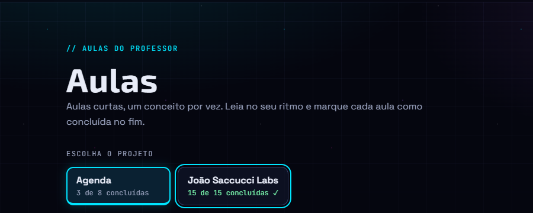
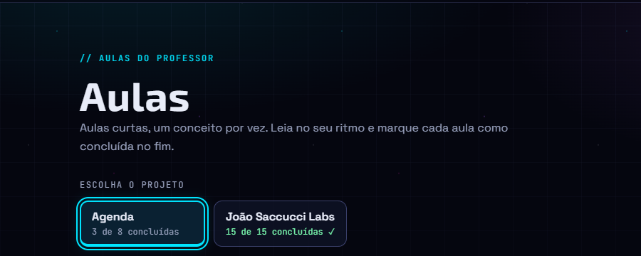
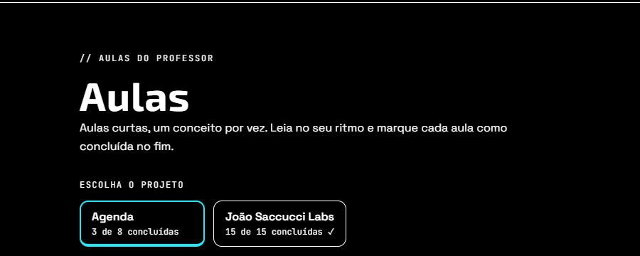

# Relatório de teste — Etapa 7

- **Data:** 2026-11-06
- **Testador:** agente testador
- **O que foi testado:** a Etapa 7 da Labs, "Aulas por projeto". São a US39 (escolher o projeto na aba Aulas), a US40 (endereço com `#` e "Voltar para as aulas"), a US41 (escolha de projeto acessível) e os requisitos gerais da Etapa 7, além da conferência do design (seção 15 do `docs/design.md`, com as decisões da 15.8).
- **Páginas:** `aulas.html` (com e sem `#`), `aula.html` (aulas da Labs, da Agenda, aula com módulo inexistente e aula que não existe) e, para ver se nada quebrou, `index.html`, `lista-projetos.html`, `detalhe-projeto.html` (Labs e Agenda, com a linha do tempo), `equipe.html` e `sobre.html`.
- **Onde:** Microsoft Edge (Chromium) em modo headless, controlado pelo Playwright, com a raiz do `empresa-ia` servida por um servidor local simples (o mesmo caminho do GitHub Pages: `/trabalhos/joao-saccucci-labs/`). Larguras: 320, 360, 500, 640 e 1280px. Os casos de erro (JSON que não carrega, `localStorage` bloqueado ou cheio, valores estranhos na chave, projetos inventados e aula com módulo inexistente) foram simulados no navegador, **sem mexer nos arquivos do site**. A Labs ainda **não** foi testada no GitHub Pages, porque as mudanças não foram commitadas.

## Resultado

**Rodada 2 (reteste, 2026-11-06): Aprovado com pendências.** O problema 1 foi corrigido e a regressão passou inteira. Fica uma pendência baixa, fora da Etapa 7 (problema 2). Detalhes na seção "Rodada 2", no fim do arquivo.

**Rodada 1: Reprovado.** Quase tudo funciona como pedem as US39, US40 e US41: os botões, a ordem, o progresso, o `#`, a chave salva, o "Voltar para as aulas", o teclado, os 360px e o contraste passaram. Mas um `#` com certos textos (`#constructor`, `#toString`, `#__proto__`, `#hasOwnProperty`) quebra a página e gera erro no console, e a US40 pede que um `#` com "texto qualquer" não quebre a página nem gere erro (problema 1, gravidade alta). A correção é pequena; depois dela, testo de novo numa Rodada 2.

## Verificações

| Área | Resultado | Observação |
|---|---|---|
| Celular a 360px | Passou | A 360px e a 320px não há rolagem horizontal; cada botão ocupa a linha inteira (328px e 288px) com 66px de altura. Com um nome de projeto bem longo e sem espaços, ele quebra dentro do botão (o botão cresce para 107px de altura) e nada vaza. A 500px os dois botões dividem a linha; a partir de 640px cada um tem a largura do texto (mínimo de 176px). |
| Teclado | Passou | O Tab passa pelo menu e depois pelos dois botões, na ordem da tela, antes dos cards. O foco é o contorno ciano de 2px, afastado 3px, também no botão selecionado (a faixa escura entre a borda e o contorno aparece). Enter e Espaço trocam o projeto, o foco fica no botão escolhido e a página não rola. |
| Acessibilidade | Passou | Botões `<button type="button">` dentro de `role="group"` com o nome "Escolha o projeto"; `aria-pressed` sempre `"true"` ou `"false"`, só um `"true"`. O ✓ tem `aria-hidden`. Títulos em ordem (h1 → h2 → h3 → h4). O `aria-live` saiu do `#area-aulas`, e a mensagem de erro tem `role="alert"`. Com `prefers-reduced-motion`, a lista aparece direto (sem o "surgir" e sem o fade). Com `forced-colors`, o selecionado continua com a borda de 2px e a barra de 4px. Em escala de cinza, o selecionado é reconhecível pela borda grossa. |
| Contraste | Passou | Todos os textos do botão passam do AA nos três estados (normal, hover e selecionado). O pior caso é o progresso em 12px sobre o fundo do selecionado: 6.55:1 (ver a tabela abaixo). |
| Erros | Falhou | Sem erros de JS nas páginas e nos casos normais, e sem 404 de arquivo do site. Mas `aulas.html#constructor` (e outros nomes, problema 1) gera `TypeError` no console e mostra a mensagem "Ops! Não conseguimos carregar os dados." sem os botões. O único 404 visto foi o do `favicon.ico`, que já existia antes desta etapa. |

### Contraste medido

Cores lidas do navegador (`getComputedStyle`) e razão calculada com a fórmula do WCAG. O fundo do vidro (`rgba(18, 24, 48, 0.55)` sobre `#05060F`) dá `#0C1021`; o selecionado dá `#0A2132`; o hover dá `#161C32`.

| Elemento | Cor / fundo | Razão | Mínimo |
|---|---|---|---|
| Rótulo "ESCOLHA O PROJETO" (12px) | `#9AA3BF` / `#05060F` | 8.05:1 | 4.5:1 |
| Nome: normal / hover / selecionado | `#E8ECF8` / vidro, hover, selecionado | 16.0 / 14.3 / 13.9:1 | 4.5:1 |
| Progresso (12px): normal / hover / selecionado | `#9AA3BF` / vidro, hover, selecionado | 7.52 / 6.71 / 6.55:1 | 4.5:1 |
| Progresso completo (verde, 12px): normal / selecionado | `#7CFFB2` / vidro, selecionado | 15.1 / 13.2:1 | 4.5:1 |
| Borda do selecionado (não-texto) | `#00E5FF` / vidro e página | 12.3 / 13.1:1 | 3:1 |
| Contorno de foco (não-texto) | `#00E5FF` / `#05060F` | 13.1:1 | 3:1 |

### Prints

## Critérios de aceite

Progresso testado nos três casos: nenhuma aula concluída (Agenda "0 de 8 concluídas"), parte (Agenda "3 de 8 concluídas") e todas (Labs "15 de 15 concluídas ✓", e Agenda "8 de 8 concluídas ✓").

### Regras "Qual projeto abre", "Ordem dos botões" e "Texto do progresso"
- [x] `#` sempre vence a chave salva (chave `"joao-saccucci-labs"` + `aulas.html#agenda` abre a Agenda).
- [x] Sem `#`, abre o projeto salvo em `jsl:aulas-projeto`; sem chave, abre o primeiro botão (Agenda).
- [x] Chave estranha (`42`, `["agenda"]`, `null`, `""`, JSON quebrado, texto sem aspas, `"nao-existe"`, `"outras-aulas"` quando o grupo não existe, `"constructor"`) abre a Agenda, sem erro.
- [x] Ordem de hoje: Agenda (2026-11-04), depois João Saccucci Labs (2026-11-02).
- [x] Com projetos inventados (simulados no navegador): empate de data → o mais para o fim do arquivo vem primeiro ("Empate Agenda" antes de "Agenda"); `dataInicio` inválida ("ontem") vai depois dos que têm data; projetos que não estão em `projetos.json` vêm depois, em ordem alfabética (`alfa`, `zeta`) e com o `id` no lugar do nome; "Outras aulas" é o último; projeto sem aulas (com `dataInicio` 2030) não ganha botão.
- [x] Singular e plural pelo total: "0 de 1 concluída" com Y = 1; "0 de 8 concluídas" / "3 de 8 concluídas" com Y > 1. Com X = Y aparece o ✓, escondido do leitor de tela.

### US39: Escolher o projeto na aba Aulas
- [x] No topo, antes da lista, um botão por projeto com aulas, mais "Outras aulas" quando existe aula com `modulo` inexistente. Os botões apareceram em todos os cenários testados (2 grupos, 7 grupos, `projetos.json` falhando); o caso de um projeto só foi conferido no código (`criarBotoes()` mostra o grupo sempre que há pelo menos 1 grupo).
- [x] Os botões vêm de `data/aulas.json` e `data/projetos.json`: os projetos inventados ganharam botão sem mudar HTML nem JS.
- [x] Ordem conforme a regra (ver acima).
- [x] Nome do projeto e, embaixo, em texto menor (mono 12px), o progresso.
- [x] Abaixo dos botões aparece só o projeto escolhido, com o nome como `h2` e os módulos e cards como antes (progresso do módulo, "✓ Concluída").
- [x] Clicar troca a lista na hora, sem recarregar. O selecionado fica com `aria-pressed="true"` e visual próprio; os outros, `"false"`.
- [x] Não existe botão "Todas".
- [x] Ao abrir um projeto (botão ou `#`), o `id` é salvo em `jsl:aulas-projeto`; "Outras aulas" salva `"outras-aulas"`.
- [x] Sem `#`, abre o salvo; sem chave, chave ilegível ou apontando para projeto sem botão, abre o primeiro botão.
- [x] Volta pelo "Voltar" do navegador: o progresso dos botões e da lista é atualizado. Testado de verdade (marquei uma aula da Agenda como concluída e voltei: "1 de 8 concluídas" e 1 card com "✓ Concluída"). O Edge headless não guarda a página na memória (bfcache), então o caminho do `pageshow` com `persisted` foi testado disparando o evento: os botões são atualizados no lugar (o mesmo elemento, o foco continua nele), a lista é remontada sem animação e a classe `--completo` entra e sai certo.

### US40: Endereço com # e "Voltar para as aulas"
- [x] `aulas.html#agenda` e `aulas.html#joao-saccucci-labs` abrem o projeto com a página no topo (rolagem 0, botões à vista).
- [x] `#agenda-m1`, `#agenda-m2`, `#joao-saccucci-labs-m1`, `-m2` e `-m3` abrem o projeto do módulo e rolam até ele (o módulo fica a 88px do topo, abaixo do menu fixo). O endereço continua com o `#` do módulo.
- [x] `aulas.html#outras-aulas` abre "Outras aulas" quando o grupo existe, com a página no topo; o `id="outras-aulas"` saiu da `section`.
- [x] Ordem de busca: projeto, depois módulo, depois `outras-aulas` (conferido no código e nos testes acima).
- [ ] **Um `#` que não corresponde a nada não quebra a página nem gera erro no console.** Passou com `#nada`, `#AGENDA`, `#agenda-m9`, `#%E0`, `#outras-aulas` (sem o grupo) e um `#` com HTML. **Falhou** com `#constructor`, `#toString`, `#__proto__` e `#hasOwnProperty` (problema 1).
- [x] Sem `#` ou com `#` que não serve, o endereço vira `aulas.html#<projeto aberto>` com `replaceState`; o `#` de módulo válido fica como está.
- [x] Trocar pelos botões não cria passo novo no histórico: entrei pelo Início, troquei de projeto duas vezes e o histórico não ganhou nenhum passo novo (o `history.length` continuou o mesmo de quando a aba Aulas abriu); o "Voltar" do navegador levou direto ao Início.
- [x] Mudar o `#` com a página aberta troca a lista (`#joao-saccucci-labs`, depois `#agenda-m2`, que também rolou até o módulo).
- [x] "Voltar para as aulas": aula da Labs (`joao-saccucci-labs-m2-aula-01`) → `aulas.html#joao-saccucci-labs`; aula da Agenda (`agenda-m2-aula-02` e `agenda-m1-aula-01`) → `aulas.html#agenda`; aula com módulo inexistente (simulada) → `aulas.html#outras-aulas`. Clicando, abre o projeto certo, no topo.
- [x] "Aula não encontrada" (id que não existe e `aula.html` sem id): o link "← Ver todas as aulas" continua apontando para `aulas.html`.

### US41: Escolha de projeto acessível, no teclado e no celular
- [x] `<button>` de verdade, dentro de `role="group"` com `aria-labelledby` no rótulo visível "Escolha o projeto".
- [x] Tab chega em cada botão na ordem da tela; Enter e Espaço escolhem; foco visível.
- [x] Nome acessível junta nome e progresso com uma pausa: o Chromium monta "Agenda , 3 de 8 concluídas" e "João Saccucci Labs , 15 de 15 concluídas" (ver a avaliação da decisão 3 abaixo). O ✓ fica fora do nome; o estado vem do `aria-pressed` ("pressed=true").
- [x] Depois da troca, o foco continua no botão escolhido e a página não rola (rolagem 0 → 0). Os botões não são recriados (o elemento é o mesmo). Títulos em ordem: h1, h2, h3, h4.
- [x] Selecionado se diferencia por mais do que a cor: borda 2px, barra de 4px embaixo e fundo ciano; o peso da letra fica 600 sempre.
- [x] Área de toque: 176 × 66px no desktop e 328 × 66px a 360px (mínimo 44 × 44px).
- [x] A 360px (e a 320px) sem rolagem horizontal; nomes longos quebram dentro do botão.
- [x] Contraste AA de nome, progresso, selecionado e foco (tabela acima).
- [x] Com `prefers-reduced-motion`, a lista aparece direto, sem fade na troca e sem o "surgir" dos cards ao abrir a página; a transição dos botões também some.

### Requisitos gerais da Etapa 7
- [x] Nenhuma biblioteca nova: tudo em JS puro.
- [x] `data/aulas.json` e `data/projetos.json` sem campos novos (o `git diff` não mostra mudança na pasta `data/`).
- [x] Só mudaram `aulas.html`, `js/aulas.js`, o link "Voltar para as aulas" (`aula.html` ganhou só um comentário e `js/aula.js`, 6 linhas) e a seção 41 nova no fim do `css/style.css` (nenhuma regra antiga mexida).
- [x] `localStorage` bloqueado: a aba abre a Agenda (ou o projeto do `#`), troca de projeto e ajusta o endereço normalmente, sem erro. `localStorage` cheio (o `setItem` falha): idem.
- [x] `data/aulas.json` falhando: aparece a mensagem de erro amigável, com `role="alert"`, e o grupo de botões fica escondido. `data/projetos.json` falhando (erro 500 ou um objeto no lugar da lista): botões com o `id` no lugar do nome, em ordem alfabética (`agenda`, `joao-saccucci-labs`), sem erro além do aviso do próprio 500.
- [x] 360px, teclado com foco visível, contraste AA e `prefers-reduced-motion` (ver Verificações).
- [ ] Funciona no GitHub Pages com caminhos relativos: os caminhos são relativos, mas ainda não dá para testar, porque não foi commitado.
- [ ] O relatório testa tudo o que a lista pede: feito, mas o resultado é "Reprovado" por causa do problema 1.
- [x] `README.md` do site atualizado: descreve a aba Aulas por projeto, o `#` de projeto e de módulo, a seção 41 do CSS e a chave `jsl:aulas-projeto`.

### Links de entregáveis do professor (`data/projetos.json`) e de fora
Todos testados clicando no link dentro do `detalhe-projeto.html`:

| Link | Abre | Rola até o módulo |
|---|---|---|
| `aulas.html#joao-saccucci-labs-m1` | João Saccucci Labs | sim (a 88px do topo) |
| `aulas.html#joao-saccucci-labs-m2` | João Saccucci Labs | sim |
| `aulas.html#joao-saccucci-labs-m3` | João Saccucci Labs | sim |
| `aulas.html#agenda-m1` | Agenda | sim |
| `aulas.html#agenda-m2` | Agenda | sim |
| `aulas.html` (sem `#`, entregável da Labs) | o último projeto salvo | página no topo |

O `README.md` do repositório `agenda` tem o link "Aulas sobre o código" para `.../joao-saccucci-labs/aulas.html`, sem `#`. Ele funciona, mas abre o último projeto que a pessoa abriu (para um visitante novo, a Agenda, porque ela é a mais recente). Ver a observação 2.

### Outras páginas da Labs
`index.html`, `lista-projetos.html`, `detalhe-projeto.html?id=agenda` e `?id=joao-saccucci-labs` (com a linha do tempo), `equipe.html`, `sobre.html` e `aula.html` (uma aula da Labs e uma da Agenda): todas abrem com status 200, sem erro de JS, sem 404 de arquivo do site e sem rolagem horizontal.

## Problemas encontrados

### Problema 1: `#` com nomes como `constructor` quebra a aba Aulas
- **Página:** `aulas.html`
- **Gravidade:** alta (quebra o critério da US40 "Um `#` que não corresponde a nada (... texto qualquer) não quebra a página nem gera erro no console").
- **Status:** corrigido pelo dev em 2026-11-06 (`js/aulas.js`: `modulosPorId` virou um `Map`, com `set`, `has` e `get`). Conferido na Rodada 2.
- **Passos para reproduzir:**
  1. Abrir `aulas.html#constructor` numa aba nova (também acontece com `#toString`, `#__proto__`, `#hasOwnProperty` e, pela mesma causa, outros nomes que todo objeto do JavaScript já tem).
  2. Olhar a página e o console (F12).
- **Resultado esperado:** a tela abre como se não houvesse `#` (projeto salvo ou Agenda), o endereço vira `aulas.html#<projeto aberto>` e o console fica sem erro.
- **Resultado obtido:** ao abrir a página, aparece "Ops! Não conseguimos carregar os dados." sem os botões, o endereço continua `#constructor` e o console mostra `TypeError: Cannot read properties of undefined (reading 'id')` em `htmlGrupo` (`js/aulas.js`, linha 140). Com a página já aberta, mudar o `#` para `#constructor` gera um erro não tratado no console; a lista continua na tela, mas nenhum botão fica com `aria-pressed="true"`.
- **Causa provável (para o dev):** `modulosPorId` é um objeto comum (`{}`), e `modulosPorId["constructor"]` devolve uma função herdada de `Object`, que é tratada como "módulo encontrado" em `lerEndereco()` (linha 302). Aí `acharGrupo()` não acha nada e `htmlGrupo(undefined)` quebra. Uma correção possível é conferir só as chaves próprias do objeto (por exemplo, `Object.hasOwn(modulosPorId, texto)`), criar o objeto sem herança (`Object.create(null)`) ou usar um `Map`. A chave salva com `"constructor"` não tem esse problema, porque `projetoSemEndereco()` usa `acharGrupo()`.

## Observações (não são problemas desta etapa)

1. **Decisões do dev em casos não cobertos** (avaliadas a pedido):
   - **`#` inválido com a página já aberta mantém o projeto da tela e só corrige o endereço.** Aceito. Como todo projeto aberto é salvo na chave, o projeto da tela é o mesmo que a regra "chave salva" escolheria, então o resultado bate com o requisito no caso normal. A única diferença é com o `localStorage` bloqueado: a regra levaria ao projeto mais recente, e o dev mantém o da tela, o que é melhor para o João (a lista não muda sozinha por causa de um endereço errado). Sugiro que o product-owner anote essa regra nos requisitos.
   - **`jsl:aulas-projeto` guardada em JSON e aceita só se for texto e tiver botão.** Aceito. Segue o padrão das outras chaves `jsl:` (o `lerProgresso`/`salvarProgresso` do `comum.js`) e o README do site documenta o valor como `"outras-aulas"`, com aspas. Testei 10 valores estranhos: todos caem no projeto mais recente, sem erro. Efeito colateral pequeno: um valor salvo à mão sem aspas (`joao-saccucci-labs`) é ignorado, o que é coerente com as outras chaves.
   - **Nome acessível "Agenda , 3 de 8 concluídas" (espaço antes da vírgula no Chromium).** Aceito. O espaço vem do jeito que o Chromium junta as partes de um botão em coluna (`display: flex`), e o HTML é o mesmo do design (15.2). Os leitores de tela não leem espaço; o que importa é a vírgula, que faz a pausa pedida pela US41. Não testei com NVDA nem com Narrador de verdade (só com a árvore de acessibilidade do Chromium); vale ouvir uma vez quando possível.
2. **README do repositório `agenda`:** o link "Aulas sobre o código" aponta para `aulas.html` sem `#`. Funciona, mas quem já abriu a Labs antes cai no último projeto que abriu. Trocar por `aulas.html#agenda` levaria sempre às aulas da Agenda. Fica como sugestão para uma próxima entrega da Agenda (não mexi no repositório).
3. **Nome do grupo em maiúsculas:** a árvore de acessibilidade do Chromium dá ao grupo o nome "ESCOLHA O PROJETO" (por causa do `text-transform: uppercase`). Os leitores de tela costumam ler normalmente, e os outros rótulos do site têm o mesmo estilo. Só uma anotação.
4. **`favicon.ico` 404:** já existia antes desta etapa (ver o relatório da Etapa 6).

## Rodada 2 (reteste) — 2026-11-06

- **O que mudou:** só o `js/aulas.js`. O `modulosPorId` deixou de ser um objeto comum (`{}`) e virou um `Map` (`new Map()`, com `set`, `has` e `get`), com um comentário explicando o motivo. O dev também revisou os outros "dicionários" da aba: os grupos e os projetos ficam em listas com `find`, a chave `jsl:aulas-projeto` só é aceita se tiver botão, e o glossário do `aula.js` já era um `Map`. O `git diff` confirma que `css/style.css`, `aula.html`, `aulas.html` e a pasta `data/` não mudaram desde a Rodada 1.
- **Onde:** o mesmo ambiente da Rodada 1 (Edge headless + Playwright, servidor local com o caminho do GitHub Pages).

### Resultado da Rodada 2

**Aprovado com pendências.** O problema 1 está corrigido nos três caminhos (ao abrir a página, com a página aberta e como valor da chave salva), e a regressão da Rodada 1 deu o mesmo resultado, sem nenhum erro novo no console. Todos os critérios de aceite das US39, US40 e US41 passam. Ficam pendentes o teste no GitHub Pages (depois do commit) e o problema 2, de gravidade baixa e fora da Etapa 7.

### Problema 1 conferido

Testados 7 nomes que todo objeto do JavaScript já tem: `constructor`, `toString`, `__proto__`, `hasOwnProperty`, `valueOf`, `isPrototypeOf` e `toLocaleString`.

| Caminho | Resultado |
|---|---|
| Ao abrir (`aulas.html#<nome>`, com a chave salva `"joao-saccucci-labs"`) | Passou nos 7: abre a João Saccucci Labs (a chave), o endereço vira `#joao-saccucci-labs`, os botões aparecem e o console fica sem erro. |
| Com a página aberta (`#agenda` → `#<nome>`) | Passou nos 7: a Agenda continua na tela com o botão marcado, o endereço volta para `#agenda` e o console fica sem erro. |
| Como valor de `jsl:aulas-projeto` (ex.: `"constructor"`) | Passou nos 7: abre a Agenda (o projeto mais recente), a chave passa a valer `"agenda"` e o console fica sem erro. |

### Regressão

Repeti os scripts da Rodada 1. Todos deram o mesmo resultado:
- **Projeto que abre:** o `#` vence a chave; sem `#`, vale a chave; sem chave, abre a Agenda; os 10 valores estranhos da chave caem na Agenda.
- **Endereço com `#`:** o `#` de projeto abre com a página no topo; os 5 `#` de módulo rolam até o módulo (a 88px do topo); `#outras-aulas` funciona e `#nada`, `#AGENDA`, `#agenda-m9`, `#%E0` e o `#` com HTML não dão erro.
- **Histórico:** trocar de projeto não cria passo no "Voltar", e o `hashchange` com a página aberta troca a lista.
- **Botões:** ordem com os projetos inventados, progresso em nenhuma, parte e todas as aulas, singular, ✓ com `aria-hidden` e "Outras aulas" com borda tracejada.
- **Falhas:** `localStorage` bloqueado e cheio; `projetos.json` e `aulas.json` falhando.
- **Links:** "Voltar para as aulas" da Labs, da Agenda e da aula órfã; "Ver todas as aulas" da aula não encontrada; os links de entregáveis do detalhe dos dois projetos; o `pageshow` atualiza o progresso no lugar.
- **Visual e acessibilidade:** a 360px não há rolagem horizontal, os botões medem 328 × 66px e o nome longo quebra dentro do botão. Tab, Enter e Espaço funcionam com o foco no botão escolhido e sem a página rolar. O botão não muda de tamanho ao ser selecionado. `prefers-reduced-motion` e `forced-colors` continuam certos. O nome acessível continua "Agenda , 3 de 8 concluídas" com `pressed`.
- **Outras páginas:** index, projetos, detalhe da Labs e da Agenda, equipe, sobre e duas aulas abrem com 200, sem erro de JS.

O único erro de console continua sendo o 404 do `favicon.ico`, que já existia antes desta etapa. Os prints da Rodada 1 continuam valendo, porque o visual não mudou.

### Problema 2: `classeDoStatus` também lê um nome herdado do JavaScript (fora da Etapa 7)
- **Página:** as que mostram o status de um projeto (`lista-projetos.html`, `detalhe-projeto.html`, `index.html`), pelo `js/comum.js`.
- **Gravidade:** baixa (não quebra critério de aceite, não quebra a página e não é desta etapa). Apontado pelo próprio dev e confirmado no código; não testei no navegador, para não mexer no `projetos.json`.
- **Status:** pendente.
- **Passos para reproduzir:**
  1. Em `data/projetos.json`, colocar `"status": "constructor"` num projeto (ou `"toString"`).
  2. Abrir `lista-projetos.html`.
- **Resultado esperado:** um status desconhecido usa a classe padrão `badge--planejado`, como diz o comentário da função.
- **Resultado obtido (pelo código):** `classes[status]` devolve a função herdada do JavaScript em vez de `undefined`, então o `|| "badge--planejado"` não entra e a classe do badge vira o texto da função (`function Object() { [native code] }`). O badge aparece sem a cor do status, mas com o texto certo, e a página não quebra. O texto da função não tem aspas nem `<`, então não abre brecha no HTML.
- **Sugestão:** a mesma correção da aba Aulas, com `Map` ou `Object.hasOwn(classes, status)`. O risco é pequeno, porque o `projetos.json` é escrito pela própria equipe. Pode ficar para uma próxima etapa.
